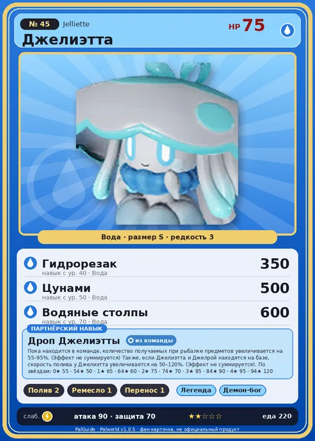

# #45 Джелиэтта (Jelliette)

№ 45

Вода

Слабость: Молния

💧 Полив <b>2</b>🖐️ Ручная работа <b>1</b>📦 Транспортировка <b>1</b>

<b>Дроп Джелиэтты</b> 🎒 из команды 🏠 на базе

❤️ 75 · ⚔️ 90 · 🛡 70

| Поле | Значение |
|---|---|
| Стихия | Вода |
| Слабость (кто бьёт сильнее) | Молния |
| Редкость | 3 |
| Размер | S |
| HP / Атака / Защита (база вида) | 75 / 90 / 70 |
| Сколько ест | 220 |
| Цена продажи | 658 |
| Множитель поимки | ×1 |
| Скорость рывка верхом | 450 |

=== "Обзор"

    #### Работа на базе
    - Полив — ур. 2
    - Ручная работа — ур. 1
    - Транспортировка — ур. 1

    #### Партнёрский навык: Дроп Джелиэтты
    Пока находится в команде, количество получаемых при рыбалке предметов увеличивается на (55~95)% . (Эффект не суммируется) Также, если Джелиэтта и Джелрой находятся на базе, скорость полива у Джелиэтта увеличивается на (50~120)% . (Эффект не суммируется) level value 1 Fishing_ItemAddDrop_JellyfishFairy_PartnerSkill 55 Fishing_EnemyAddDrop_JellyfishFairy 55 WorkSpeedUp_JellyfishFairy_PartnerSkill 50 WorkSpeedUp_Farm_JellyfishFairy_PartnerSkill 50 2 Fishing_ItemAddDrop_JellyfishFairy_PartnerSkill 65 Fishing_EnemyAddDrop_JellyfishFairy 65 WorkSpeedUp_JellyfishFairy_PartnerSkill 60 WorkSpeedUp_Farm_JellyfishFairy_PartnerSkill 60 3 Fishing_ItemAddDrop_JellyfishFairy_PartnerSkill 75 Fishing_EnemyAddDrop_JellyfishFairy 75 WorkSpeedUp_JellyfishFairy_PartnerSkill 70 WorkSpeedUp_Farm_JellyfishFairy_PartnerSkill 70 4 Fishing_ItemAddDrop_JellyfishFairy_PartnerSkill 85 Fishing_EnemyAddDrop_JellyfishFairy 85 WorkSpeedUp_JellyfishFairy_PartnerSkill 90 WorkSpeedUp_Farm_JellyfishFairy_PartnerSkill 90 5 Fishing_ItemAddDrop_JellyfishFairy_PartnerSkill 95 Fishing_EnemyAddDrop_JellyfishFairy 95 WorkSpeedUp_JellyfishFairy_PartnerSkill 120 WorkSpeedUp_Farm_JellyfishFairy_PartnerSkill 120

    #### Чем хорош / чем плох
    - ✅ +55–95% улова на рыбалке; можно оседлать
    - ❌ явных минусов нет

    > Пал, внешне очень похожий на Джелрой . Он ведёт активную социальную жизнь, и когда планы пересекаются, просит своего близкого друга Джелрой сходить вместо него. Плата за это — одно свидание.

    См. также: [Стихии](../../guide/06_stihii.md) · [Разведение](../../guide/07_razvedenie.md) · [Все палы](README.md)

=== "Атаки"

    #### Атаки по уровням
    - ур. 1: Акваджет (Вода, сила 40)
    - ур. 7: Водяной выстрел (Вода, сила 50)
    - ур. 15: Пузырьковый выстрел (Вода, сила 80)
    - ур. 22: Водяная бомба (Вода, сила 200)
    - ур. 30: Водяная стена (Вода, сила 300)
    - ур. 40: Гидрорезак (Вода, сила 350)
    - ур. 50: Цунами (Вода, сила 500)
    - ур. 70: Водяные столпы (Вода, сила 600)

=== "Где живёт"

    #### Где водится
    - В дикой природе: да; точек появления днём: 869, ночью: 116; уровни в первых точках: 1–10
    - Подземелья: Пещера Горного Потока, Пещера Отдалённого Острова, Пещера Холмов
    - Яйцо: Яйцо воды

=== "Дроп"

    #### Дроп
    - Жидкость водного Пала — 1–2 шт., 100%
    - Зонтик медузы Джелиэтты — 1 шт., 100%

    **Дроп альфы:**
    - Деталь древней цивилизации — 2–3 шт., 100%
    - Ценные внутренности — 2–3 шт., 100%

=== "Разведение"

    #### Разведение
    - Ранг разведения (CombiRank): 2650

=== "Пассивки"

    #### Лучшие пассивки по роли
    - боец: Легенда, Демон-бог, Хладнокровный, Бессмертие, Владыка морей (вместо Бессмертия, если нет мутации)
    - ездовой: Божественная скорость, Легенда, Вечный двигатель, Небесное скольжение

<a class="card-link" href="../ribbuny_botan/">← Риббани Ботан</a><a class="card-link" href="../jellroy/">Джелрой →</a>

