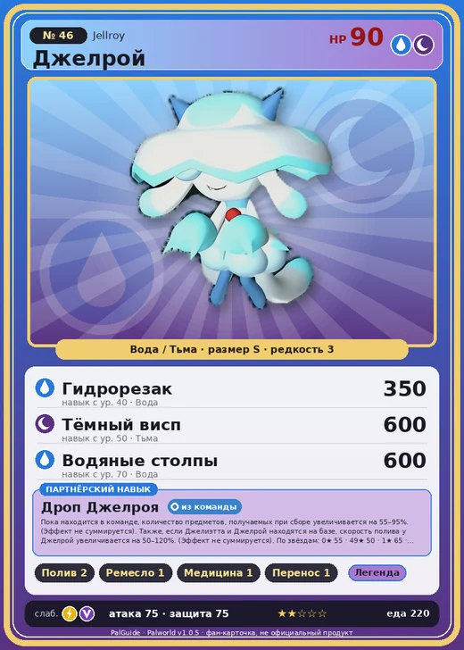

# #46 Джелрой (Jellroy)

#46 · Jellroy

ВодаТьма

Слабость: ДраконМолния

💧 Полив <b>2</b>🖐️ Ручная работа <b>1</b>💊 Фармацевтика <b>1</b>📦 Транспортировка <b>1</b>

<b>Дроп Джелроя</b> 🎒 из команды 🏠 на базе

❤️ 90 · ⚔️ 75 · 🛡 75

| Поле | Значение |
|---|---|
| Стихия | Вода, Тьма |
| Слабость (кто бьёт сильнее) | Дракон, Молния |
| Редкость | 3 |
| Размер | S |
| HP / Атака / Защита (база вида) | 90 / 75 / 75 |
| Сколько ест | 220 |
| Цена продажи | 1328 |
| Множитель поимки | ×1 |
| Скорость рывка верхом | 600 |

## Работа на базе
- Полив — ур. 2
- Ручная работа — ур. 1
- Фармацевтика — ур. 1
- Транспортировка — ур. 1

## Партнёрский навык: Дроп Джелроя
Пока находится в команде, количество предметов, получаемых при сборе увеличивается на (55~95)% . (Эффект не суммируется). Также, если Джелиэтта и Джелрой находятся на базе, скорость полива у Джелрой увеличивается на (50~120)% . (Эффект не суммируется) level value 1 FishingSalvage_ItemDrop_JellyfishGhost_PartnerSkill 55 WorkSpeedUp_JellyfishGhost_PartnerSkill 50 WorkSpeedUp_Farm_JellyfishGhost_PartnerSkill 50 2 FishingSalvage_ItemDrop_JellyfishGhost_PartnerSkill 65 WorkSpeedUp_JellyfishGhost_PartnerSkill 60 WorkSpeedUp_Farm_JellyfishGhost_PartnerSkill 60 3 FishingSalvage_ItemDrop_JellyfishGhost_PartnerSkill 75 WorkSpeedUp_JellyfishGhost_PartnerSkill 70 WorkSpeedUp_Farm_JellyfishGhost_PartnerSkill 70 4 FishingSalvage_ItemDrop_JellyfishGhost_PartnerSkill 85 WorkSpeedUp_JellyfishGhost_PartnerSkill 90 WorkSpeedUp_Farm_JellyfishGhost_PartnerSkill 90 5 FishingSalvage_ItemDrop_JellyfishGhost_PartnerSkill 95 WorkSpeedUp_JellyfishGhost_PartnerSkill 120 WorkSpeedUp_Farm_JellyfishGhost_PartnerSkill 120

## Атаки по уровням
- ур. 1: Ядовитый выстрел (Тьма, сила 30)
- ур. 7: Распространение тьмы (Тьма, сила 60)
- ур. 15: Пузырьковый выстрел (Вода, сила 80)
- ур. 22: Духовное пламя (Тьма, сила 200)
- ур. 30: Ядовитый душ (Тьма, сила 160)
- ур. 40: Гидрорезак (Вода, сила 350)
- ур. 50: Тёмный висп (Тьма, сила 600)
- ур. 70: Водяные столпы (Вода, сила 600)

## Где водится
- В дикой природе: да; точек появления днём: 9, ночью: 1194; уровни в первых точках: 1–10
- Подземелья: Пещера Ущелья
- Яйцо: Яйцо воды

## Дроп
- Жидкость водного Пала — 1–2 шт., 100%
- Зонтик медузы Джелроя — 1 шт., 100%

**Дроп альфы:**
- Деталь древней цивилизации — 2–3 шт., 100%
- Ценные внутренности — 2–3 шт., 100%

## Разведение
- Ранг разведения (CombiRank): 2590

## Лучшие пассивки по роли
- боец: Легенда, Демон-бог, Хладнокровный, Бессмертие, Владыка морей (вместо Бессмертия, если нет мутации)
- ездовой: Божественная скорость, Легенда, Вечный двигатель, Небесное скольжение

## Чем хорош / чем плох
- ✅ можно оседлать
- ❌ слабая атака (75)

> Пал, внешне очень похожий на Джелиэтта . Когда у Джелиэтта не получается прийти, он иногда появляется вместо него. Его игра настолько убедительна, что никто не замечает подмены.

См. также: [Стихии](../../guide/06_stihii.md) · [Разведение](../../guide/07_razvedenie.md) · [Все палы](README.md)
