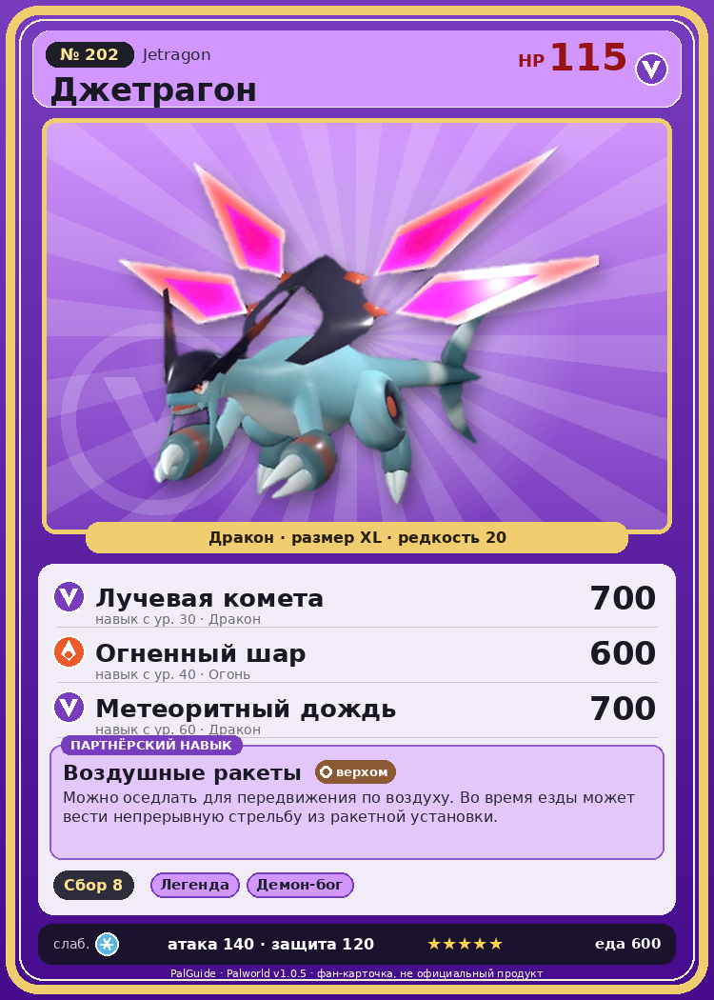

# #202 Джетрагон (Jetragon)

{ width=360 }

| Поле | Значение |
|---|---|
| Стихия | Дракон |
| Слабость (кто бьёт сильнее) | Лёд |
| Редкость | 20 |
| Размер | XL |
| HP / Атака / Защита (база вида) | 115 / 140 / 120 |
| Сколько ест | 600 |
| Цена продажи | 4452 |
| Множитель поимки | ×1 |
| Скорость рывка верхом | 3300 |

## Работа на базе
- Сбор — ур. 8

## Партнёрский навык: Воздушные ракеты
Можно оседлать для передвижения по воздуху. Во время езды может вести непрерывную стрельбу из ракетной установки. Технологии 70 level value 1 MainValue 20 Пробуждение : 2 MainValue 22 Пробуждение : (Увеличение урона: Небольшое ) 3 MainValue 26 Пробуждение : (Увеличение урона: Среднее ) 4 MainValue 32 Пробуждение : (Увеличение урона: Большое ) 5 MainValue 40 Пробуждение : (Увеличение урона: Очень большое )

## Атаки по уровням
- ур. 1: Расщеплённый огонь (Огонь, сила 80)
- ур. 7: Драконий взрыв (Дракон, сила 80)
- ур. 15: Огненный шторм (Огонь, сила 200)
- ур. 22: Дыхание дракона (Дракон, сила 160)
- ур. 30: Лучевая комета (Дракон, сила 700)
- ур. 40: Огненный шар (Огонь, сила 600)
- ур. 50: Драконий метеор (Дракон, сила 600)
- ур. 55: Режущий луч (Дракон, сила 350)
- ур. 60: Метеоритный дождь (Дракон, сила 700)
- ур. 70: Звездные мины (Нейтральный, сила 400)

## Где водится
- В дикой природе: да; точек появления днём: 1, ночью: 1
- Яйцо: Огромное яйцо дракона

## Дроп
- Соллайт — 10 шт., 100%
- Термоядро — 1–2 шт., 100%
- Алмаз — 1 шт., 30%
- Большая душа Пала — 1 шт., 1%

**Дроп альфы:**
- Деталь древней цивилизации — 7–9 шт., 100%
- Ценный драконий самоцвет — 7–9 шт., 100%

## Разведение
- Ранг разведения (CombiRank): 70
- **Особая пара:** [Джетрагон](../../4_spravochniki/paly/jetragon.md) + [Джетрагон](../../4_spravochniki/paly/jetragon.md)
- Участвует в особых парах: Джетрагон → Джетрагон; Джетрагон → Джетрагон

## Лучшие пассивки по роли
- по обзору: Легенда, Демон-бог, Хладнокровный, Божественный дракон
- боец: Легенда, Демон-бог, Хладнокровный, Бессмертие, Божественный дракон (вместо Бессмертия, если нет мутации)
- рабочий: Дьявольские руки, Виртуоз, Мастеровитый, Небожитель/Трудоголик
- ездовой: Божественная скорость, Легенда, Вечный двигатель, Небесное скольжение

## Чем хорош / чем плох
- ✅ Самый быстрый летающий маунт; огромный урон драконом; легендарный; очень высокая атака (140); крепкая защита (120); отличный рабочий (пригодность 8); можно оседлать; летает (ездовой)
- ❌ Легендарная поимка трудная, много ест; много ест (600); разводится только особой парой

> Наблюдает за островом Палпагос с высот небес. И когда вновь пробудится бедствие, земля расколется, а небо вспыхнет огнём — он уничтожит всё вспышкой абсолютного разрушения.

См. также: [Стихии](../../2_mehaniki/stihii.md) · [Разведение](../../2_mehaniki/razvedenie.md) · [Все палы](README.md)
_Источник: paldb.cc v1.0.5_
