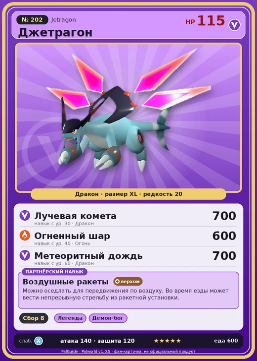

# Джетрагон

<canvas id="fx"></canvas>

№ 202 · Jetragon

Дракон

Слабость: Лёд

🌾 Сбор <b>8</b>

<b>Воздушные ракеты</b> 🐎 верхом

❤️ 115 · ⚔️ 140 · 🛡 120

Основное

💎Редкость <button class="hlp" data-tip="Чем выше число, тем реже встречается пал. 1–4 — обычные, 5–7 — редкие, 8+ — легендарные.">?</button><b>20</b>

📏Размер<b>XL</b>

💰Цена продажи <button class="hlp" data-tip="Сколько золота даст торговец за пала.">?</button><b>4452</b>

Бой

🎯Множитель поимки <button class="hlp" data-tip="Насколько легче или труднее поймать: ×1 — обычно, меньше — сложнее.">?</button><b>×1</b>

🐎Скорость рывка верхом <button class="hlp" data-tip="Скорость, если сесть на пала и бежать рывком.">?</button><b>3300</b>

Ферма и еда

🍖Сколько ест <button class="hlp" data-tip="Сколько сытости пал тратит — чем больше, тем больше еды нужно на базе.">?</button><b>600</b>

Разведение

🧬Сила разведения <button class="hlp" data-tip="Скрытое число игры: у детёныша оно примерно среднее от родителей. Чем меньше — тем «сильнее» пал.">?</button><b>70</b>

💞Особая пара <button class="hlp" data-tip="Этого пала можно вывести только от этой пары.">?</button><b>Джетрагон + Джетрагон</b>

=== "Обзор"

    #### Работа на базе
    - Сбор — ур. 8

    #### Партнёрский навык: Воздушные ракеты
    Можно оседлать для передвижения по воздуху. Во время езды может вести непрерывную стрельбу из ракетной установки. Технологии 70.

    #### Чем хорош / чем плох
    - ✅ Самый быстрый летающий маунт; огромный урон драконом; легендарный; очень высокая атака (140); крепкая защита (120); отличный рабочий (пригодность 8); можно оседлать; летает (ездовой)
    - ❌ Легендарная поимка трудная, много ест; много ест (600); разводится только особой парой

    > Наблюдает за островом Палпагос с высот небес. И когда вновь пробудится бедствие, земля расколется, а небо вспыхнет огнём — он уничтожит всё вспышкой абсолютного разрушения.

    См. также: [Стихии](../../guide/06_stihii.md) · [Разведение](../../guide/07_razvedenie.md) · [Все палы](README.md)

=== "Атаки"

    #### Атаки по уровням
    - ур. 1: Расщеплённый огонь (Огонь, сила 80)
    - ур. 7: Драконий взрыв (Дракон, сила 80)
    - ур. 15: Огненный шторм (Огонь, сила 200)
    - ур. 22: Дыхание дракона (Дракон, сила 160)
    - ур. 30: Лучевая комета (Дракон, сила 700)
    - ур. 40: Огненный шар (Огонь, сила 600)
    - ур. 50: Драконий метеор (Дракон, сила 600)
    - ур. 55: Режущий луч (Дракон, сила 350)
    - ур. 60: Метеоритный дождь (Дракон, сила 700)
    - ур. 70: Звездные мины (Нейтральный, сила 400)

=== "Где живёт"

    #### Где водится
    - В дикой природе: да; точек появления днём: 1, ночью: 1
    - Яйцо: Огромное яйцо дракона

=== "Дроп"

    #### Дроп
    - Соллайт — 10 шт., 100%
    - Термоядро — 1–2 шт., 100%
    - Алмаз — 1 шт., 30%
    - Большая душа Пала — 1 шт., 1%

    **Дроп альфы:**
    - Деталь древней цивилизации — 7–9 шт., 100%
    - Ценный драконий самоцвет — 7–9 шт., 100%

=== "Разведение"

    #### Разведение
    - Ранг разведения (CombiRank): 70
    - **Особая пара:** [Джетрагон](../../4_spravochniki/paly/jetragon.md) + [Джетрагон](../../4_spravochniki/paly/jetragon.md)
    - Участвует в особых парах: Джетрагон → Джетрагон; Джетрагон → Джетрагон

=== "Пассивки"

    #### Лучшие пассивки по роли

    

⚔️ Боец

максимум урона и живучести в бою

<a class="psv r-4" data-psv="Легенда" href="../../../passivki/legend/">Легенда</a><a class="psv r-4" data-psv="Демон-бог" href="../../../passivki/demon_god/">Демон-бог</a><a class="psv r-3" data-psv="Божественный дракон" href="../../../passivki/divine_dragon/">Божественный дракон</a><a class="psv r-3" data-psv="Хладнокровный" href="../../../passivki/serenity/">Хладнокровный</a>

🛠 Рабочий

работает быстрее и меньше устаёт на базе

<a class="psv r-5" data-psv="Дьявольские руки" href="../../../passivki/demons_hand/">Дьявольские руки</a><a class="psv r-4" data-psv="Виртуоз" href="../../../passivki/remarkable_craftsmanship/">Виртуоз</a><a class="psv r-3" data-psv="Мастеровитый" href="../../../passivki/artisan/">Мастеровитый</a><a class="psv r-3" data-psv="Трудоголик" href="../../../passivki/workaholic/">Трудоголик</a>

🐎 Ездовой

быстрее бегает или летает с тобой верхом

<a class="psv r-4" data-psv="Божественная скорость" href="../../../passivki/swift/">Божественная скорость</a><a class="psv r-4" data-psv="Легенда" href="../../../passivki/legend/">Легенда</a><a class="psv r-4" data-psv="Вечный двигатель" href="../../../passivki/eternal_engine/">Вечный двигатель</a><a class="psv r-3" data-psv="Умелый бегун" href="../../../passivki/runner/">Умелый бегун</a>

    <small>Нажми на пассивку, чтобы узнать, что она даёт и где её взять.</small>

<a class="card-link" href="../neptilius/">← Нептилиус</a><a class="card-link" href="../panthalus/">Панталус →</a>

