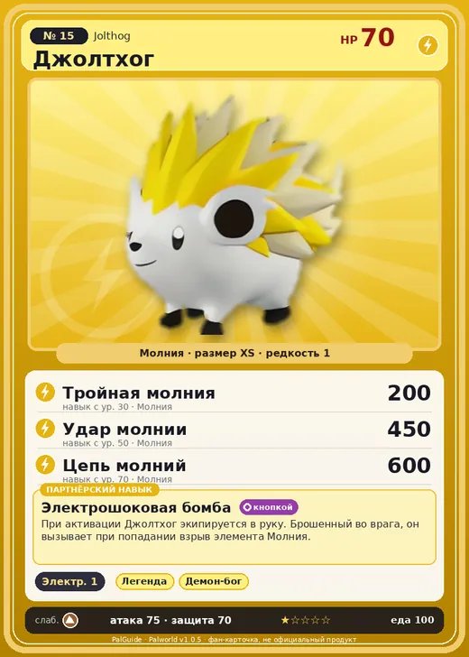

# #15 Джолтхог (Jolthog)

#15 · Jolthog

Молния

Слабость: Земля

⚡ Генерация энергии <b>1</b>

<b>Электрошоковая бомба</b> 🔘 кнопкой

❤️ 70 · ⚔️ 75 · 🛡 70

| Поле | Значение |
|---|---|
| Стихия | Молния |
| Слабость (кто бьёт сильнее) | Земля |
| Редкость | 1 |
| Размер | XS |
| HP / Атака / Защита (база вида) | 70 / 75 / 70 |
| Сколько ест | 100 |
| Цена продажи | 417 |
| Множитель поимки | ×1.2 |
| Скорость рывка верхом | 550 |

## Работа на базе
- Генерация энергии — ур. 1

## Партнёрский навык: Электрошоковая бомба
При активации Джолтхог экипируется в руку. Брошенный во врага, он вызывает при попадании взрыв элемента Молния . level value 1 MainValue 100 Пробуждение : 2 MainValue 110 Пробуждение : (Увеличение урона: Небольшое ) 3 MainValue 130 Пробуждение : (Увеличение урона: Среднее ) 4 MainValue 160 Пробуждение : (Увеличение урона: Большое ) 5 MainValue 200 Пробуждение : (Увеличение урона: Очень большое )

## Атаки по уровням
- ур. 1: Шоковая волна (Молния, сила 80)
- ур. 7: Силовой выстрел (Нейтральный, сила 80)
- ур. 15: Шаровая молния (Молния, сила 100)
- ур. 22: Силовая бомба (Нейтральный, сила 120)
- ур. 30: Тройная молния (Молния, сила 200)
- ур. 40: Грозовая линия (Молния, сила 160)
- ур. 50: Удар молнии (Молния, сила 450)
- ур. 70: Цепь молний (Молния, сила 600)

## Где водится
- В дикой природе: да; точек появления днём: 25, ночью: 25; уровни в первых точках: 4–8
- Подземелья: Пещера Отдалённого Острова, Пещера Холмов
- Яйцо: Яйцо молнии

## Дроп
- Электрический орган — 1 шт., 100%

**Дроп альфы:**
- Деталь древней цивилизации — 1–2 шт., 100%
- Ценный коготь — 1–2 шт., 100%

## Разведение
- Ранг разведения (CombiRank): 3030
- Участвует в особых парах: Пенгуллет → Джолтхог Крист

## Лучшие пассивки по роли
- боец: Легенда, Демон-бог, Хладнокровный, Бессмертие, Император молнии (вместо Бессмертия, если нет мутации)
- ездовой: Божественная скорость, Легенда, Вечный двигатель, Небесное скольжение

## Чем хорош / чем плох
- ✅ можно оседлать
- ❌ слабая атака (75)

> При сильном ударе он выпускает накопленное электричество. Его напряжение превышает 10 миллионов вольт. Если бросить его — это куда опаснее, чем плохо обращённое тяжёлое оружие.

См. также: [Стихии](../../guide/06_stihii.md) · [Разведение](../../guide/07_razvedenie.md) · [Все палы](README.md)
