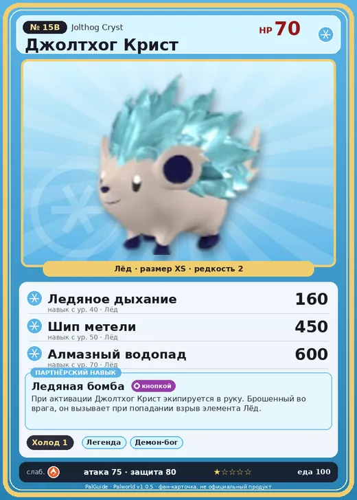

# Джолтхог Крист

<canvas id="fx"></canvas>

№ 15B · Jolthog Cryst

Лёд

Слабость: Огонь

❄️ Охлаждение <b>1</b>

<b>Ледяная бомба</b> 🔘 кнопкой

❤️ 70 · ⚔️ 75 · 🛡 80

Основное

💎Редкость <button class="hlp" data-tip="Чем выше число, тем реже встречается пал. 1–4 — обычные, 5–7 — редкие, 8+ — легендарные.">?</button><b>2</b>

📏Размер<b>XS</b>

💰Цена продажи <button class="hlp" data-tip="Сколько золота даст торговец за пала.">?</button><b>472</b>

Бой

🎯Множитель поимки <button class="hlp" data-tip="Насколько легче или труднее поймать: ×1 — обычно, меньше — сложнее.">?</button><b>×1</b>

🐎Скорость рывка верхом <button class="hlp" data-tip="Скорость, если сесть на пала и бежать рывком.">?</button><b>550</b>

Ферма и еда

🍖Сколько ест <button class="hlp" data-tip="Сколько сытости пал тратит — чем больше, тем больше еды нужно на базе.">?</button><b>100</b>

Разведение

🧬Сила разведения <button class="hlp" data-tip="Скрытое число игры: у детёныша оно примерно среднее от родителей. Чем меньше — тем «сильнее» пал.">?</button><b>2850</b>

💞Особая пара <button class="hlp" data-tip="Этого пала можно вывести только от этой пары.">?</button><b>Джолтхог + Пенгуллет</b>

=== "Обзор"

    #### Работа на базе
    - Охлаждение — ур. 1

    #### Партнёрский навык: Ледяная бомба
    При активации Джолтхог Крист экипируется в руку. Брошенный во врага, он вызывает при попадании взрыв элемента Лёд.

    #### Чем хорош / чем плох
    - ✅
    - ❌ слабая атака (75); разводится только особой парой

    > При ударе выпускает накопленный холод. Ледяные волны расходятся во все стороны, замораживая воздух, и напавший оказывается пронзён насквозь морозом.

    См. также: [Стихии](../../guide/06_stihii.md) · [Разведение](../../guide/07_razvedenie.md) · [Все палы](README.md)

=== "Атаки"

    #### Атаки по уровням
    - ур. 1: Ледяная ракета (Лёд, сила 40)
    - ур. 7: Силовой выстрел (Нейтральный, сила 80)
    - ур. 15: Айсберг (Лёд, сила 120)
    - ур. 22: Силовая бомба (Нейтральный, сила 120)
    - ур. 30: Ледяной резак (Лёд, сила 80)
    - ур. 40: Ледяное дыхание (Лёд, сила 160)
    - ур. 50: Шип метели (Лёд, сила 450)
    - ур. 70: Алмазный водопад (Лёд, сила 600)

=== "Где живёт"

    #### Где водится
    - В дикой природе: да; точек появления днём: 69, ночью: 69; уровни в первых точках: 10–20
    - Яйцо: Яйцо льда

=== "Дроп"

    #### Дроп
    - Ледяной орган — 1 шт., 100%

    **Дроп альфы:**
    - Деталь древней цивилизации — 1–2 шт., 100%
    - Ценный коготь — 1–2 шт., 100%

=== "Разведение"

    #### Разведение
    - Ранг разведения (CombiRank): 2850
    - **Особая пара:** [Джолтхог](../../4_spravochniki/paly/jolthog.md) + [Пенгуллет](../../4_spravochniki/paly/pengullet.md)

=== "Пассивки"

    #### Лучшие пассивки по роли

    

⚔️ Боец

максимум урона и живучести в бою

<a class="psv r-4" data-psv="Легенда" href="../../../passivki/legend/">Легенда</a><a class="psv r-4" data-psv="Демон-бог" href="../../../passivki/demon_god/">Демон-бог</a><a class="psv r-3" data-psv="Император льда" href="../../../passivki/ice_emperor/">Император льда</a><a class="psv r-3" data-psv="Хладнокровный" href="../../../passivki/serenity/">Хладнокровный</a>

    <small>Нажми на пассивку, чтобы узнать, что она даёт и где её взять.</small>

<a class="card-link" href="../jolthog/">← Джолтхог</a><a class="card-link" href="../depresso/">Депрессо →</a>

