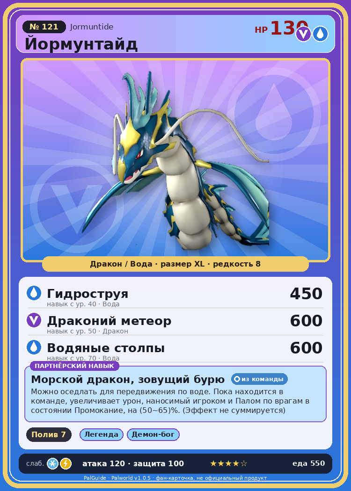

# #121 Йормунтайд (Jormuntide)

{ width=360 }

| Поле | Значение |
|---|---|
| Стихия | Дракон, Вода |
| Слабость (кто бьёт сильнее) | Лёд, Молния |
| Редкость | 8 |
| Размер | XL |
| HP / Атака / Защита (база вида) | 130 / 120 / 100 |
| Сколько ест | 550 |
| Цена продажи | 3723 |
| Множитель поимки | ×1 |
| Скорость рывка верхом | 1000 |

## Работа на базе
- Полив — ур. 7

## Партнёрский навык: Морской дракон, зовущий бурю
Можно оседлать для передвижения по воде. Пока находится в команде, увеличивает урон, наносимый игроком и Палом по врагам в состоянии Промокание , на (50~65)% . (Эффект не суммируется) Технологии 40 level value 1 DamageUpTrainerAndOtomo_ToWetness_PartnerSkill_Umihebi 50 Пробуждение : 2 DamageUpTrainerAndOtomo_ToWetness_PartnerSkill_Umihebi 53 MoveSpeed_up_PartnerSkill_Ride_1 10 Пробуждение : (Скорость передвижения верхом: +10% ) 3 DamageUpTrainerAndOtomo_ToWetness_PartnerSkill_Umihebi 56 MoveSpeed_up_PartnerSkill_Ride_2 12 Пробуждение : (Скорость передвижения верхом: +12% ) 4 DamageUpTrainerAndOtomo_ToWetness_PartnerSkill_Umihebi 60 MoveSpeed_up_PartnerSkill_Ride_3 15 Пробуждение : (Скорость передвижения верхом: +15% ) 5 DamageUpTrainerAndOtomo_ToWetness_PartnerSkill_Umihebi 65 MoveSpeed_up_PartnerSkill_Ride_4 20 Пробуждение : (Скорость передвижения верхом: +20% )

## Атаки по уровням
- ур. 1: Водяной выстрел (Вода, сила 50)
- ур. 7: Драконья пушка (Дракон, сила 40)
- ур. 15: Дыхание дракона (Дракон, сила 160)
- ур. 22: Водяная бомба (Вода, сила 200)
- ур. 30: Тройная молния (Молния, сила 200)
- ур. 35: Морской змей (Вода, сила 400)
- ур. 40: Гидроструя (Вода, сила 450)
- ур. 50: Драконий метеор (Дракон, сила 600)
- ур. 70: Водяные столпы (Вода, сила 600)

## Где водится
- В дикой природе: да; точек появления днём: 1, ночью: 1
- Яйцо: Огромное яйцо дракона

## Дроп
- Жидкость водного Пала — 2–4 шт., 100%

**Дроп альфы:**
- Деталь древней цивилизации — 5–6 шт., 100%
- Ценный драконий самоцвет — 5–6 шт., 100%

## Разведение
- Ранг разведения (CombiRank): 590
- Участвует в особых парах: Блейзхаул → Йормунтайд Игнис; Судзаку → Судзаку Аква; Фалерис → Фалерис Аква

## Лучшие пассивки по роли
- по обзору: Легенда, Демон-бог, Хладнокровный, Владыка морей
- боец: Легенда, Демон-бог, Хладнокровный, Бессмертие, Божественный дракон (вместо Бессмертия, если нет мутации)
- рабочий: Дьявольские руки, Виртуоз, Мастеровитый, Небожитель/Трудоголик
- ездовой: Божественная скорость, Легенда, Вечный двигатель, Небесное скольжение

## Чем хорош / чем плох
- ✅ Сильный водный урон; полив 7; очень высокая атака (120); много здоровья (130); отличный рабочий (пригодность 7); можно оседлать
- ❌ Медленный на суше; много ест (550)

> Ходит легенда о мудреце, несправедливо сброшенном в водоворот. Возродившись в облике Йормунтайд , он обрушил гибель на целую страну.

См. также: [Стихии](../../2_mehaniki/stihii.md) · [Разведение](../../2_mehaniki/razvedenie.md) · [Все палы](README.md)
_Источник: paldb.cc v1.0.5_
