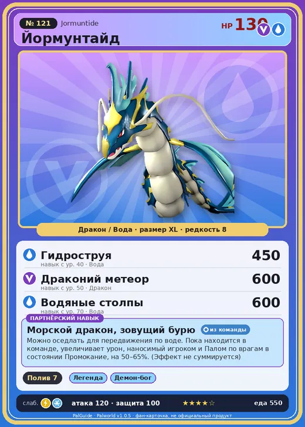

# Йормунтайд

<canvas id="fx"></canvas>

№ 121 · Jormuntide

ДраконВода

Слабость: ЛёдМолния

💧 Полив <b>7</b>

<b>Морской дракон, зовущий бурю</b> 🎒 из команды 🐎 верхом

❤️ 130 · ⚔️ 120 · 🛡 100

Основное

💎Редкость <button class="hlp" data-tip="Чем выше число, тем реже встречается пал. 1–4 — обычные, 5–7 — редкие, 8+ — легендарные.">?</button><b>8</b>

📏Размер<b>XL</b>

💰Цена продажи <button class="hlp" data-tip="Сколько золота даст торговец за пала.">?</button><b>3723</b>

Бой

🎯Множитель поимки <button class="hlp" data-tip="Насколько легче или труднее поймать: ×1 — обычно, меньше — сложнее.">?</button><b>×1</b>

🐎Скорость рывка верхом <button class="hlp" data-tip="Скорость, если сесть на пала и бежать рывком.">?</button><b>1000</b>

Ферма и еда

🍖Сколько ест <button class="hlp" data-tip="Сколько сытости пал тратит — чем больше, тем больше еды нужно на базе.">?</button><b>550</b>

Разведение

🧬Сила разведения <button class="hlp" data-tip="Скрытое число игры: у детёныша оно примерно среднее от родителей. Чем меньше — тем «сильнее» пал.">?</button><b>590</b>

=== "Обзор"

    #### Работа на базе
    - Полив — ур. 7

    #### Партнёрский навык: Морской дракон, зовущий бурю
    Можно оседлать для передвижения по воде. Пока находится в команде, увеличивает урон, наносимый игроком и Палом по врагам в состоянии Промокание, на 50–65%. (Эффект не суммируется) Технологии 40.

    #### Чем хорош / чем плох
    - ✅ Сильный водный урон; полив 7; очень высокая атака (120); много здоровья (130); отличный рабочий (пригодность 7); можно оседлать
    - ❌ Медленный на суше; много ест (550)

    > Ходит легенда о мудреце, несправедливо сброшенном в водоворот. Возродившись в облике Йормунтайд , он обрушил гибель на целую страну.

    См. также: [Стихии](../../guide/06_stihii.md) · [Разведение](../../guide/07_razvedenie.md) · [Все палы](README.md)

=== "Атаки"

    #### Атаки по уровням
    - ур. 1: Водяной выстрел (Вода, сила 50)
    - ур. 7: Драконья пушка (Дракон, сила 40)
    - ур. 15: Дыхание дракона (Дракон, сила 160)
    - ур. 22: Водяная бомба (Вода, сила 200)
    - ур. 30: Тройная молния (Молния, сила 200)
    - ур. 35: Морской змей (Вода, сила 400)
    - ур. 40: Гидроструя (Вода, сила 450)
    - ур. 50: Драконий метеор (Дракон, сила 600)
    - ур. 70: Водяные столпы (Вода, сила 600)

=== "Где живёт"

    #### Где водится
    - В дикой природе: да; точек появления днём: 1, ночью: 1
    - Яйцо: Огромное яйцо дракона

=== "Дроп"

    #### Дроп
    - Жидкость водного Пала — 2–4 шт., 100%

    **Дроп альфы:**
    - Деталь древней цивилизации — 5–6 шт., 100%
    - Ценный драконий самоцвет — 5–6 шт., 100%

=== "Разведение"

    #### Разведение
    - Ранг разведения (CombiRank): 590
    - Участвует в особых парах: Блейзхаул → Йормунтайд Игнис; Судзаку → Судзаку Аква; Фалерис → Фалерис Аква

=== "Пассивки"

    #### Лучшие пассивки по роли

    

⚔️ Боец

максимум урона и живучести в бою

<a class="psv r-4" data-psv="Легенда" href="../../../passivki/legend/">Легенда</a><a class="psv r-4" data-psv="Демон-бог" href="../../../passivki/demon_god/">Демон-бог</a><a class="psv r-3" data-psv="Божественный дракон" href="../../../passivki/divine_dragon/">Божественный дракон</a><a class="psv r-3" data-psv="Хладнокровный" href="../../../passivki/serenity/">Хладнокровный</a>

🛠 Рабочий

работает быстрее и меньше устаёт на базе

<a class="psv r-5" data-psv="Дьявольские руки" href="../../../passivki/demons_hand/">Дьявольские руки</a><a class="psv r-4" data-psv="Виртуоз" href="../../../passivki/remarkable_craftsmanship/">Виртуоз</a><a class="psv r-3" data-psv="Мастеровитый" href="../../../passivki/artisan/">Мастеровитый</a><a class="psv r-3" data-psv="Трудоголик" href="../../../passivki/workaholic/">Трудоголик</a>

🐎 Ездовой

быстрее бегает или летает с тобой верхом

<a class="psv r-4" data-psv="Божественная скорость" href="../../../passivki/swift/">Божественная скорость</a><a class="psv r-4" data-psv="Легенда" href="../../../passivki/legend/">Легенда</a><a class="psv r-4" data-psv="Вечный двигатель" href="../../../passivki/eternal_engine/">Вечный двигатель</a><a class="psv r-4" data-psv="Небесное скольжение" href="../../../passivki/sky_strider/">Небесное скольжение</a>

    <small>Нажми на пассивку, чтобы узнать, что она даёт и где её взять.</small>

<a class="card-link" href="../gildra/">← Йомира</a><a class="card-link" href="../jormuntide_ignis/">Йормунтайд Игнис →</a>

