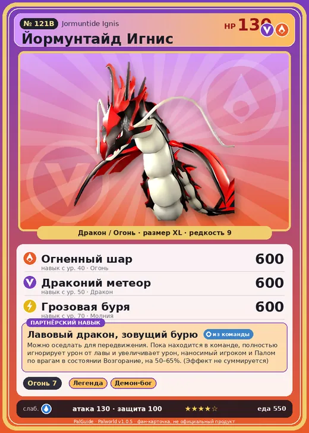

# #121B Йормунтайд Игнис (Jormuntide Ignis)

#121B · Jormuntide Ignis

ДраконОгонь

Слабость: ВодаЛёд

🔥 Разжигание огня <b>7</b>

<b>Лавовый дракон, зовущий бурю</b> 🎒 из команды 🐎 верхом

❤️ 130 · ⚔️ 130 · 🛡 100

| Поле | Значение |
|---|---|
| Стихия | Дракон, Огонь |
| Слабость (кто бьёт сильнее) | Вода, Лёд |
| Редкость | 9 |
| Размер | XL |
| HP / Атака / Защита (база вида) | 130 / 130 / 100 |
| Сколько ест | 550 |
| Цена продажи | 3577 |
| Множитель поимки | ×1 |
| Скорость рывка верхом | 1000 |

## Работа на базе
- Разжигание огня — ур. 7

## Партнёрский навык: Лавовый дракон, зовущий бурю
Можно оседлать для передвижения. Пока находится в команде, полностью игнорирует урон от лавы и увеличивает урон, наносимый игроком и Палом по врагам в состоянии Возгорание , на (50~65)% . (Эффект не суммируется) Технологии 59 level value 1 DamageUpTrainerAndOtomo_ToWetness_PartnerSkill_Umihebi_Fire 50 LavaDamageInvalid_PartnerSkill 1 Пробуждение : 2 DamageUpTrainerAndOtomo_ToWetness_PartnerSkill_Umihebi_Fire 53 LavaDamageInvalid_PartnerSkill 1 MoveSpeed_up_PartnerSkill_Ride_1 10 Пробуждение : (Скорость передвижения верхом: +10% ) 3 DamageUpTrainerAndOtomo_ToWetness_PartnerSkill_Umihebi_Fire 56 LavaDamageInvalid_PartnerSkill 1 MoveSpeed_up_PartnerSkill_Ride_2 12 Пробуждение : (Скорость передвижения верхом: +12% ) 4 DamageUpTrainerAndOtomo_ToWetness_PartnerSkill_Umihebi_Fire 60 LavaDamageInvalid_PartnerSkill 1 MoveSpeed_up_PartnerSkill_Ride_3 15 Пробуждение : (Скорость передвижения верхом: +15% ) 5 DamageUpTrainerAndOtomo_ToWetness_PartnerSkill_Umihebi_Fire 65 LavaDamageInvalid_PartnerSkill 1 MoveSpeed_up_PartnerSkill_Ride_4 20 Пробуждение : (Скорость передвижения верхом: +20% )

## Атаки по уровням
- ур. 1: Огненный выстрел (Огонь, сила 40)
- ур. 7: Драконья пушка (Дракон, сила 40)
- ур. 15: Огненный шторм (Огонь, сила 200)
- ур. 22: Огненное дыхание (Огонь, сила 160)
- ур. 30: Тройная молния (Молния, сила 200)
- ур. 35: Магмовый змей (Огонь, сила 400)
- ур. 40: Огненный шар (Огонь, сила 600)
- ур. 50: Драконий метеор (Дракон, сила 600)
- ур. 70: Грозовая буря (Молния, сила 600)

## Где водится
- В дикой природе: да; точек появления днём: 27, ночью: 27; уровни в первых точках: 66–67
- Яйцо: Огромное яйцо дракона

## Дроп
- Качественное масло Пала — 2–3 шт., 100%
- Огненный орган — 2–3 шт., 100%

**Дроп альфы:**
- Деталь древней цивилизации — 5–6 шт., 100%
- Ценный драконий самоцвет — 5–6 шт., 100%

## Разведение
- Ранг разведения (CombiRank): 170
- **Особая пара:** [Йормунтайд](../../4_spravochniki/paly/jormuntide.md) + [Блейзхаул](../../4_spravochniki/paly/blazehowl.md)

## Лучшие пассивки по роли
- по обзору: Мастеровитый, Виртуоз, Легенда, Император огня
- боец: Легенда, Демон-бог, Хладнокровный, Бессмертие, Божественный дракон (вместо Бессмертия, если нет мутации)
- рабочий: Дьявольские руки, Виртуоз, Мастеровитый, Небожитель/Трудоголик
- ездовой: Божественная скорость, Легенда, Вечный двигатель, Небесное скольжение

## Чем хорош / чем плох
- ✅ Разжигание огня 7; очень высокая атака (130); много здоровья (130); отличный рабочий (пригодность 7); можно оседлать
- ❌ Медленный; много ест (550); разводится только особой парой

> Ходит легенда о воине, несправедливо сброшенном в жерло вулкана. Возродившись в облике Йормунтайд Игнис , он сжёг страну дотла.

См. также: [Стихии](../../2_mehaniki/stihii.md) · [Разведение](../../2_mehaniki/razvedenie.md) · [Все палы](README.md)
_Источник: paldb.cc v1.0.5_
