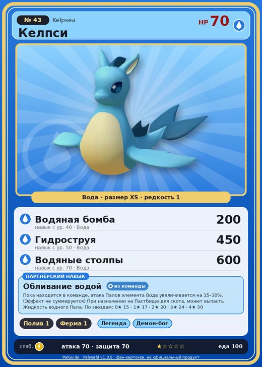

# Келпси

<canvas id="fx"></canvas>

№ 43 · Kelpsea

Вода

Слабость: Молния

💧 Полив <b>1</b>🐑 Фермерство <b>1</b>

<b>Обливание водой</b> 🎒 из команды 🏠 на базе

❤️ 70 · ⚔️ 70 · 🛡 70

Основное

💎Редкость <button class="hlp" data-tip="Чем выше число, тем реже встречается пал. 1–4 — обычные, 5–7 — редкие, 8+ — легендарные.">?</button><b>1</b>

📏Размер<b>XS</b>

💰Цена продажи <button class="hlp" data-tip="Сколько золота даст торговец за пала.">?</button><b>407</b>

Бой

🎯Множитель поимки <button class="hlp" data-tip="Насколько легче или труднее поймать: ×1 — обычно, меньше — сложнее.">?</button><b>×1</b>

🐎Скорость рывка верхом <button class="hlp" data-tip="Скорость, если сесть на пала и бежать рывком.">?</button><b>900</b>

Ферма и еда

🍖Сколько ест <button class="hlp" data-tip="Сколько сытости пал тратит — чем больше, тем больше еды нужно на базе.">?</button><b>100</b>

Разведение

🧬Сила разведения <button class="hlp" data-tip="Скрытое число игры: у детёныша оно примерно среднее от родителей. Чем меньше — тем «сильнее» пал.">?</button><b>2810</b>

=== "Обзор"

    #### Работа на базе
    - Полив — ур. 1
    - Фермерство — ур. 1

    #### Партнёрский навык: Обливание водой
    Пока находится в команде, атака Палов элемента Вода увеличивается на 15–30%. (Эффект не суммируется) При назначении на Пастбище для скота, может выпасть Жидкость водного Пала. По звёздам: 0★ 15 · 1★ 17 · 2★ 20 · 3★ 24 · 4★ 30

    #### Чем хорош / чем плох
    - ✅
    - ❌ слабая атака (70)

    > Характер Келпси зависит от качества воды, в которой он появился на свет. Особи, родившиеся в грязном водоёме, как правило, обладают скверным характером и ведут себя как настоящие хулиганы.

    См. также: [Стихии](../../guide/06_stihii.md) · [Разведение](../../guide/07_razvedenie.md) · [Все палы](README.md)

=== "Атаки"

    #### Атаки по уровням
    - ур. 1: Акваджет (Вода, сила 40)
    - ур. 7: Драконья пушка (Дракон, сила 40)
    - ур. 15: Водяной выстрел (Вода, сила 50)
    - ур. 22: Пузырьковый выстрел (Вода, сила 80)
    - ур. 30: Силовая бомба (Нейтральный, сила 120)
    - ур. 40: Водяная бомба (Вода, сила 200)
    - ур. 50: Гидроструя (Вода, сила 450)
    - ур. 70: Водяные столпы (Вода, сила 600)

=== "Где живёт"

    #### Где водится
    - В дикой природе: да; точек появления днём: 1360, ночью: 1360; уровни в первых точках: 1–10
    - Подземелья: Пещера Ущелья
    - Яйцо: Яйцо воды

=== "Дроп"

    #### Дроп
    - Мясо Келпси — 1 шт., 100%
    - Жидкость водного Пала — 1 шт., 100%

    **Дроп альфы:**
    - Деталь древней цивилизации — 1–2 шт., 100%
    - Ценные внутренности — 1–2 шт., 100%

=== "Разведение"

    #### Разведение
    - Ранг разведения (CombiRank): 2810

=== "Пассивки"

    #### Лучшие пассивки по роли

    

⚔️ Боец

максимум урона и живучести в бою

<a class="psv r-4" data-psv="Легенда" href="../../../passivki/legend/">Легенда</a><a class="psv r-4" data-psv="Демон-бог" href="../../../passivki/demon_god/">Демон-бог</a><a class="psv r-3" data-psv="Владыка морей" href="../../../passivki/lord_of_the_sea/">Владыка морей</a><a class="psv r-3" data-psv="Хладнокровный" href="../../../passivki/serenity/">Хладнокровный</a>

    <small>Нажми на пассивку, чтобы узнать, что она даёт и где её взять.</small>

<a class="card-link" href="../sparkit/">← Спаркит</a><a class="card-link" href="../kelpsea_ignis/">Келпси Игнис →</a>

