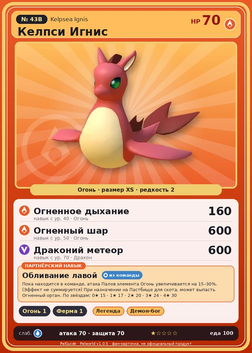

# #43B Келпси Игнис (Kelpsea Ignis)

#43B · Kelpsea Ignis

Огонь

Слабость: Вода

🔥 Разжигание огня <b>1</b>🐑 Фермерство <b>1</b>

<b>Обливание лавой</b> 🎒 из команды 🏠 на базе

❤️ 70 · ⚔️ 70 · 🛡 70

| Поле | Значение |
|---|---|
| Стихия | Огонь |
| Слабость (кто бьёт сильнее) | Вода |
| Редкость | 2 |
| Размер | XS |
| HP / Атака / Защита (база вида) | 70 / 70 / 70 |
| Сколько ест | 100 |
| Цена продажи | 407 |
| Множитель поимки | ×1 |
| Скорость рывка верхом | 900 |

## Работа на базе
- Разжигание огня — ур. 1
- Фермерство — ур. 1

## Партнёрский навык: Обливание лавой
Пока находится в команде, атака Палов элемента Огонь увеличивается на (15~30)% . (Эффект не суммируется) При назначении на Пастбище для скота , может выпасть Огненный орган . level value 1 AttackUp_Fire_PartnerSkill 15 2 AttackUp_Fire_PartnerSkill 17 3 AttackUp_Fire_PartnerSkill 20 4 AttackUp_Fire_PartnerSkill 24 5 AttackUp_Fire_PartnerSkill 30

## Атаки по уровням
- ур. 1: Огненный выстрел (Огонь, сила 40)
- ур. 7: Драконья пушка (Дракон, сила 40)
- ур. 15: Расщеплённый огонь (Огонь, сила 80)
- ур. 22: Огненная стрела (Огонь, сила 120)
- ур. 30: Драконий взрыв (Дракон, сила 80)
- ур. 40: Огненное дыхание (Огонь, сила 160)
- ур. 50: Огненный шар (Огонь, сила 600)
- ур. 70: Драконий метеор (Дракон, сила 600)

## Где водится
- В дикой природе: да; точек появления днём: 786, ночью: 786; уровни в первых точках: 20–22
- Подземелья: Пещера Вулкана
- Может продаваться у торговца/рекрутера
- Яйцо: Раскалённое яйцо

## Дроп
- Мясо Келпси — 1 шт., 100%
- Огненный орган — 1 шт., 100%

**Дроп альфы:**
- Деталь древней цивилизации — 1–2 шт., 100%
- Ценные внутренности — 1–2 шт., 100%

## Разведение
- Ранг разведения (CombiRank): 2470

## Лучшие пассивки по роли
- по обзору: Легенда
- боец: Легенда, Демон-бог, Хладнокровный, Бессмертие, Император огня (вместо Бессмертия, если нет мутации)
- ездовой: Божественная скорость, Легенда, Вечный двигатель, Небесное скольжение

## Чем хорош / чем плох
- ✅ +15–30% атаки огненных; можно оседлать
- ❌ Слабый; слабая атака (70)

> Характер Келпси зависит от температуры воды, в которой он появился на свет. Особи, родившиеся в тёплом водоёме, как правило, обладают пылким нравом и неиссякаемой энергией.

См. также: [Стихии](../../2_mehaniki/stihii.md) · [Разведение](../../2_mehaniki/razvedenie.md) · [Все палы](README.md)
_Источник: paldb.cc v1.0.5_
