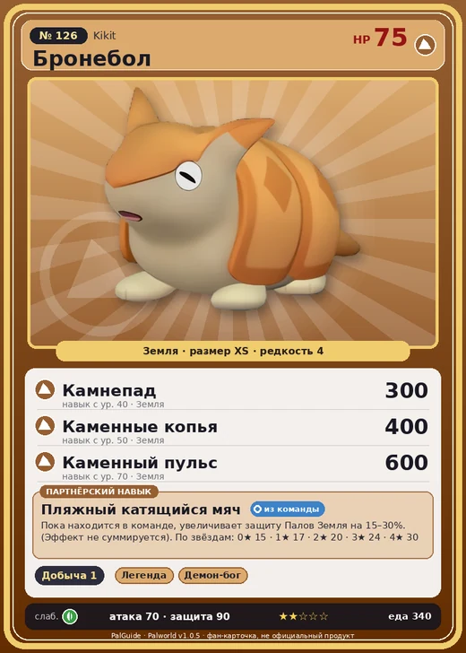

# Бронебол

<canvas id="fx"></canvas>

№ 126

Земля

Слабость: Трава <b class="mx">×1,5</b> <button class="hlp" data-tip="Множители перемножаются по обеим стихиям: ×1,5 за стихию, которую атака бьёт, ×0,65 за ту, что её держит.">?</button>

Устойчив: Молния <b class="mx">×0,65</b>

⛏️ Добыча <b>1</b>

<b>Пляжный катящийся мяч</b> 🎒 Работает из команды

❤️ 75 · ⚔️ 70 · 🛡 90

Основное

💎Редкость <button class="hlp" data-tip="Чем выше число, тем реже встречается пал. 1–4 — обычные, 5–7 — редкие, 8+ — легендарные.">?</button><b>4</b>

📏Размер<b>XS</b>

💰Цена продажи <button class="hlp" data-tip="Сколько золота даст торговец за пала.">?</button><b>1152</b>

Бой

🎯Множитель поимки <button class="hlp" data-tip="Насколько легче или труднее поймать: ×1 — обычно, меньше — сложнее.">?</button><b>×1</b>

🐎Скорость рывка верхом <button class="hlp" data-tip="Скорость, если сесть на пала и бежать рывком.">?</button><b>900</b>

Ферма и еда

🍖Сколько ест <button class="hlp" data-tip="Сколько сытости пал тратит — чем больше, тем больше еды нужно на базе.">?</button><b>340</b>

Разведение

🧬Сила разведения <button class="hlp" data-tip="Скрытое число игры: у детёныша оно примерно среднее от родителей. Чем меньше — тем «сильнее» пал.">?</button><b>2310</b>

=== "Обзор"

    #### Работа на базе

    
⛏️ Добыча<i style="--v:10%"></i><b>1</b>

    #### Партнёрский навык: Пляжный катящийся мяч
    Пока находится в команде, увеличивает защиту Палов Земля на 15–30%. (Эффект не суммируется). По звёздам: 0★ 15 · 1★ 17 · 2★ 20 · 3★ 24 · 4★ 30

    #### Чем хорош / чем плох
    - ✅ крепкая защита (90)
    - ❌ слабая атака (70)

    > Когда-то был популярен футбол, где Бронебол выступал в роли мяча. Эта мода быстро сошла на нет благодаря усилиям Организации по защите Палов, но сами Палы были отнюдь не против — ведь так они легко избавлялись от ороговевшей кожи.

    См. также: [Стихии](../../guide/06_stihii.md) · [Разведение](../../guide/07_razvedenie.md) · [Все палы](README.md)

=== "Атаки"

    #### Атаки по уровням
    - ур. 1: Силовой выстрел (Нейтральный, сила 80)
    - ур. 7: Грязевой выстрел (Земля, сила 40)
    - ур. 15: Каменный залп (Земля, сила 80)
    - ур. 22: Силовая бомба (Нейтральный, сила 120)
    - ур. 30: Песчаный вихрь (Земля, сила 200)
    - ур. 40: Камнепад (Земля, сила 300)
    - ур. 50: Каменные копья (Земля, сила 400)
    - ур. 70: Каменный пульс (Земля, сила 600)

=== "Где живёт"

    #### Где водится

    

<button data-k="d" class="on">☀️ День</button><button data-k="n">🌙 Ночь</button>

ур. 46–46<a class="btn hm-full" href="../../../map/?pal=SmallArmadillo">Показать на большой карте</a>

Сакурадзима

🕳 Подземелье<b>Пещера Цветущей Сакуры</b>

🥚 Яйцо<b>Яйцо земли</b>

=== "Дроп"

    #### Дроп
    - Кожа — 1–2 шт., 100%
    - Кость — 1–2 шт., 60%
    - Сырая нефть — 1 шт., 50%

    **Дроп альфы:**

    - Деталь древней цивилизации — 2–3 шт., 100%
    - Ценный коготь — 2–3 шт., 100%

=== "Разведение"

    #### Разведение
    - Ранг разведения: 2310
    - Участвует в особых парах: [Вулипоп](woolipop.md) → [Вулипоп Терра](woolipop_terra.md); [Горират](gorirat.md) → [Горират Терра](gorirat_terra.md)

=== "Пассивки"

    #### Лучшие пассивки по роли

    

⚔️ Боец

максимум урона и живучести в бою

<a class="psv r-4" data-psv="Легенда" href="../../../passivki/legend/">Легенда</a><a class="psv r-4" data-psv="Демон-бог" href="../../../passivki/demon_god/">Демон-бог</a><a class="psv r-3" data-psv="Император земли" href="../../../passivki/earth_emperor/">Император земли</a><a class="psv r-3" data-psv="Хладнокровный" href="../../../passivki/serenity/">Хладнокровный</a>

    <small>Нажми на пассивку, чтобы узнать, что она даёт и где её взять.</small>

<a class="card-link" href="../lullu/">← Нежноцвет</a><a class="card-link" href="../yakumo/">Якумо →</a>

