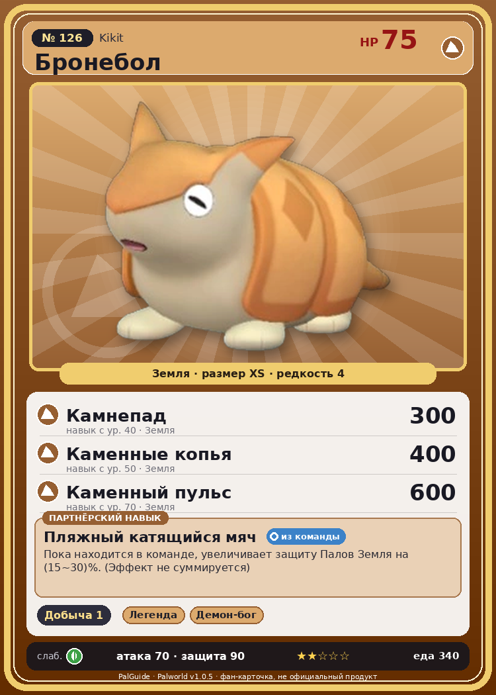

# #126 Бронебол (Kikit)

{ width=360 }

| Поле | Значение |
|---|---|
| Стихия | Земля |
| Слабость (кто бьёт сильнее) | Трава |
| Редкость | 4 |
| Размер | XS |
| HP / Атака / Защита (база вида) | 75 / 70 / 90 |
| Сколько ест | 340 |
| Цена продажи | 1152 |
| Множитель поимки | ×1 |
| Скорость рывка верхом | 900 |

## Работа на базе
- Добыча — ур. 1

## Партнёрский навык: Пляжный катящийся мяч
Пока находится в команде, увеличивает защиту Палов Земля на (15~30)% . (Эффект не суммируется) level value 1 DefenseUp_Earth_PartnerSkill 15 2 DefenseUp_Earth_PartnerSkill 17 3 DefenseUp_Earth_PartnerSkill 20 4 DefenseUp_Earth_PartnerSkill 24 5 DefenseUp_Earth_PartnerSkill 30

## Атаки по уровням
- ур. 1: Силовой выстрел (Нейтральный, сила 80)
- ур. 7: Грязевой выстрел (Земля, сила 40)
- ур. 15: Каменный залп (Земля, сила 80)
- ур. 22: Силовая бомба (Нейтральный, сила 120)
- ур. 30: Песчаный вихрь (Земля, сила 200)
- ур. 40: Камнепад (Земля, сила 300)
- ур. 50: Каменные копья (Земля, сила 400)
- ур. 70: Каменный пульс (Земля, сила 600)

## Где водится
- В дикой природе: да; точек появления днём: 70, ночью: 70; уровни в первых точках: 46–48
- Подземелья: Пещера Цветущей Сакуры
- Яйцо: Яйцо земли

## Дроп
- Кожа — 1–2 шт., 100%
- Кость — 1–2 шт., 60%
- Сырая нефть — 1 шт., 50%

**Дроп альфы:**
- Деталь древней цивилизации — 2–3 шт., 100%
- Ценный коготь — 2–3 шт., 100%

## Разведение
- Ранг разведения (CombiRank): 2310
- Участвует в особых парах: Вулипоп → Вулипоп Терра; Горират → Горират Терра

## Лучшие пассивки по роли
- боец: Легенда, Демон-бог, Хладнокровный, Бессмертие, Император земли (вместо Бессмертия, если нет мутации)
- ездовой: Божественная скорость, Легенда, Вечный двигатель, Небесное скольжение

## Чем хорош / чем плох
- ✅ можно оседлать
- ❌ слабая атака (70)

> Когда-то был популярен футбол, где Бронебол выступал в роли мяча. Эта мода быстро сошла на нет благодаря усилиям Организации по защите Палов, но сами Палы были отнюдь не против — ведь так они легко избавлялись от ороговевшей кожи.

См. также: [Стихии](../../2_mehaniki/stihii.md) · [Разведение](../../2_mehaniki/razvedenie.md) · [Все палы](README.md)
_Источник: paldb.cc v1.0.5_
