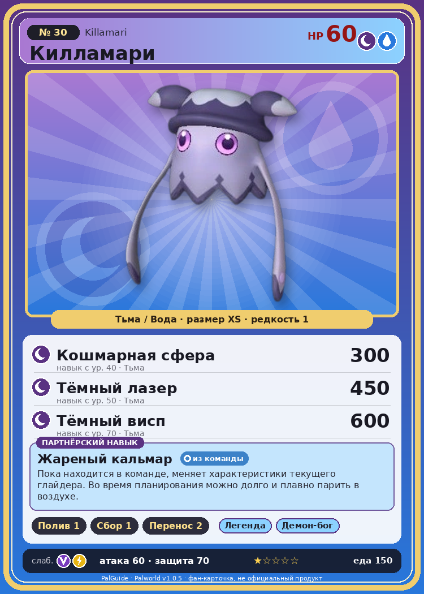

# #30 Килламари (Killamari)

{ width=360 }

| Поле | Значение |
|---|---|
| Стихия | Тьма, Вода |
| Слабость (кто бьёт сильнее) | Дракон, Молния |
| Редкость | 1 |
| Размер | XS |
| HP / Атака / Защита (база вида) | 60 / 60 / 70 |
| Сколько ест | 150 |
| Цена продажи | 376 |
| Множитель поимки | ×1 |
| Скорость рывка верхом | 550 |

## Работа на базе
- Полив — ур. 1
- Сбор — ур. 1
- Транспортировка — ур. 2

## Партнёрский навык: Жареный кальмар
Пока находится в команде, меняет характеристики текущего глайдера. Во время планирования можно долго и плавно парить в воздухе. level value 1 Пробуждение : 2 Пробуждение : (Улучшение характеристик глайдера: Небольшое ) 3 Пробуждение : (Улучшение характеристик глайдера: Среднее ) 4 Пробуждение : (Улучшение характеристик глайдера: Большое ) 5 Пробуждение : (Улучшение характеристик глайдера: Очень большое ) Lv. GliderMaxSpeed GliderGravityScale GliderSP 1 500 0.013 8 2 600 0.011 6.5 3 700 0.009 4 800 0.007 3.5 5 900 0.005 2

## Атаки по уровням
- ур. 1: Акваджет (Вода, сила 40)
- ур. 7: Ядовитый выстрел (Тьма, сила 30)
- ур. 15: Тёмный шар (Тьма, сила 50)
- ур. 22: Теневой взрыв (Тьма, сила 80)
- ур. 30: Кислотный дождь (Вода, сила 120)
- ур. 40: Кошмарная сфера (Тьма, сила 300)
- ур. 50: Тёмный лазер (Тьма, сила 450)
- ур. 70: Тёмный висп (Тьма, сила 600)

## Где водится
- В дикой природе: да; точек появления днём: 201, ночью: 361; уровни в первых точках: 20–22
- Подземелья: Пещера Отдалённого Острова, Пещера Холмов
- Яйцо: Яйцо тьмы

## Дроп
- Ядовитая железа — 2–4 шт., 100%
- Щупальце Килламари — 1 шт., 50%
- Жидкость водного Пала — 1 шт., 100%

**Дроп альфы:**
- Деталь древней цивилизации — 1–2 шт., 100%
- Ценный мех — 1–2 шт., 100%

## Разведение
- Ранг разведения (CombiRank): 2770
- Участвует в особых парах: Риббани → Килламари Примо

## Лучшие пассивки по роли
- боец: Легенда, Демон-бог, Хладнокровный, Бессмертие, Король тьмы (вместо Бессмертия, если нет мутации)
- ездовой: Божественная скорость, Легенда, Вечный двигатель, Небесное скольжение

## Чем хорош / чем плох
- ✅ можно оседлать
- ❌ слабая атака (60); мало здоровья (60)

> Килламари садится врагу на голову и высасывает всё, что внутри его черепа. Иногда находят мумии Палов, и почти все из них — его жертвы.

См. также: [Стихии](../../2_mehaniki/stihii.md) · [Разведение](../../2_mehaniki/razvedenie.md) · [Все палы](README.md)
_Источник: paldb.cc v1.0.5_
