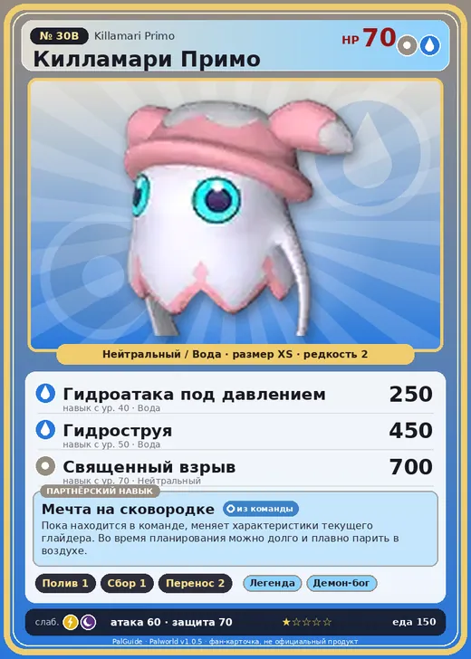

# #30B Килламари Примо (Killamari Primo)

№ 30B

НейтральныйВода

Слабость: МолнияТьма

💧 Полив <b>1</b>🌾 Сбор <b>1</b>📦 Транспортировка <b>2</b>

<b>Мечта на сковородке</b> 🎒 из команды

❤️ 70 · ⚔️ 60 · 🛡 70

| Поле | Значение |
|---|---|
| Стихия | Нейтральный, Вода |
| Слабость (кто бьёт сильнее) | Молния, Тьма |
| Редкость | 2 |
| Размер | XS |
| HP / Атака / Защита (база вида) | 70 / 60 / 70 |
| Сколько ест | 150 |
| Цена продажи | 421 |
| Множитель поимки | ×1 |
| Скорость рывка верхом | 550 |

=== "Обзор"

    #### Работа на базе
    - Полив — ур. 1
    - Сбор — ур. 1
    - Транспортировка — ур. 2

    #### Партнёрский навык: Мечта на сковородке
    Пока находится в команде, меняет характеристики текущего глайдера. Во время планирования можно долго и плавно парить в воздухе. level value 1 Пробуждение : 2 Пробуждение : (Улучшение характеристик глайдера: Небольшое ) 3 Пробуждение : (Улучшение характеристик глайдера: Среднее ) 4 Пробуждение : (Улучшение характеристик глайдера: Большое ) 5 Пробуждение : (Улучшение характеристик глайдера: Очень большое ) Lv. GliderMaxSpeed GliderGravityScale GliderSP 1 500 0.013 8 2 600 0.011 6 3 700 0.009 6.5 4 800 0.007 3.5 5 900 0.005 2

    #### Чем хорош / чем плох
    - ✅ можно оседлать
    - ❌ слабая атака (60); разводится только особой парой

    > Вцепляется в шею врага, высасывая всю кровь до последней капли. Если два Килламари Примо сцепляются друг с другом, они начинают бесконечно пить друг у друга, не отпуская, пока один не падёт.

    См. также: [Стихии](../../guide/06_stihii.md) · [Разведение](../../guide/07_razvedenie.md) · [Все палы](README.md)

=== "Атаки"

    #### Атаки по уровням
    - ур. 1: Воздушная пушка (Нейтральный, сила 40)
    - ур. 7: Силовой выстрел (Нейтральный, сила 80)
    - ур. 15: Пузырьковый выстрел (Вода, сила 80)
    - ур. 22: Силовая бомба (Нейтральный, сила 120)
    - ур. 30: Кислотный дождь (Вода, сила 120)
    - ур. 40: Гидроатака под давлением (Вода, сила 250)
    - ур. 50: Гидроструя (Вода, сила 450)
    - ур. 70: Священный взрыв (Нейтральный, сила 700)

=== "Где живёт"

    #### Где водится
    - В дикой природе: да; точек появления днём: 382, ночью: 382; уровни в первых точках: 24–28
    - Яйцо: Обычное яйцо

=== "Дроп"

    #### Дроп
    - Жидкость водного Пала — 1–2 шт., 100%
    - Щупальце Килламари — 1 шт., 50%

    **Дроп альфы:**
    - Деталь древней цивилизации — 2–3 шт., 100%
    - Ценный мех — 2–3 шт., 100%

=== "Разведение"

    #### Разведение
    - Ранг разведения (CombiRank): 2540
    - **Особая пара:** [Килламари](../../4_spravochniki/paly/killamari.md) + [Риббани](../../4_spravochniki/paly/ribbuny.md)

=== "Пассивки"

    #### Лучшие пассивки по роли
    - боец: Легенда, Демон-бог, Хладнокровный, Бессмертие, Святое небо (вместо Бессмертия, если нет мутации)
    - ездовой: Божественная скорость, Легенда, Вечный двигатель, Небесное скольжение

<a class="card-link" href="../killamari/">← Килламари</a><a class="card-link" href="../fuddler/">Фуддлер →</a>

