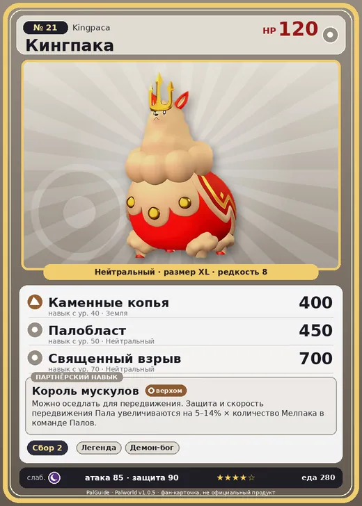

# #21 Кингпака (Kingpaca)

#21 · Kingpaca

Нейтральный

Слабость: Тьма

🌾 Сбор <b>2</b>

<b>Король мускулов</b> 🐎 верхом

❤️ 120 · ⚔️ 85 · 🛡 90

| Поле | Значение |
|---|---|
| Стихия | Нейтральный |
| Слабость (кто бьёт сильнее) | Тьма |
| Редкость | 8 |
| Размер | XL |
| HP / Атака / Защита (база вида) | 120 / 85 / 90 |
| Сколько ест | 280 |
| Цена продажи | 1274 |
| Множитель поимки | ×1 |
| Скорость рывка верхом | 1040 |

## Работа на базе
- Сбор — ур. 2

## Партнёрский навык: Король мускулов
Можно оседлать для передвижения. Защита и скорость передвижения Пала увеличиваются на (5~14)% × количество Мелпака в команде Палов. Технологии 23 level value 1 MoveSpeed_KingAlpaca_PartnerSkill 5 Defense_KingAlpaca_PartnerSkill 5 2 MoveSpeed_KingAlpaca_PartnerSkill 7 Defense_KingAlpaca_PartnerSkill 7 3 MoveSpeed_KingAlpaca_PartnerSkill 9 Defense_KingAlpaca_PartnerSkill 9 4 MoveSpeed_KingAlpaca_PartnerSkill 11 Defense_KingAlpaca_PartnerSkill 11 5 MoveSpeed_KingAlpaca_PartnerSkill 14 Defense_KingAlpaca_PartnerSkill 14

## Атаки по уровням
- ур. 1: Грязевой выстрел (Земля, сила 40)
- ур. 7: Силовой выстрел (Нейтральный, сила 80)
- ур. 15: Силовая бомба (Нейтральный, сила 120)
- ур. 22: Королевский таран (Нейтральный, сила 200)
- ур. 30: Тройная молния (Молния, сила 200)
- ур. 40: Каменные копья (Земля, сила 400)
- ур. 50: Палобласт (Нейтральный, сила 450)
- ур. 70: Священный взрыв (Нейтральный, сила 700)

## Где водится
- В дикой природе: да; точек появления днём: 1, ночью: 1
- Яйцо: Огромное обычное яйцо

## Дроп
- Шерсть — 5 шт., 100%

**Дроп альфы:**
- Деталь древней цивилизации — 3–5 шт., 100%
- Ценный мех — 3–5 шт., 100%

## Разведение
- Ранг разведения (CombiRank): 2220
- Участвует в особых парах: Рейндрикс → Кингпака Крист

## Лучшие пассивки по роли
- боец: Легенда, Демон-бог, Хладнокровный, Бессмертие, Святое небо (вместо Бессмертия, если нет мутации)
- ездовой: Божественная скорость, Легенда, Вечный двигатель, Небесное скольжение

## Чем хорош / чем плох
- ✅ много здоровья (120); можно оседлать
- ❌ явных минусов нет

> В поединках Кингпака используют в качестве ставки своих прислужников‑ Мелпака . Особь, лишённая прислужника, считается проигравшим.

См. также: [Стихии](../../guide/06_stihii.md) · [Разведение](../../guide/07_razvedenie.md) · [Все палы](README.md)
