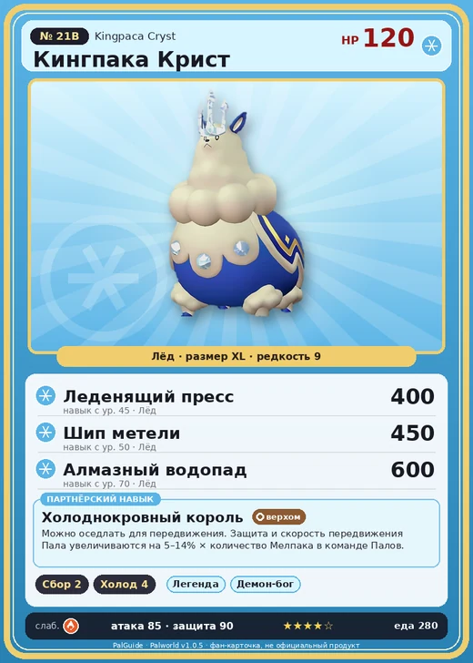

# #21B Кингпака Крист (Kingpaca Cryst)

№ 21B

Лёд

Слабость: Огонь

🌾 Сбор <b>2</b>❄️ Охлаждение <b>4</b>

<b>Холоднокровный король</b> 🐎 верхом

❤️ 120 · ⚔️ 85 · 🛡 90

| Поле | Значение |
|---|---|
| Стихия | Лёд |
| Слабость (кто бьёт сильнее) | Огонь |
| Редкость | 9 |
| Размер | XL |
| HP / Атака / Защита (база вида) | 120 / 85 / 90 |
| Сколько ест | 280 |
| Цена продажи | 1624 |
| Множитель поимки | ×1 |
| Скорость рывка верхом | 1040 |

=== "Обзор"

    #### Работа на базе
    - Сбор — ур. 2
    - Охлаждение — ур. 4

    #### Партнёрский навык: Холоднокровный король
    Можно оседлать для передвижения. Защита и скорость передвижения Пала увеличиваются на 5–14% × количество Мелпака в команде Палов. Технологии 46.

    #### Чем хорош / чем плох
    - ✅ много здоровья (120); можно оседлать
    - ❌ разводится только особой парой

    > Его характер хладнокровен, и выражать эмоции ему непросто. Те, кто оказался слишком неуклюжим по отношению к Мелпака , обречены на одиночество.

    См. также: [Стихии](../../guide/06_stihii.md) · [Разведение](../../guide/07_razvedenie.md) · [Все палы](README.md)

=== "Атаки"

    #### Атаки по уровням
    - ур. 1: Ледяная ракета (Лёд, сила 40)
    - ур. 7: Ледяной резак (Лёд, сила 80)
    - ур. 15: Айсберг (Лёд, сила 120)
    - ур. 22: Королевский таран (Нейтральный, сила 200)
    - ур. 30: Ледяное дыхание (Лёд, сила 160)
    - ур. 40: Водяная бомба (Вода, сила 200)
    - ур. 45: Леденящий пресс (Лёд, сила 400)
    - ур. 50: Шип метели (Лёд, сила 450)
    - ур. 70: Алмазный водопад (Лёд, сила 600)

=== "Где живёт"

    #### Где водится
    - В дикой природе: да; точек появления днём: 1, ночью: 1
    - Яйцо: Огромное яйцо льда

=== "Дроп"

    #### Дроп
    - Шерсть — 5 шт., 100%
    - Ледяной орган — 3–6 шт., 100%

    **Дроп альфы:**
    - Деталь древней цивилизации — 5–7 шт., 100%
    - Ценный мех — 5–7 шт., 100%

=== "Разведение"

    #### Разведение
    - Ранг разведения (CombiRank): 1530
    - **Особая пара:** [Кингпака](../../4_spravochniki/paly/kingpaca.md) + [Рейндрикс](../../4_spravochniki/paly/reindrix.md)

=== "Пассивки"

    #### Лучшие пассивки по роли

    

⚔️ Боец

максимум урона и живучести в бою

<a class="psv r-4" data-psv="Легенда" href="../../../passivki/legend/">Легенда</a><a class="psv r-4" data-psv="Демон-бог" href="../../../passivki/demon_god/">Демон-бог</a><a class="psv r-3" data-psv="Император льда" href="../../../passivki/ice_emperor/">Император льда</a><a class="psv r-3" data-psv="Хладнокровный" href="../../../passivki/serenity/">Хладнокровный</a>

🛠 Рабочий

работает быстрее и меньше устаёт на базе

<a class="psv r-5" data-psv="Дьявольские руки" href="../../../passivki/demons_hand/">Дьявольские руки</a><a class="psv r-4" data-psv="Виртуоз" href="../../../passivki/remarkable_craftsmanship/">Виртуоз</a><a class="psv r-3" data-psv="Мастеровитый" href="../../../passivki/artisan/">Мастеровитый</a><a class="psv r-3" data-psv="Трудоголик" href="../../../passivki/workaholic/">Трудоголик</a>

🐎 Ездовой

быстрее бегает или летает с тобой верхом

<a class="psv r-4" data-psv="Божественная скорость" href="../../../passivki/swift/">Божественная скорость</a><a class="psv r-4" data-psv="Легенда" href="../../../passivki/legend/">Легенда</a><a class="psv r-4" data-psv="Вечный двигатель" href="../../../passivki/eternal_engine/">Вечный двигатель</a><a class="psv r-4" data-psv="Небесное скольжение" href="../../../passivki/sky_strider/">Небесное скольжение</a>

    <small>Нажми на пассивку, чтобы узнать, что она даёт и где её взять.</small>

<a class="card-link" href="../kingpaca/">← Кингпака</a><a class="card-link" href="../daedream/">Даэдрим →</a>

