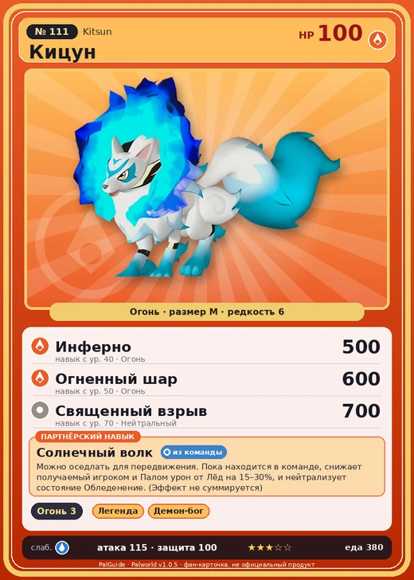

# #111 Кицун (Kitsun)

№ 111

Огонь

Слабость: Вода

🔥 Разжигание огня <b>3</b>

<b>Солнечный волк</b> 🎒 из команды 🐎 верхом

❤️ 100 · ⚔️ 115 · 🛡 100

| Поле | Значение |
|---|---|
| Стихия | Огонь |
| Слабость (кто бьёт сильнее) | Вода |
| Редкость | 6 |
| Размер | M |
| HP / Атака / Защита (база вида) | 100 / 115 / 100 |
| Сколько ест | 380 |
| Цена продажи | 1744 |
| Множитель поимки | ×1 |
| Скорость рывка верхом | 1100 |

## Работа на базе
- Разжигание огня — ур. 3

## Партнёрский навык: Солнечный волк
Можно оседлать для передвижения. Пока находится в команде, снижает получаемый игроком и Палом урон от Лёд на (15~30)% , и нейтрализует состояние Обледенение . (Эффект не суммируется) Технологии 57 level value 1 AmaterasuWolf_PartnerSkill 15, 100 Пробуждение : 2 AmaterasuWolf_PartnerSkill 17, 100 MoveSpeed_up_PartnerSkill_Ride_1 10 Пробуждение : (Скорость передвижения верхом: +10% ) 3 AmaterasuWolf_PartnerSkill 20, 100 MoveSpeed_up_PartnerSkill_Ride_2 12 Пробуждение : (Скорость передвижения верхом: +12% ) 4 AmaterasuWolf_PartnerSkill 24, 100 MoveSpeed_up_PartnerSkill_Ride_3 15 Пробуждение : (Скорость передвижения верхом: +15% ) 5 AmaterasuWolf_PartnerSkill 30, 100 MoveSpeed_up_PartnerSkill_Ride_4 20 Пробуждение : (Скорость передвижения верхом: +20% )

## Атаки по уровням
- ур. 1: Двойные клыки (огонь) (Огонь, сила 40)
- ур. 2: Дикие клыки (огонь) (Огонь, сила 50)
- ур. 3: Огненный выстрел (Огонь, сила 40)
- ур. 7: Расщеплённый огонь (Огонь, сила 80)
- ур. 15: Духовное пламя (Тьма, сила 200)
- ур. 22: Фуринкадзан (Огонь, сила 200)
- ур. 30: Огненный шторм (Огонь, сила 200)
- ур. 40: Инферно (Огонь, сила 500)
- ур. 50: Огненный шар (Огонь, сила 600)
- ур. 70: Священный взрыв (Нейтральный, сила 700)

## Где водится
- В дикой природе: да; точек появления днём: 10, ночью: 31; уровни в первых точках: 34–38
- Яйцо: Большое раскалённое яйцо

## Дроп
- Огненный орган — 2–3 шт., 100%
- Кожа — 2–3 шт., 100%

**Дроп альфы:**
- Деталь древней цивилизации — 6–8 шт., 100%
- Ценный мех — 6–8 шт., 100%

## Разведение
- Ранг разведения (CombiRank): 1670
- Участвует в особых парах: Няфия → Кицун Нокт

## Лучшие пассивки по роли
- по обзору: Легенда, Демон-бог, Хладнокровный, Император огня
- боец: Легенда, Демон-бог, Хладнокровный, Бессмертие, Император огня (вместо Бессмертия, если нет мутации)
- рабочий: Дьявольские руки, Виртуоз, Мастеровитый, Небожитель/Трудоголик
- ездовой: Божественная скорость, Легенда, Вечный двигатель, Небесное скольжение

## Чем хорош / чем плох
- ✅ Защищает от льда/заморозки; огненный урон; хорошая атака (115); можно оседлать
- ❌ Средние статы

> Обладает чрезвычайно чувствительным характером. Стоит случиться чему-то неприятному — и он скрывается в пещере. В древности люди верили: если Кицун исчез, беда не за горами.

См. также: [Стихии](../../guide/06_stihii.md) · [Разведение](../../guide/07_razvedenie.md) · [Все палы](README.md)
