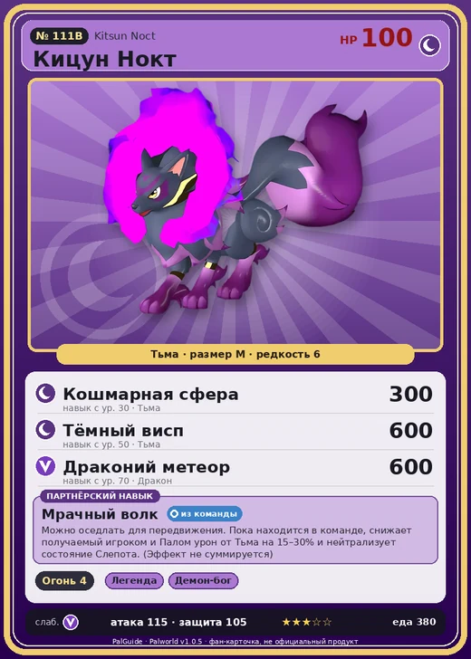

# #111B Кицун Нокт (Kitsun Noct)

№ 111B

Тьма

Слабость: Дракон

🔥 Разжигание огня <b>4</b>

<b>Мрачный волк</b> 🎒 из команды 🐎 верхом

❤️ 100 · ⚔️ 115 · 🛡 105

| Поле | Значение |
|---|---|
| Стихия | Тьма |
| Слабость (кто бьёт сильнее) | Дракон |
| Редкость | 6 |
| Размер | M |
| HP / Атака / Защита (база вида) | 100 / 115 / 105 |
| Сколько ест | 380 |
| Цена продажи | 2014 |
| Множитель поимки | ×1 |
| Скорость рывка верхом | 1100 |

=== "Обзор"

    #### Работа на базе
    - Разжигание огня — ур. 4

    #### Партнёрский навык: Мрачный волк
    Можно оседлать для передвижения. Пока находится в команде, снижает получаемый игроком и Палом урон от Тьма на (15~30)% и нейтрализует состояние Слепота . (Эффект не суммируется) Технологии 59 level value 1 AmaterasuWolf_Dark_PartnerSkill 15, 100 Пробуждение : 2 AmaterasuWolf_Dark_PartnerSkill 17, 100 MoveSpeed_up_PartnerSkill_Ride_1 10 Пробуждение : (Скорость передвижения верхом: +10% ) 3 AmaterasuWolf_Dark_PartnerSkill 20, 100 MoveSpeed_up_PartnerSkill_Ride_2 12 Пробуждение : (Скорость передвижения верхом: +12% ) 4 AmaterasuWolf_Dark_PartnerSkill 24, 100 MoveSpeed_up_PartnerSkill_Ride_3 15 Пробуждение : (Скорость передвижения верхом: +15% ) 5 AmaterasuWolf_Dark_PartnerSkill 30, 100 MoveSpeed_up_PartnerSkill_Ride_4 20 Пробуждение : (Скорость передвижения верхом: +20% )

    #### Чем хорош / чем плох
    - ✅ хорошая атака (115); можно оседлать
    - ❌ разводится только особой парой

    > Обладает чрезвычайно чувствительным характером. Стоит случиться чему-то неприятному — и он скрывается в пещере. От постоянного уединения он стал каким-то мрачным.

    См. также: [Стихии](../../guide/06_stihii.md) · [Разведение](../../guide/07_razvedenie.md) · [Все палы](README.md)

=== "Атаки"

    #### Атаки по уровням
    - ур. 1: Двойные клыки (тьма) (Тьма, сила 40)
    - ур. 2: Дикие клыки (тьма) (Тьма, сила 50)
    - ур. 3: Тёмная пушка (Тьма, сила 70)
    - ур. 7: Расщеплённый огонь (Огонь, сила 80)
    - ур. 15: Духовное пламя (Тьма, сила 200)
    - ур. 22: Рывок адского пламени (Тьма, сила 250)
    - ур. 30: Кошмарная сфера (Тьма, сила 300)
    - ур. 40: Огненная воронка (Огонь, сила 300)
    - ур. 50: Тёмный висп (Тьма, сила 600)
    - ур. 70: Драконий метеор (Дракон, сила 600)

=== "Где живёт"

    #### Где водится
    - В дикой природе: да; точек появления днём: 355, ночью: 355; уровни в первых точках: 61–63
    - Подземелья: Пещера Тэнраку
    - Яйцо: Большое яйцо тьмы

=== "Дроп"

    #### Дроп
    - Огненный орган — 2–3 шт., 100%
    - Кожа — 2–3 шт., 100%
    - Осколок тьмы — 1–2 шт., 100%

    **Дроп альфы:**
    - Деталь древней цивилизации — 7–8 шт., 100%
    - Ценный мех — 2–3 шт., 100%

=== "Разведение"

    #### Разведение
    - Ранг разведения (CombiRank): 800
    - **Особая пара:** [Кицун](../../4_spravochniki/paly/kitsun.md) + [Няфия](../../4_spravochniki/paly/nyafia.md)
    - Участвует в особых парах: Селесдир → Селесдир Нокт

=== "Пассивки"

    #### Лучшие пассивки по роли
    - боец: Легенда, Демон-бог, Хладнокровный, Бессмертие, Король тьмы (вместо Бессмертия, если нет мутации)
    - рабочий: Дьявольские руки, Виртуоз, Мастеровитый, Небожитель/Трудоголик
    - ездовой: Божественная скорость, Легенда, Вечный двигатель, Небесное скольжение

<a class="card-link" href="../kitsun/">← Кицун</a><a class="card-link" href="../blazehowl/">Блейзхаул →</a>

