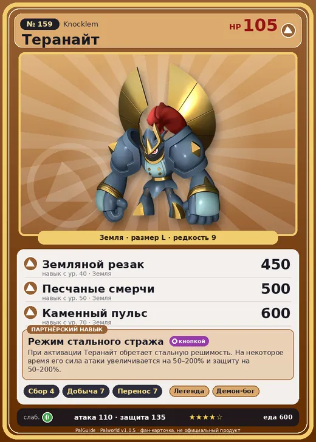

# #159 Теранайт (Knocklem)

#159 · Knocklem

Земля

Слабость: Трава

🌾 Сбор <b>4</b>⛏️ Добыча <b>7</b>📦 Транспортировка <b>7</b>

<b>Режим стального стража</b> 🔘 кнопкой

❤️ 105 · ⚔️ 110 · 🛡 135

| Поле | Значение |
|---|---|
| Стихия | Земля |
| Слабость (кто бьёт сильнее) | Трава |
| Редкость | 9 |
| Размер | L |
| HP / Атака / Защита (база вида) | 105 / 110 / 135 |
| Сколько ест | 600 |
| Цена продажи | 3767 |
| Множитель поимки | ×1 |
| Скорость рывка верхом | 700 |

## Работа на базе
- Сбор — ур. 4
- Добыча — ур. 7
- Транспортировка — ур. 7

## Партнёрский навык: Режим стального стража
При активации Теранайт обретает стальную решимость. На некоторое время его сила атаки увеличивается на (50~200)% и защиту на (50~200)% .

## Атаки по уровням
- ур. 1: Силовой выстрел (Нейтральный, сила 80)
- ур. 7: Каменный залп (Земля, сила 80)
- ур. 15: Камнемёт (Земля, сила 120)
- ур. 22: Камнепад (Земля, сила 300)
- ур. 30: Каменные копья (Земля, сила 400)
- ур. 40: Земляной резак (Земля, сила 450)
- ур. 50: Песчаные смерчи (Земля, сила 500)
- ур. 70: Каменный пульс (Земля, сила 600)

## Где водится
- В дикой природе: да; точек появления днём: 13, ночью: 13
- Яйцо: Огромное яйцо земли

## Дроп
- Металлическая руда — 2–3 шт., 100%

**Дроп альфы:**
- Деталь древней цивилизации — 6–7 шт., 100%
- Ценные внутренности — 6–7 шт., 100%

## Разведение
- Ранг разведения (CombiRank): 260
- Участвует в особых парах: Менастинг → Менастинг Терра; Рагнахавк → Теранайт Игнис

## Лучшие пассивки по роли
- боец: Легенда, Демон-бог, Хладнокровный, Бессмертие, Император земли (вместо Бессмертия, если нет мутации)
- рабочий: Дьявольские руки, Виртуоз, Мастеровитый, Небожитель/Трудоголик
- ездовой: Божественная скорость, Легенда, Вечный двигатель, Небесное скольжение

## Чем хорош / чем плох
- ✅ хорошая атака (110); крепкая защита (135); отличный рабочий (пригодность 7); можно оседлать
- ❌ много ест (600)

> Загадочный Пал, которого можно разобрать на 215 частей. Даже после полной разборки, при повторной сборке начинает двигаться как ни в чём не бывало. Если смешать детали разных особей, личность разрушается и рассудок идёт вразнос.

См. также: [Стихии](../../guide/06_stihii.md) · [Разведение](../../guide/07_razvedenie.md) · [Все палы](README.md)
