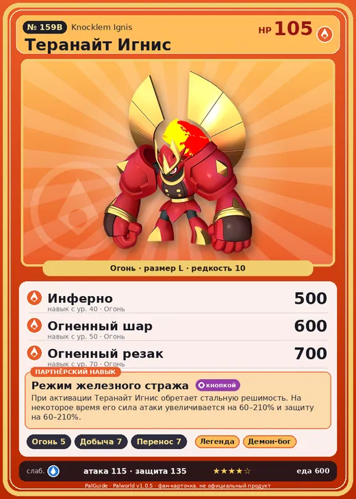

# Теранайт Игнис

<canvas id="fx"></canvas>

№ 159B · Knocklem Ignis

Огонь

Слабость: Вода

🔥 Разжигание огня <b>5</b>⛏️ Добыча <b>7</b>📦 Транспортировка <b>7</b>

<b>Режим железного стража</b> 🔘 кнопкой

❤️ 105 · ⚔️ 115 · 🛡 135

| Поле | Значение |
|---|---|
| Стихия | Огонь |
| Слабость (кто бьёт сильнее) | Вода |
| Редкость | 10 |
| Размер | L |
| HP / Атака / Защита (база вида) | 105 / 115 / 135 |
| Сколько ест | 600 |
| Цена продажи | 3895 |
| Множитель поимки | ×1 |
| Скорость рывка верхом | 700 |

=== "Обзор"

    #### Работа на базе
    - Разжигание огня — ур. 5
    - Добыча — ур. 7
    - Транспортировка — ур. 7

    #### Партнёрский навык: Режим железного стража
    При активации Теранайт Игнис обретает стальную решимость. На некоторое время его сила атаки увеличивается на 60–210% и защиту на 60–210%.

    #### Чем хорош / чем плох
    - ✅ хорошая атака (115); крепкая защита (135); отличный рабочий (пригодность 7)
    - ❌ много ест (600); разводится только особой парой

    > Загадочный Пал, который даже после разборки спокойно начинает двигаться, если собрать снова. Если смешать детали разных особей, в мышлении возникает критическая ошибка, что приводит к перегреву.

    См. также: [Стихии](../../guide/06_stihii.md) · [Разведение](../../guide/07_razvedenie.md) · [Все палы](README.md)

=== "Атаки"

    #### Атаки по уровням
    - ур. 1: Огненная стрела (Огонь, сила 120)
    - ур. 7: Огненный шторм (Огонь, сила 200)
    - ур. 15: Огненная стена (Огонь, сила 250)
    - ур. 22: Огненная воронка (Огонь, сила 300)
    - ур. 30: Вулканический дождь (Огонь, сила 450)
    - ур. 40: Инферно (Огонь, сила 500)
    - ур. 50: Огненный шар (Огонь, сила 600)
    - ур. 70: Огненный резак (Огонь, сила 700)

=== "Где живёт"

    #### Где водится
    - В дикой природе: да; точек появления днём: 36, ночью: 36
    - Яйцо: Огромное раскалённое яйцо

=== "Дроп"

    #### Дроп
    - Металлическая руда — 2–3 шт., 100%
    - Огненный орган — 2–3 шт., 100%

    **Дроп альфы:**
    - Деталь древней цивилизации — 4–6 шт., 100%
    - Ценные внутренности — 2–3 шт., 100%

=== "Разведение"

    #### Разведение
    - Ранг разведения (CombiRank): 210
    - **Особая пара:** [Теранайт](../../4_spravochniki/paly/knocklem.md) + [Рагнахавк](../../4_spravochniki/paly/ragnahawk.md)

=== "Пассивки"

    #### Лучшие пассивки по роли

    

⚔️ Боец

максимум урона и живучести в бою

<a class="psv r-4" data-psv="Легенда" href="../../../passivki/legend/">Легенда</a><a class="psv r-4" data-psv="Демон-бог" href="../../../passivki/demon_god/">Демон-бог</a><a class="psv r-3" data-psv="Император огня" href="../../../passivki/flame_emperor/">Император огня</a><a class="psv r-3" data-psv="Хладнокровный" href="../../../passivki/serenity/">Хладнокровный</a>

🛠 Рабочий

работает быстрее и меньше устаёт на базе

<a class="psv r-5" data-psv="Дьявольские руки" href="../../../passivki/demons_hand/">Дьявольские руки</a><a class="psv r-4" data-psv="Виртуоз" href="../../../passivki/remarkable_craftsmanship/">Виртуоз</a><a class="psv r-3" data-psv="Мастеровитый" href="../../../passivki/artisan/">Мастеровитый</a><a class="psv r-3" data-psv="Трудоголик" href="../../../passivki/workaholic/">Трудоголик</a>

    <small>Нажми на пассивку, чтобы узнать, что она даёт и где её взять.</small>

<a class="card-link" href="../knocklem/">← Теранайт</a><a class="card-link" href="../silvegis/">Силвегис →</a>

