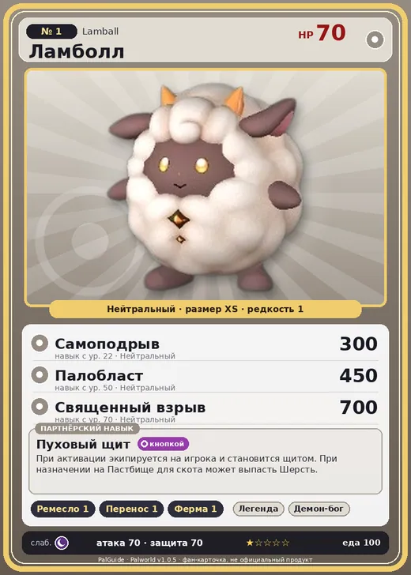

# #1 Ламболл (Lamball)

№ 1

Нейтральный

Слабость: Тьма

🖐️ Ручная работа <b>1</b>📦 Транспортировка <b>1</b>🐑 Фермерство <b>1</b>

<b>Пуховый щит</b> 🔘 кнопкой 🏠 на базе

❤️ 70 · ⚔️ 70 · 🛡 70

| Поле | Значение |
|---|---|
| Стихия | Нейтральный |
| Слабость (кто бьёт сильнее) | Тьма |
| Редкость | 1 |
| Размер | XS |
| HP / Атака / Защита (база вида) | 70 / 70 / 70 |
| Сколько ест | 100 |
| Цена продажи | 421 |
| Множитель поимки | ×1.5 |
| Скорость рывка верхом | 550 |

=== "Обзор"

    #### Работа на базе
    - Ручная работа — ур. 1
    - Транспортировка — ур. 1
    - Фермерство — ур. 1

    #### Партнёрский навык: Пуховый щит
    При активации экипируется на игрока и становится щитом. При назначении на Пастбище для скота может выпасть Шерсть.

    #### Чем хорош / чем плох
    - ✅ Шерсть на пастбище, ранний щит
    - ❌ Слабый; слабая атака (70)

    > Если дорога ведет под горку, этот Пал начинает катиться вниз. Головокружение парализует его, лишая возможности двигаться, превращая в лёгкую добычу. Он занимает самое низкое положение в пищевой цепи.

    См. также: [Стихии](../../guide/06_stihii.md) · [Разведение](../../guide/07_razvedenie.md) · [Все палы](README.md)

=== "Атаки"

    #### Атаки по уровням
    - ур. 1: Мокобок (Нейтральный, сила 40)
    - ур. 7: Воздушная пушка (Нейтральный, сила 40)
    - ур. 15: Силовой выстрел (Нейтральный, сила 80)
    - ур. 22: Самоподрыв (Нейтральный, сила 300)
    - ур. 30: Шаровая молния (Молния, сила 100)
    - ур. 40: Силовая бомба (Нейтральный, сила 120)
    - ур. 50: Палобласт (Нейтральный, сила 450)
    - ур. 70: Священный взрыв (Нейтральный, сила 700)

=== "Где живёт"

    #### Где водится
    - В дикой природе: да; точек появления днём: 351, ночью: 351; уровни в первых точках: 1–3
    - Подземелья: Пещера Отдалённого Острова, Пещера Холмов
    - Может продаваться у торговца/рекрутера
    - Яйцо: Обычное яйцо

=== "Дроп"

    #### Дроп
    - Шерсть — 1–3 шт., 100%
    - Мясо Ламболла — 1 шт., 100%

    **Дроп альфы:**
    - Деталь древней цивилизации — 1–2 шт., 100%
    - Ценный мех — 1–2 шт., 100%

=== "Разведение"

    #### Разведение
    - Ранг разведения (CombiRank): 3050

=== "Пассивки"

    #### Лучшие пассивки по роли

    

⚔️ Боец

максимум урона и живучести в бою

<a class="psv r-4" data-psv="Легенда" href="../../../passivki/legend/">Легенда</a><a class="psv r-4" data-psv="Демон-бог" href="../../../passivki/demon_god/">Демон-бог</a><a class="psv r-3" data-psv="Святое небо" href="../../../passivki/celestial_emperor/">Святое небо</a><a class="psv r-3" data-psv="Хладнокровный" href="../../../passivki/serenity/">Хладнокровный</a>

    <small>Нажми на пассивку, чтобы узнать, что она даёт и где её взять.</small>

<a class="card-link" href="../cattiva/">Каттива →</a>

