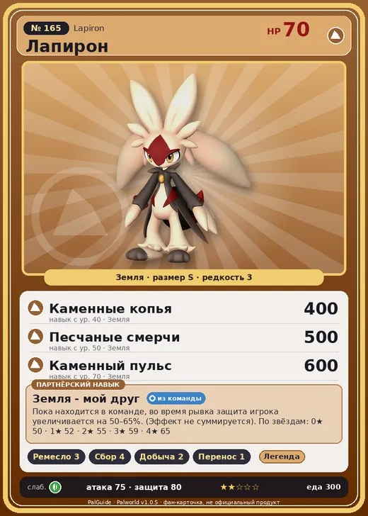

# #165 Лапирон (Lapiron)

#165 · Lapiron

Земля

Слабость: Трава

🖐️ Ручная работа <b>3</b>🌾 Сбор <b>4</b>⛏️ Добыча <b>2</b>📦 Транспортировка <b>1</b>

<b>Земля - мой друг</b> 🎒 из команды

❤️ 70 · ⚔️ 75 · 🛡 80

| Поле | Значение |
|---|---|
| Стихия | Земля |
| Слабость (кто бьёт сильнее) | Трава |
| Редкость | 3 |
| Размер | S |
| HP / Атака / Защита (база вида) | 70 / 75 / 80 |
| Сколько ест | 300 |
| Цена продажи | 777 |
| Множитель поимки | ×1 |
| Скорость рывка верхом | 720 |

## Работа на базе
- Ручная работа — ур. 3
- Сбор — ур. 4
- Добыча — ур. 2
- Транспортировка — ур. 1

## Партнёрский навык: Земля - мой друг
Пока находится в команде, во время рывка защита игрока увеличивается на (50~65)% . (Эффект не суммируется) level value 1 DashDefence_PartnerSkill_BrownRabbit 50 2 DashDefence_PartnerSkill_BrownRabbit 52 3 DashDefence_PartnerSkill_BrownRabbit 55 4 DashDefence_PartnerSkill_BrownRabbit 59 5 DashDefence_PartnerSkill_BrownRabbit 65

## Атаки по уровням
- ур. 1: Грязевой выстрел (Земля, сила 40)
- ур. 7: Каменный залп (Земля, сила 80)
- ур. 15: Камнемёт (Земля, сила 120)
- ур. 22: Песчаный вихрь (Земля, сила 200)
- ур. 30: Камнепад (Земля, сила 300)
- ур. 40: Каменные копья (Земля, сила 400)
- ур. 50: Песчаные смерчи (Земля, сила 500)
- ур. 70: Каменный пульс (Земля, сила 600)

## Где водится
- В дикой природе: да; точек появления днём: 37, ночью: 37
- Яйцо: Яйцо земли

## Дроп
- Кожа — 1–2 шт., 100%

**Дроп альфы:**
- Деталь древней цивилизации — 2–3 шт., 100%
- Ценный мех — 2–3 шт., 100%

## Разведение
- Ранг разведения (CombiRank): 1680

## Лучшие пассивки по роли
- боец: Легенда, Демон-бог, Хладнокровный, Бессмертие, Император земли (вместо Бессмертия, если нет мутации)
- рабочий: Дьявольские руки, Виртуоз, Мастеровитый, Небожитель/Трудоголик
- ездовой: Божественная скорость, Легенда, Вечный двигатель, Небесное скольжение

## Чем хорош / чем плох
- ✅ можно оседлать
- ❌ слабая атака (75)

> Прислушивается к голосу земли и, избегая неустойчивой почвы, бежит вперёд. Но если с почвой не ладит, часто теряет равновесие и падает.

См. также: [Стихии](../../guide/06_stihii.md) · [Разведение](../../guide/07_razvedenie.md) · [Все палы](README.md)
