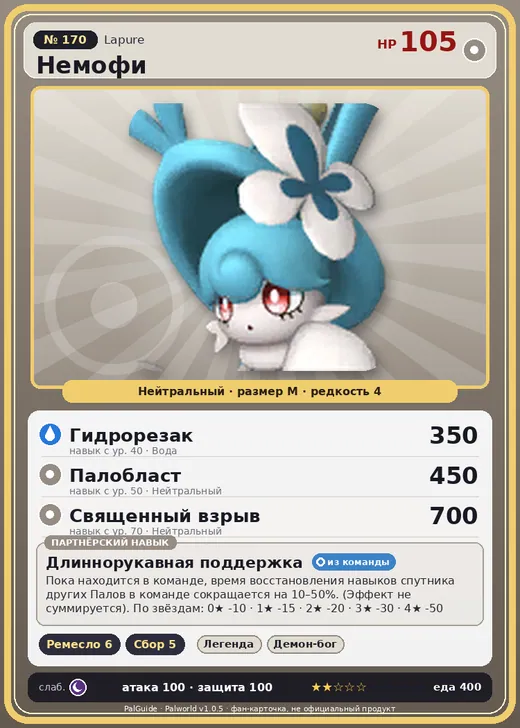

# #170 Немофи (Lapure)

№ 170

Нейтральный

Слабость: Тьма

🖐️ Ручная работа <b>6</b>🌾 Сбор <b>5</b>

<b>Длиннорукавная поддержка</b> 🎒 из команды

❤️ 105 · ⚔️ 100 · 🛡 100

| Поле | Значение |
|---|---|
| Стихия | Нейтральный |
| Слабость (кто бьёт сильнее) | Тьма |
| Редкость | 4 |
| Размер | M |
| HP / Атака / Защита (база вида) | 105 / 100 / 100 |
| Сколько ест | 400 |
| Цена продажи | 2464 |
| Множитель поимки | ×1 |
| Скорость рывка верхом | 700 |

## Работа на базе
- Ручная работа — ур. 6
- Сбор — ур. 5

## Партнёрский навык: Длиннорукавная поддержка
Пока находится в команде, время восстановления навыков спутника других Палов в команде сокращается на (10~50)% . (Эффект не суммируется) level value 1 PartnerSkillCoolTime_Decrease -10 2 PartnerSkillCoolTime_Decrease -15 3 PartnerSkillCoolTime_Decrease -20 4 PartnerSkillCoolTime_Decrease -30 5 PartnerSkillCoolTime_Decrease -50

## Атаки по уровням
- ур. 1: Силовой выстрел (Нейтральный, сила 80)
- ур. 7: Пузырьковый выстрел (Вода, сила 80)
- ур. 15: Силовая бомба (Нейтральный, сила 120)
- ур. 22: Воздушные клинки (Нейтральный, сила 160)
- ур. 30: Водяная стена (Вода, сила 300)
- ур. 40: Гидрорезак (Вода, сила 350)
- ур. 50: Палобласт (Нейтральный, сила 450)
- ур. 70: Священный взрыв (Нейтральный, сила 700)

## Где водится
- В дикой природе: да; точек появления днём: 30, ночью: 30
- Яйцо: Обычное яйцо

## Дроп
- Кожа — 2–3 шт., 100%

**Дроп альфы:**
- Деталь древней цивилизации — 2–3 шт., 100%
- Ценный мех — 2–3 шт., 100%

## Разведение
- Ранг разведения (CombiRank): 810
- Участвует в особых парах: Сибеликс → Сибеликс Примо

## Лучшие пассивки по роли
- боец: Легенда, Демон-бог, Хладнокровный, Бессмертие, Святое небо (вместо Бессмертия, если нет мутации)
- рабочий: Дьявольские руки, Виртуоз, Мастеровитый, Небожитель/Трудоголик
- ездовой: Божественная скорость, Легенда, Вечный двигатель, Небесное скольжение

## Чем хорош / чем плох
- ✅ хорошая атака (100); отличный рабочий (пригодность 6); можно оседлать
- ❌ явных минусов нет

> Длинную шерсть на кончиках лап использует для демонстрации. Чувствителен к грязи и тщательно за ней ухаживает. Если рядом поднять пыль, лицо становится крайне недовольным.

См. также: [Стихии](../../guide/06_stihii.md) · [Разведение](../../guide/07_razvedenie.md) · [Все палы](README.md)
