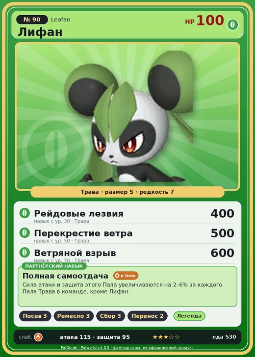

# #90 Лифан (Leafan)

№ 90

Трава

Слабость: Огонь

🌱 Посев семян <b>3</b>🖐️ Ручная работа <b>3</b>🌾 Сбор <b>3</b>📦 Транспортировка <b>2</b>

<b>Полная самоотдача</b> 🐾 выпущен

❤️ 100 · ⚔️ 115 · 🛡 95

| Поле | Значение |
|---|---|
| Стихия | Трава |
| Слабость (кто бьёт сильнее) | Огонь |
| Редкость | 7 |
| Размер | S |
| HP / Атака / Защита (база вида) | 100 / 115 / 95 |
| Сколько ест | 530 |
| Цена продажи | 1806 |
| Множитель поимки | ×1 |
| Скорость рывка верхом | 750 |

=== "Обзор"

    #### Работа на базе
    - Посев семян — ур. 3
    - Ручная работа — ур. 3
    - Сбор — ур. 3
    - Транспортировка — ур. 2

    #### Партнёрский навык: Полная самоотдача
    Сила атаки и защита этого Пала увеличиваются на (2~6)% за каждого Пала Трава в команде, кроме Лифан . level value 1 ShotAttack_Defence_PartnerSkill_SpecificElement 2, 2 2 ShotAttack_Defence_PartnerSkill_SpecificElement 3, 3 3 ShotAttack_Defence_PartnerSkill_SpecificElement 4, 4 4 ShotAttack_Defence_PartnerSkill_SpecificElement 5, 5 5 ShotAttack_Defence_PartnerSkill_SpecificElement 6, 6

    #### Чем хорош / чем плох
    - ✅ хорошая атака (115); можно оседлать
    - ❌ много ест (530)

    > Чтобы отточить боевое искусство, передаваемое единственному наследнику, только ежедневные тренировки! Терять голову из-за любви — недопустимо! Только ежедневная практика! Но час настал! В атаку на ту, что не даёт покоя! Итог — одно разбитое сердце! Техники любви не передаются по наследству! Остаётся лишь сожаление!

    См. также: [Стихии](../../guide/06_stihii.md) · [Разведение](../../guide/07_razvedenie.md) · [Все палы](README.md)

=== "Атаки"

    #### Атаки по уровням
    - ур. 1: Семенной пулемёт (Трава, сила 80)
    - ур. 7: Мультиклинок (Трава, сила 160)
    - ур. 15: Веер клинков (Трава, сила 200)
    - ур. 22: Круговые удары ногой (Трава, сила 250)
    - ур. 30: Рейдовые лезвия (Трава, сила 400)
    - ур. 40: Отражающий лист (Трава, сила 400)
    - ур. 50: Перекрестие ветра (Трава, сила 500)
    - ур. 70: Ветряной взрыв (Трава, сила 600)

=== "Где живёт"

    #### Где водится
    - В дикой природе: да; точек появления днём: 105, ночью: 105
    - Яйцо: Большое яйцо свежей листвы

=== "Дроп"

    #### Дроп
    - Кожа — 2–3 шт., 100%

    **Дроп альфы:**
    - Деталь древней цивилизации — 2–3 шт., 100%
    - Ценные внутренности — 2–3 шт., 100%

=== "Разведение"

    #### Разведение
    - Ранг разведения (CombiRank): 1410

=== "Пассивки"

    #### Лучшие пассивки по роли
    - боец: Легенда, Демон-бог, Хладнокровный, Бессмертие, Король духов (вместо Бессмертия, если нет мутации)
    - рабочий: Дьявольские руки, Виртуоз, Мастеровитый, Небожитель/Трудоголик
    - ездовой: Божественная скорость, Легенда, Вечный двигатель, Небесное скольжение

<a class="card-link" href="../petallia_ignis/">← Петаллия Игнис</a><a class="card-link" href="../incineram/">Инсинерам →</a>

