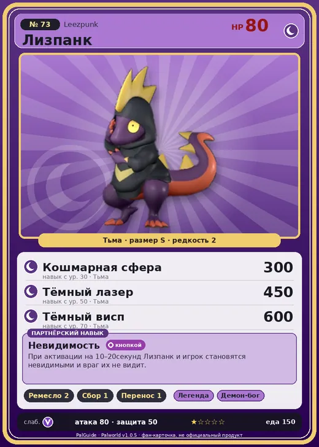

# Лизпанк

<canvas id="fx"></canvas>

№ 73 · Leezpunk

Тьма

Слабость: Дракон

🖐️ Ручная работа <b>2</b>🌾 Сбор <b>1</b>📦 Транспортировка <b>1</b>

<b>Невидимость</b> 🔘 кнопкой

❤️ 80 · ⚔️ 80 · 🛡 50

| Поле | Значение |
|---|---|
| Стихия | Тьма |
| Слабость (кто бьёт сильнее) | Дракон |
| Редкость | 2 |
| Размер | S |
| HP / Атака / Защита (база вида) | 80 / 80 / 50 |
| Сколько ест | 150 |
| Цена продажи | 476 |
| Множитель поимки | ×1 |
| Скорость рывка верхом | 800 |

=== "Обзор"

    #### Работа на базе
    - Ручная работа — ур. 2
    - Сбор — ур. 1
    - Транспортировка — ур. 1

    #### Партнёрский навык: Невидимость
    При активации на 10–20секунд Лизпанк и игрок становятся невидимыми и враг их не видит.

    #### Чем хорош / чем плох
    - ✅
    - ❌ явных минусов нет

    > Этот Пал зациклен на том, как он стоит. Он бесконечно оттачивает крутую позу, а если дать ему зеркало — будет позировать перед ним целый день.

    См. также: [Стихии](../../guide/06_stihii.md) · [Разведение](../../guide/07_razvedenie.md) · [Все палы](README.md)

=== "Атаки"

    #### Атаки по уровням
    - ур. 1: Ядовитый выстрел (Тьма, сила 30)
    - ур. 7: Тёмный шар (Тьма, сила 50)
    - ур. 15: Теневой взрыв (Тьма, сила 80)
    - ур. 22: Духовное пламя (Тьма, сила 200)
    - ур. 30: Кошмарная сфера (Тьма, сила 300)
    - ур. 40: Огненное дыхание (Огонь, сила 160)
    - ур. 50: Тёмный лазер (Тьма, сила 450)
    - ур. 70: Тёмный висп (Тьма, сила 600)

=== "Где живёт"

    #### Где водится
    - В дикой природе: да; точек появления днём: 176, ночью: 854; уровни в первых точках: 21–23
    - Подземелья: Пещера Вулкана, Пещера Песчаных Дюн
    - Может продаваться у торговца/рекрутера
    - Яйцо: Яйцо тьмы

=== "Дроп"

    #### Дроп
    - Бронзовый ключ — 1 шт., 100%
    - Серебряный ключ — 1 шт., 1%
    - Гребень Лизпанка — 1 шт., 50%

    **Дроп альфы:**
    - Деталь древней цивилизации — 1–2 шт., 100%
    - Серебряный ключ — 1 шт., 2%
    - Ценные внутренности — 1–2 шт., 100%

=== "Разведение"

    #### Разведение
    - Ранг разведения (CombiRank): 2670
    - Участвует в особых парах: Фламбелль → Лизпанк Игнис

=== "Пассивки"

    #### Лучшие пассивки по роли

    

⚔️ Боец

максимум урона и живучести в бою

<a class="psv r-4" data-psv="Легенда" href="../../../passivki/legend/">Легенда</a><a class="psv r-4" data-psv="Демон-бог" href="../../../passivki/demon_god/">Демон-бог</a><a class="psv r-3" data-psv="Король тьмы" href="../../../passivki/lord_of_the_underworld/">Король тьмы</a><a class="psv r-3" data-psv="Хладнокровный" href="../../../passivki/serenity/">Хладнокровный</a>

    <small>Нажми на пассивку, чтобы узнать, что она даёт и где её взять.</small>

<a class="card-link" href="../polapup_terra/">← Полапап Терра</a><a class="card-link" href="../leezpunk_ignis/">Лизпанк Игнис →</a>

