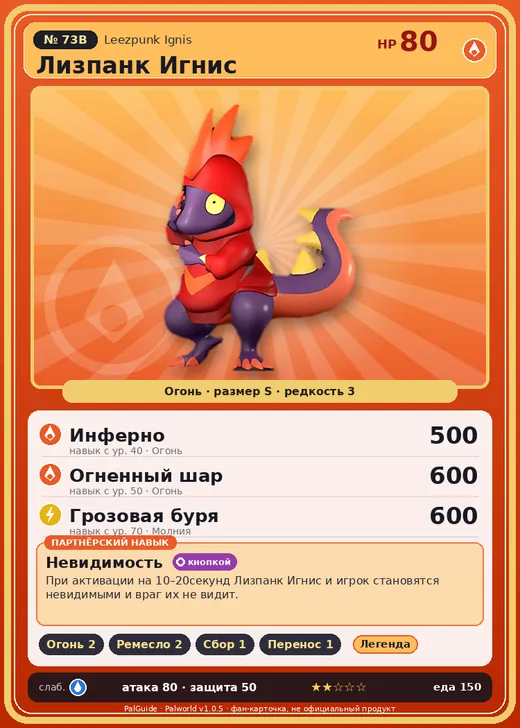

# #73B Лизпанк Игнис (Leezpunk Ignis)

#73B · Leezpunk Ignis

Огонь

Слабость: Вода

🔥 Разжигание огня <b>2</b>🖐️ Ручная работа <b>2</b>🌾 Сбор <b>1</b>📦 Транспортировка <b>1</b>

<b>Невидимость</b> 🔘 кнопкой

❤️ 80 · ⚔️ 80 · 🛡 50

| Поле | Значение |
|---|---|
| Стихия | Огонь |
| Слабость (кто бьёт сильнее) | Вода |
| Редкость | 3 |
| Размер | S |
| HP / Атака / Защита (база вида) | 80 / 80 / 50 |
| Сколько ест | 150 |
| Цена продажи | 493 |
| Множитель поимки | ×1 |
| Скорость рывка верхом | 550 |

## Работа на базе
- Разжигание огня — ур. 2
- Ручная работа — ур. 2
- Сбор — ур. 1
- Транспортировка — ур. 1

## Партнёрский навык: Невидимость
При активации на (10~20) секунд Лизпанк Игнис и игрок становятся невидимыми и враг их не видит. level value 1 OverWriteCoolTime 30 OverWriteEffectTime 10 Пробуждение : 2 OverWriteCoolTime 25 OverWriteEffectTime 12 Пробуждение : (Сокращение перезарядки: Небольшое ) 3 OverWriteCoolTime 20 OverWriteEffectTime 14 Пробуждение : (Сокращение перезарядки: Среднее ) 4 OverWriteCoolTime 15 OverWriteEffectTime 16 Пробуждение : (Сокращение перезарядки: Большое ) 5 OverWriteCoolTime 8 OverWriteEffectTime 20 Пробуждение : (Сокращение перезарядки: Очень большое )

## Атаки по уровням
- ур. 1: Огненный выстрел (Огонь, сила 40)
- ур. 7: Ядовитый выстрел (Тьма, сила 30)
- ур. 15: Расщеплённый огонь (Огонь, сила 80)
- ур. 22: Огненное дыхание (Огонь, сила 160)
- ур. 30: Огненный шторм (Огонь, сила 200)
- ур. 40: Инферно (Огонь, сила 500)
- ур. 50: Огненный шар (Огонь, сила 600)
- ур. 70: Грозовая буря (Молния, сила 600)

## Где водится
- В дикой природе: да; точек появления днём: 51, ночью: 51; уровни в первых точках: 28–30
- Подземелья: Пещера Вулкана
- Может продаваться у торговца/рекрутера
- Яйцо: Раскалённое яйцо

## Дроп
- Огненный орган — 1–2 шт., 100%
- Серебряный ключ — 1 шт., 2%
- Гребень Лизпанка — 1 шт., 50%

**Дроп альфы:**
- Деталь древней цивилизации — 1–2 шт., 100%
- Серебряный ключ — 1 шт., 2%
- Ценные внутренности — 1–2 шт., 100%

## Разведение
- Ранг разведения (CombiRank): 2640
- **Особая пара:** [Лизпанк](../../4_spravochniki/paly/leezpunk.md) + [Фламбелль](../../4_spravochniki/paly/flambelle.md)

## Лучшие пассивки по роли
- боец: Легенда, Демон-бог, Хладнокровный, Бессмертие, Император огня (вместо Бессмертия, если нет мутации)
- ездовой: Божественная скорость, Легенда, Вечный двигатель, Небесное скольжение

## Чем хорош / чем плох
- ✅ можно оседлать
- ❌ разводится только особой парой

> Этот Пал зациклен на том, как он стоит. Он бесконечно оттачивает горячую позу, и весь день устраивает перед хозяином пафосное шоу.

См. также: [Стихии](../../2_mehaniki/stihii.md) · [Разведение](../../2_mehaniki/razvedenie.md) · [Все палы](README.md)
