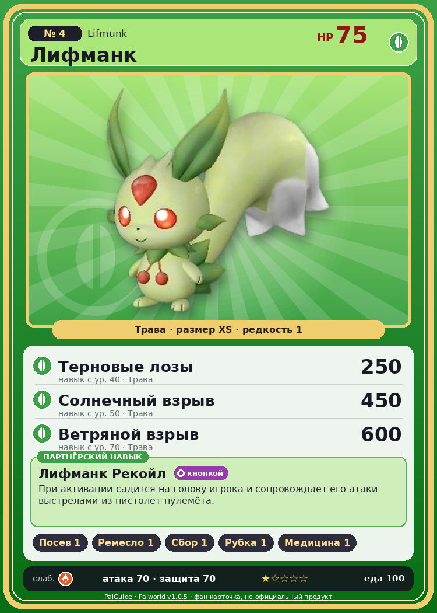

# #4 Лифманк (Lifmunk)

{ width=360 }

| Поле | Значение |
|---|---|
| Стихия | Трава |
| Слабость (кто бьёт сильнее) | Огонь |
| Редкость | 1 |
| Размер | XS |
| HP / Атака / Защита (база вида) | 75 / 70 / 70 |
| Сколько ест | 100 |
| Цена продажи | 480 |
| Множитель поимки | ×0.9 |
| Скорость рывка верхом | 550 |

## Работа на базе
- Посев семян — ур. 1
- Ручная работа — ур. 1
- Сбор — ур. 1
- Рубка деревьев — ур. 1
- Фармацевтика — ур. 1

## Партнёрский навык: Лифманк Рекойл
При активации садится на голову игрока и сопровождает его атаки выстрелами из пистолет-пулемёта. Технологии 11 level value 1 MainValue 15 Пробуждение : 2 MainValue 16 Пробуждение : (Увеличение урона: Небольшое ) 3 MainValue 18 Пробуждение : (Увеличение урона: Среднее ) 4 MainValue 21 Пробуждение : (Увеличение урона: Большое ) 5 MainValue 25 Пробуждение : (Увеличение урона: Очень большое )

## Атаки по уровням
- ур. 1: Ветряной клинок (Трава, сила 40)
- ур. 7: Воздушная пушка (Нейтральный, сила 40)
- ур. 15: Силовой выстрел (Нейтральный, сила 80)
- ур. 22: Семенной пулемёт (Трава, сила 80)
- ур. 30: Силовая бомба (Нейтральный, сила 120)
- ур. 40: Терновые лозы (Трава, сила 250)
- ур. 50: Солнечный взрыв (Трава, сила 450)
- ур. 70: Ветряной взрыв (Трава, сила 600)

## Где водится
- В дикой природе: да; точек появления днём: 213, ночью: 213; уровни в первых точках: 1–3
- Подземелья: Пещера Отдалённого Острова, Пещера Холмов
- Может продаваться у торговца/рекрутера
- Яйцо: Яйцо свежей листвы

## Дроп
- Семена пшеницы — 1 шт., 100%
- Медикаменты низкого качества — 1 шт., 20%

**Дроп альфы:**
- Деталь древней цивилизации — 1–2 шт., 100%
- Ценный мех — 1–2 шт., 100%

## Разведение
- Ранг разведения (CombiRank): 3020

## Лучшие пассивки по роли
- боец: Легенда, Демон-бог, Хладнокровный, Бессмертие, Король духов (вместо Бессмертия, если нет мутации)
- ездовой: Божественная скорость, Легенда, Вечный двигатель, Небесное скольжение

## Чем хорош / чем плох
- ✅ можно оседлать
- ❌ слабая атака (70)

> Его интеллект соответствует уровню 5-7 лет. Подходит для роли партнера, но были зафиксированы случаи, когда особи, обученные обращаться с оружием, убивали своих хозяев.

См. также: [Стихии](../../2_mehaniki/stihii.md) · [Разведение](../../2_mehaniki/razvedenie.md) · [Все палы](README.md)
_Источник: paldb.cc v1.0.5_
