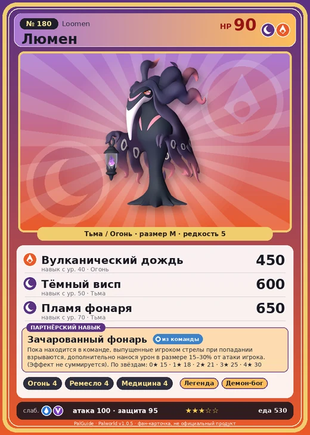

# #180 Люмен (Loomen)

№ 180

ТьмаОгонь

Слабость: ВодаДракон

🔥 Разжигание огня <b>4</b>🖐️ Ручная работа <b>4</b>💊 Фармацевтика <b>4</b>

<b>Зачарованный фонарь</b> 🎒 из команды

❤️ 90 · ⚔️ 100 · 🛡 95

| Поле | Значение |
|---|---|
| Стихия | Тьма, Огонь |
| Слабость (кто бьёт сильнее) | Вода, Дракон |
| Редкость | 5 |
| Размер | M |
| HP / Атака / Защита (база вида) | 90 / 100 / 95 |
| Сколько ест | 530 |
| Цена продажи | 2309 |
| Множитель поимки | ×1 |
| Скорость рывка верхом | 450 |

## Работа на базе
- Разжигание огня — ур. 4
- Ручная работа — ур. 4
- Фармацевтика — ур. 4

## Партнёрский навык: Зачарованный фонарь
Пока находится в команде, выпущенные игроком стрелы при попадании взрываются , дополнительно нанося урон в размере (15~30)% от атаки игрока. (Эффект не суммируется) level value 1 LanternButler_PartnerSkill 15 2 LanternButler_PartnerSkill 18 3 LanternButler_PartnerSkill 21 4 LanternButler_PartnerSkill 25 5 LanternButler_PartnerSkill 30

## Атаки по уровням
- ур. 1: Тёмный шар (Тьма, сила 50)
- ур. 7: Расщеплённый огонь (Огонь, сила 80)
- ур. 15: Духовное пламя (Тьма, сила 200)
- ур. 22: Кошмарная сфера (Тьма, сила 300)
- ур. 30: Огненная воронка (Огонь, сила 300)
- ур. 40: Вулканический дождь (Огонь, сила 450)
- ур. 50: Тёмный висп (Тьма, сила 600)
- ур. 70: Пламя фонаря (Тьма, сила 650)

## Где водится
- В дикой природе: нет/особый способ; точек появления днём: 0, ночью: 0
- Яйцо: Большое яйцо тьмы

## Дроп
- Качественное масло Пала — 2–3 шт., 100%
- Кожа — 2–3 шт., 100%
- Ядовитая железа — 2 шт., 100%

**Дроп альфы:**
- Деталь древней цивилизации — 2–3 шт., 100%
- Ценные внутренности — 2–3 шт., 100%

## Разведение
- Ранг разведения (CombiRank): 890

## Лучшие пассивки по роли
- боец: Легенда, Демон-бог, Хладнокровный, Бессмертие, Король тьмы (вместо Бессмертия, если нет мутации)
- рабочий: Дьявольские руки, Виртуоз, Мастеровитый, Небожитель/Трудоголик
- ездовой: Божественная скорость, Легенда, Вечный двигатель, Небесное скольжение

## Чем хорош / чем плох
- ✅ хорошая атака (100); можно оседлать
- ❌ много ест (530)

> Таинственно светящийся фонарь выявляет истинную суть мира. Если его свет кажется ослепляющим, вероятно, на душе есть что-то тёмное.

См. также: [Стихии](../../guide/06_stihii.md) · [Разведение](../../guide/07_razvedenie.md) · [Все палы](README.md)
