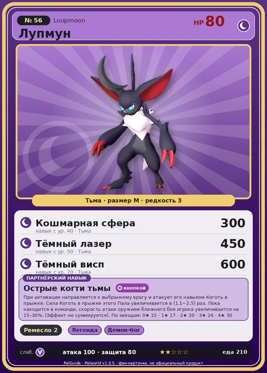

# #56 Лупмун (Loupmoon)

#56 · Loupmoon

Тьма

Слабость: Дракон

🖐️ Ручная работа <b>2</b>

<b>Острые когти тьмы</b> 🎒 из команды 🐾 выпущен 🔘 кнопкой

❤️ 80 · ⚔️ 100 · 🛡 80

| Поле | Значение |
|---|---|
| Стихия | Тьма |
| Слабость (кто бьёт сильнее) | Дракон |
| Редкость | 3 |
| Размер | M |
| HP / Атака / Защита (база вида) | 80 / 100 / 80 |
| Сколько ест | 210 |
| Цена продажи | 842 |
| Множитель поимки | ×1 |
| Скорость рывка верхом | 800 |

## Работа на базе
- Ручная работа — ур. 2

## Партнёрский навык: Острые когти тьмы
При активации направляется к выбранному врагу и атакует его навыком Коготь в прыжке . Сила Коготь в прыжке этого Пала увеличивается в (1.1~2.5) раз . Пока находится в команде, скорость атаки оружием ближнего боя игрока увеличивается на (15~30)% . (Эффект не суммируется) level value 1 AttackSpeedUp_PartnerSkill_Werewolf 15 MainValue 1.1 2 AttackSpeedUp_PartnerSkill_Werewolf 17 MainValue 1.3 3 AttackSpeedUp_PartnerSkill_Werewolf 20 MainValue 1.6 4 AttackSpeedUp_PartnerSkill_Werewolf 24 MainValue 2 5 AttackSpeedUp_PartnerSkill_Werewolf 30 MainValue 2.5

## Атаки по уровням
- ур. 1: Тёмный шар (Тьма, сила 50)
- ур. 7: Коготь в прыжке (Тьма, сила 80)
- ур. 15: Теневой взрыв (Тьма, сила 80)
- ур. 22: Ледяной резак (Лёд, сила 80)
- ур. 30: Духовное пламя (Тьма, сила 200)
- ур. 40: Кошмарная сфера (Тьма, сила 300)
- ур. 50: Тёмный лазер (Тьма, сила 450)
- ур. 70: Тёмный висп (Тьма, сила 600)

## Где водится
- В дикой природе: да; точек появления днём: 1, ночью: 1111; уровни в первых точках: 14–16
- Подземелья: Пещера Горного Потока
- Яйцо: Яйцо тьмы

## Дроп
- Кость — 1 шт., 100%

**Дроп альфы:**
- Деталь древней цивилизации — 1–3 шт., 100%
- Ценный коготь — 1–3 шт., 100%

## Разведение
- Ранг разведения (CombiRank): 2110
- Участвует в особых парах: Свипа → Лупмун Крист

## Лучшие пассивки по роли
- боец: Легенда, Демон-бог, Хладнокровный, Бессмертие, Король тьмы (вместо Бессмертия, если нет мутации)
- ездовой: Божественная скорость, Легенда, Вечный двигатель, Небесное скольжение

## Чем хорош / чем плох
- ✅ хорошая атака (100); можно оседлать
- ❌ явных минусов нет

> Рог на его голове растёт под лунным светом. Солнце ему не вредит, но на солнце рог слегка зудит.

См. также: [Стихии](../../2_mehaniki/stihii.md) · [Разведение](../../2_mehaniki/razvedenie.md) · [Все палы](README.md)
