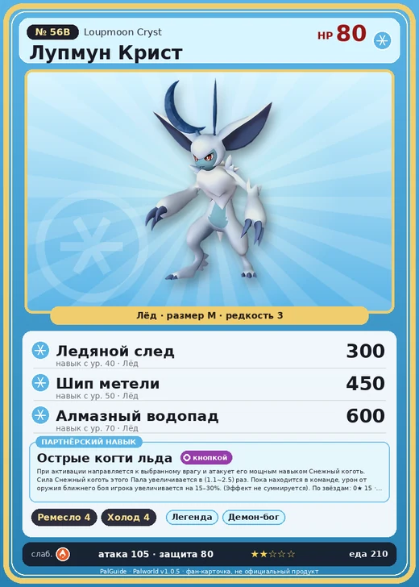

# #56B Лупмун Крист (Loupmoon Cryst)

№ 56B

Лёд

Слабость: Огонь

🖐️ Ручная работа <b>4</b>❄️ Охлаждение <b>4</b>

<b>Острые когти льда</b> 🎒 из команды 🐾 выпущен 🔘 кнопкой

❤️ 80 · ⚔️ 105 · 🛡 80

| Поле | Значение |
|---|---|
| Стихия | Лёд |
| Слабость (кто бьёт сильнее) | Огонь |
| Редкость | 3 |
| Размер | M |
| HP / Атака / Защита (база вида) | 80 / 105 / 80 |
| Сколько ест | 210 |
| Цена продажи | 1176 |
| Множитель поимки | ×1 |
| Скорость рывка верхом | 800 |

## Работа на базе
- Ручная работа — ур. 4
- Охлаждение — ур. 4

## Партнёрский навык: Острые когти льда
При активации направляется к выбранному врагу и атакует его мощным навыком Снежный коготь . Сила Снежный коготь этого Пала увеличивается в (1.1~2.5) раз . Пока находится в команде, урон от оружия ближнего боя игрока увеличивается на (15~30)% . (Эффект не суммируется) level value 1 AttackSpeedUp_PartnerSkill_Werewolf 15 MainValue 1.1 2 AttackSpeedUp_PartnerSkill_Werewolf 17 MainValue 1.3 3 AttackSpeedUp_PartnerSkill_Werewolf 20 MainValue 1.6 4 AttackSpeedUp_PartnerSkill_Werewolf 24 MainValue 2 5 AttackSpeedUp_PartnerSkill_Werewolf 30 MainValue 2.5

## Атаки по уровням
- ур. 1: Ледяная ракета (Лёд, сила 40)
- ур. 7: Ледяной резак (Лёд, сила 80)
- ур. 15: Снежный коготь (Лёд, сила 160)
- ур. 22: Ледяная стена (Лёд, сила 200)
- ур. 30: Ледяные пули (Лёд, сила 250)
- ур. 40: Ледяной след (Лёд, сила 300)
- ур. 50: Шип метели (Лёд, сила 450)
- ур. 70: Алмазный водопад (Лёд, сила 600)

## Где водится
- В дикой природе: да; точек появления днём: 124, ночью: 463; уровни в первых точках: 40–45
- Подземелья: Пещера Тэнраку
- Яйцо: Яйцо льда

## Дроп
- Кость — 1 шт., 100%

**Дроп альфы:**
- Деталь древней цивилизации — 7–8 шт., 100%
- Ценный коготь — 2–3 шт., 100%

## Разведение
- Ранг разведения (CombiRank): 1290
- **Особая пара:** [Лупмун](../../4_spravochniki/paly/loupmoon.md) + [Свипа](../../4_spravochniki/paly/sweepa.md)

## Лучшие пассивки по роли
- боец: Легенда, Демон-бог, Хладнокровный, Бессмертие, Император льда (вместо Бессмертия, если нет мутации)
- рабочий: Дьявольские руки, Виртуоз, Мастеровитый, Небожитель/Трудоголик
- ездовой: Божественная скорость, Легенда, Вечный двигатель, Небесное скольжение

## Чем хорош / чем плох
- ✅ хорошая атака (105); можно оседлать
- ❌ разводится только особой парой

> Ледяные рога на его голове никогда не тают. Говорят, что колотый лёд из отколовшихся рогов — настоящий деликатес, но потом болит голова и у того, кто его съел, и у самого Лупмун Крист .

См. также: [Стихии](../../guide/06_stihii.md) · [Разведение](../../guide/07_razvedenie.md) · [Все палы](README.md)
