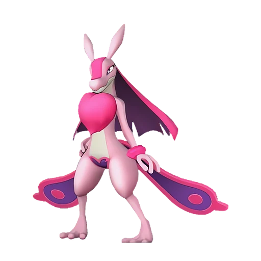

# Ловандер

<canvas id="fx"></canvas>

№ 69

Тьма

Слабость: Дракон <b class="mx">×1,5</b> <button class="hlp" data-tip="Множители перемножаются по обеим стихиям: ×1,5 за стихию, которую атака бьёт, ×0,65 за ту, что её держит.">?</button>

Устойчив: Нейтральный <b class="mx">×0,65</b>

🖐️ Ручная работа <b>3</b>⛏️ Добыча <b>2</b>💊 Фармацевтика <b>3</b>📦 Транспортировка <b>2</b>

<b>Иссушение сердца</b> 🐾 Когда пал выпущен

❤️ 120 · ⚔️ 70 · 🛡 70

Основное

💎Редкость <button class="hlp" data-tip="Чем выше число, тем реже встречается пал. 1–4 — обычные, 5–7 — редкие, 8+ — легендарные.">?</button><b>5</b>

📏Размер<b>L</b>

💰Цена продажи <button class="hlp" data-tip="Сколько золота даст торговец за пала.">?</button><b>1056</b>

Бой

🎯Множитель поимки <button class="hlp" data-tip="Насколько легче или труднее поймать: ×1 — обычно, меньше — сложнее.">?</button><b>×1</b>

🐎Скорость рывка верхом <button class="hlp" data-tip="Скорость, если сесть на пала и бежать рывком.">?</button><b>850</b>

Ферма и еда

🍖Сколько ест <button class="hlp" data-tip="Сколько сытости пал тратит — чем больше, тем больше еды нужно на базе.">?</button><b>280</b>

Разведение

🧬Сила разведения <button class="hlp" data-tip="Скрытое число игры: у детёныша оно примерно среднее от родителей. Чем меньше — тем «сильнее» пал.">?</button><b>2090</b>

=== "Обзор"

    #### Работа на базе

    
<a class="wbar" href="../../../2_mehaniki/rabota/?w=handiwork&lv=3">✋ Ручная работа<i style="--v:30%"></i><b>3</b></a><a class="wbar" href="../../../2_mehaniki/rabota/?w=mining&lv=2">⛏️ Добыча<i style="--v:20%"></i><b>2</b></a><a class="wbar" href="../../../2_mehaniki/rabota/?w=medicine&lv=3">💊 Фармацевтика<i style="--v:30%"></i><b>3</b></a><a class="wbar" href="../../../2_mehaniki/rabota/?w=transporting&lv=2">📦 Транспортировка<i style="--v:20%"></i><b>2</b></a><a class="wb-more" href="../../../2_mehaniki/rabota/">Что значат уровни работы →</a>

    #### Партнёрский навык: Иссушение сердца
    Во время совместного боя игрок и Ловандер получают эффект кражи жизни, восстанавливая HP на 5–9% от нанесённого урона. По звёздам: 0★ 5 · 1★ 6 · 2★ 7 · 3★ 8 · 4★ 9

    #### Чем хорош / чем плох
    - ✅ много здоровья (120)
    - ❌ слабая атака (70)

    > Постоянно преследует кого-то в поисках любви на одну ночь. Поначалу интересовался только Палами, но в последние годы стал тянуть свои нечистые лапы и к людям.

    См. также: [Стихии](../../guide/06_stihii.md) · [Разведение](../../guide/07_razvedenie.md) · [Все палы](README.md)

=== "Атаки"

    #### Атаки по уровням
    - ур. 1: Силовой выстрел (Нейтральный, сила 80)
    - ур. 7: Ядовитый выстрел (Тьма, сила 30)
    - ур. 15: Теневой взрыв (Тьма, сила 80)
    - ур. 22: Кислотный дождь (Вода, сила 120)
    - ур. 30: Силовая бомба (Нейтральный, сила 120)
    - ур. 35: Ядовитый душ (Тьма, сила 160)
    - ур. 40: Самоподрыв (Нейтральный, сила 300)
    - ур. 50: Палобласт (Нейтральный, сила 450)
    - ур. 55: Тёмный лазер (Тьма, сила 450)
    - ур. 70: Тёмный висп (Тьма, сила 600)

=== "Где живёт"

    #### Где водится

    

<button data-k="d" class="on">☀️ День</button><button data-k="n">🌙 Ночь</button>

ур. 30–38<a class="btn hm-full" href="../../../map/?pal=PinkLizard">Показать на большой карте</a>

Иссохшие дюныДюны АнубисаКричащий островШрамы войны

🕳 Подземелье<b>Пещера Песчаных Дюн</b>

🥚 Яйцо<b>Большое яйцо тьмы</b>

🛒 Торговец<b>Продаётся у торговца палами</b>

=== "Дроп"

    #### Дроп
    - Гриб — 2–4 шт., 100%
    - Торт — 1 шт., 1%
    - Подозрительный сок — 1 шт., 1%
    - Странный сок — 1 шт., 1%
    - Снадобье очистки памяти — 1 шт., 1%

    **Дроп альфы:**
    - Деталь древней цивилизации — 2–4 шт., 100%
    - Ценный мех — 2–4 шт., 100%

=== "Разведение"

    #### Разведение
    - Ранг разведения: 2090

=== "Пассивки"

    #### Лучшие пассивки по роли

    

⚔️ Боец

максимум урона и живучести в бою

<a class="psv r-4" data-psv="Легенда" href="../../../passivki/legend/">Легенда</a><a class="psv r-4" data-psv="Демон-бог" href="../../../passivki/demon_god/">Демон-бог</a><a class="psv r-3" data-psv="Король тьмы" href="../../../passivki/lord_of_the_underworld/">Король тьмы</a><a class="psv r-3" data-psv="Хладнокровный" href="../../../passivki/serenity/">Хладнокровный</a>

🛠 Рабочий

работает быстрее и меньше устаёт на базе

<a class="psv r-5" data-psv="Дьявольские руки" href="../../../passivki/demons_hand/">Дьявольские руки</a><a class="psv r-4" data-psv="Виртуоз" href="../../../passivki/remarkable_craftsmanship/">Виртуоз</a><a class="psv r-3" data-psv="Мастеровитый" href="../../../passivki/artisan/">Мастеровитый</a><a class="psv r-3" data-psv="Трудоголик" href="../../../passivki/workaholic/">Трудоголик</a>

    <small>Нажми на пассивку, чтобы узнать, что она даёт и где её взять.</small>

<a class="card-link" href="../elizabee/">← Элизаби</a><a class="card-link" href="../grintale/">Гринтэйл →</a>

