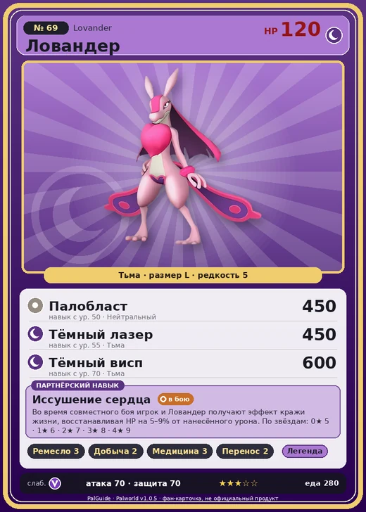

# #69 Ловандер (Lovander)

#69 · Lovander

Тьма

Слабость: Дракон

🖐️ Ручная работа <b>3</b>⛏️ Добыча <b>2</b>💊 Фармацевтика <b>3</b>📦 Транспортировка <b>2</b>

<b>Иссушение сердца</b> 🐾 выпущен

❤️ 120 · ⚔️ 70 · 🛡 70

| Поле | Значение |
|---|---|
| Стихия | Тьма |
| Слабость (кто бьёт сильнее) | Дракон |
| Редкость | 5 |
| Размер | L |
| HP / Атака / Защита (база вида) | 120 / 70 / 70 |
| Сколько ест | 280 |
| Цена продажи | 1056 |
| Множитель поимки | ×1 |
| Скорость рывка верхом | 850 |

## Работа на базе
- Ручная работа — ур. 3
- Добыча — ур. 2
- Фармацевтика — ур. 3
- Транспортировка — ур. 2

## Партнёрский навык: Иссушение сердца
Во время совместного боя игрок и Ловандер получают эффект кражи жизни, восстанавливая HP на (5~9)% от нанесённого урона. level value 1 LifeSteal 5 2 LifeSteal 6 3 LifeSteal 7 4 LifeSteal 8 5 LifeSteal 9

## Атаки по уровням
- ур. 1: Силовой выстрел (Нейтральный, сила 80)
- ур. 7: Ядовитый выстрел (Тьма, сила 30)
- ур. 15: Теневой взрыв (Тьма, сила 80)
- ур. 22: Кислотный дождь (Вода, сила 120)
- ур. 30: Силовая бомба (Нейтральный, сила 120)
- ур. 35: Ядовитый душ (Тьма, сила 160)
- ур. 40: Самоподрыв (Нейтральный, сила 300)
- ур. 50: Палобласт (Нейтральный, сила 450)
- ур. 55: Тёмный лазер (Тьма, сила 450)
- ур. 70: Тёмный висп (Тьма, сила 600)

## Где водится
- В дикой природе: нет/особый способ; точек появления днём: 0, ночью: 768; уровни в первых точках: 30–33
- Подземелья: Пещера Песчаных Дюн
- Может продаваться у торговца/рекрутера
- Яйцо: Большое яйцо тьмы

## Дроп
- Гриб — 2–4 шт., 100%
- Торт — 1 шт., 1%
- Подозрительный сок — 1 шт., 1%
- Странный сок — 1 шт., 1%
- Снадобье очистки памяти — 1 шт., 1%

**Дроп альфы:**
- Деталь древней цивилизации — 2–4 шт., 100%
- Ценный мех — 2–4 шт., 100%

## Разведение
- Ранг разведения (CombiRank): 2090

## Лучшие пассивки по роли
- боец: Легенда, Демон-бог, Хладнокровный, Бессмертие, Король тьмы (вместо Бессмертия, если нет мутации)
- рабочий: Дьявольские руки, Виртуоз, Мастеровитый, Небожитель/Трудоголик
- ездовой: Божественная скорость, Легенда, Вечный двигатель, Небесное скольжение

## Чем хорош / чем плох
- ✅ много здоровья (120); можно оседлать
- ❌ слабая атака (70)

> Постоянно преследует кого-то в поисках любви на одну ночь. Поначалу интересовался только Палами, но в последние годы стал тянуть свои нечистые лапы и к людям.

См. также: [Стихии](../../guide/06_stihii.md) · [Разведение](../../guide/07_razvedenie.md) · [Все палы](README.md)
