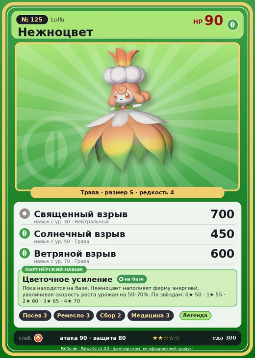

# #125 Нежноцвет (Lullu)

#125 · Lullu

Трава

Слабость: Огонь

🌱 Посев семян <b>3</b>🖐️ Ручная работа <b>3</b>🌾 Сбор <b>2</b>💊 Фармацевтика <b>3</b>

<b>Цветочное усиление</b> 🏠 на базе

❤️ 90 · ⚔️ 90 · 🛡 80

| Поле | Значение |
|---|---|
| Стихия | Трава |
| Слабость (кто бьёт сильнее) | Огонь |
| Редкость | 4 |
| Размер | S |
| HP / Атака / Защита (база вида) | 90 / 90 / 80 |
| Сколько ест | 300 |
| Цена продажи | 1261 |
| Множитель поимки | ×1 |
| Скорость рывка верхом | 800 |

## Работа на базе
- Посев семян — ур. 3
- Ручная работа — ур. 3
- Сбор — ур. 2
- Фармацевтика — ур. 3

## Партнёрский навык: Цветочное усиление
Пока находится на базе, Нежноцвет наполняет ферму энергией, увеличивая скорость роста урожая на (50~70)% . level value 1 FarmCropGrowupSpeed_Up 50 2 FarmCropGrowupSpeed_Up 55 3 FarmCropGrowupSpeed_Up 60 4 FarmCropGrowupSpeed_Up 65 5 FarmCropGrowupSpeed_Up 70

## Атаки по уровням
- ур. 1: Ветряной клинок (Трава, сила 40)
- ур. 7: Семенной пулемёт (Трава, сила 80)
- ур. 15: Мультиклинок (Трава, сила 160)
- ур. 22: Травяной торнадо (Трава, сила 200)
- ур. 30: Священный взрыв (Нейтральный, сила 700)
- ур. 40: Кольцевая лоза (Трава, сила 300)
- ур. 50: Солнечный взрыв (Трава, сила 450)
- ур. 70: Ветряной взрыв (Трава, сила 600)

## Где водится
- В дикой природе: да; точек появления днём: 20, ночью: 20; уровни в первых точках: 55–57
- Подземелья: Пещера Цветущей Сакуры
- Яйцо: Яйцо свежей листвы

## Дроп
- Красивый цветок — 2–3 шт., 100%
- Красная ягода — 1–2 шт., 60%

**Дроп альфы:**
- Деталь древней цивилизации — 2–3 шт., 100%
- Ценные внутренности — 2–3 шт., 100%

## Разведение
- Ранг разведения (CombiRank): 1990
- Участвует в особых парах: Фэски → Фэски Ботан

## Лучшие пассивки по роли
- боец: Легенда, Демон-бог, Хладнокровный, Бессмертие, Король духов (вместо Бессмертия, если нет мутации)
- рабочий: Дьявольские руки, Виртуоз, Мастеровитый, Небожитель/Трудоголик
- ездовой: Божественная скорость, Легенда, Вечный двигатель, Небесное скольжение

## Чем хорош / чем плох
- ✅ можно оседлать
- ❌ явных минусов нет

> С приходом весны ветер разносит по острову клубы пыльцы. В своей аллергии на неё Флопи винит Нежноцвет .

См. также: [Стихии](../../2_mehaniki/stihii.md) · [Разведение](../../2_mehaniki/razvedenie.md) · [Все палы](README.md)
_Источник: paldb.cc v1.0.5_
