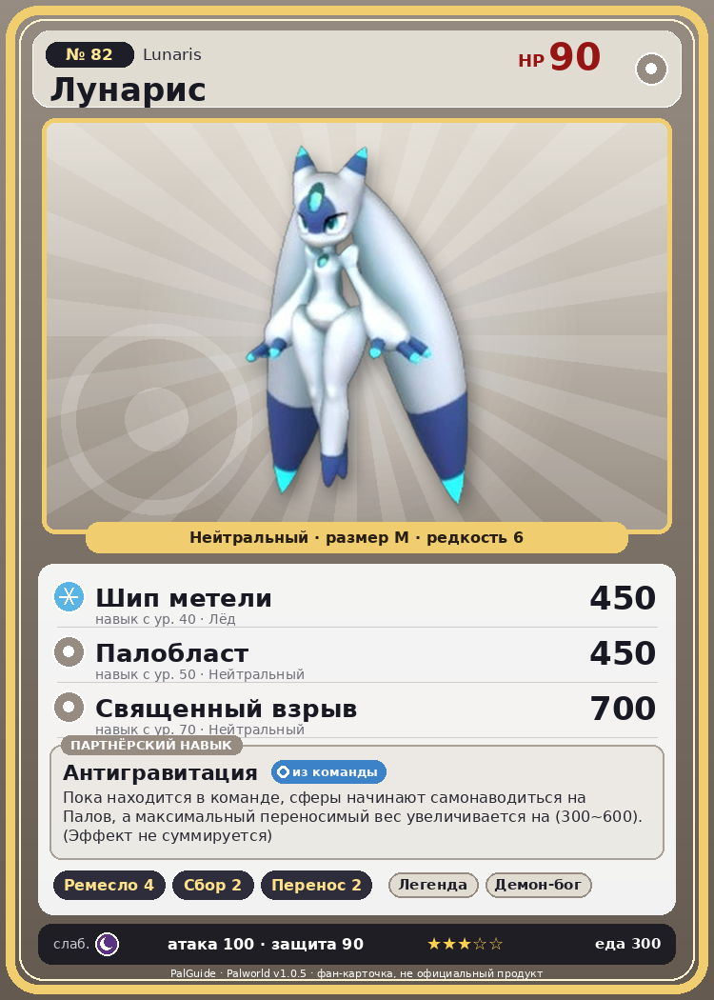

# #82 Лунарис (Lunaris)

{ width=360 }

| Поле | Значение |
|---|---|
| Стихия | Нейтральный |
| Слабость (кто бьёт сильнее) | Тьма |
| Редкость | 6 |
| Размер | M |
| HP / Атака / Защита (база вида) | 90 / 100 / 90 |
| Сколько ест | 300 |
| Цена продажи | 1845 |
| Множитель поимки | ×1 |
| Скорость рывка верхом | 650 |

## Работа на базе
- Ручная работа — ур. 4
- Сбор — ур. 2
- Транспортировка — ур. 2

## Партнёрский навык: Антигравитация
Пока находится в команде, сферы начинают самонаводиться на Палов, а максимальный переносимый вес увеличивается на (300~600) . (Эффект не суммируется) level value 1 MaxInventoryWeight_PartnerSkill_Mutant 300 Homing_PartnerSkill_Mutant 19 2 MaxInventoryWeight_PartnerSkill_Mutant 339 Homing_PartnerSkill_Mutant 19 3 MaxInventoryWeight_PartnerSkill_Mutant 399 Homing_PartnerSkill_Mutant 19 4 MaxInventoryWeight_PartnerSkill_Mutant 480 Homing_PartnerSkill_Mutant 19 5 MaxInventoryWeight_PartnerSkill_Mutant 600 Homing_PartnerSkill_Mutant 19

## Атаки по уровням
- ур. 1: Воздушная пушка (Нейтральный, сила 40)
- ур. 7: Силовой выстрел (Нейтральный, сила 80)
- ур. 15: Ледяной резак (Лёд, сила 80)
- ур. 22: Плазмомёт (Молния, сила 120)
- ур. 30: Силовая бомба (Нейтральный, сила 120)
- ур. 40: Шип метели (Лёд, сила 450)
- ур. 50: Палобласт (Нейтральный, сила 450)
- ур. 70: Священный взрыв (Нейтральный, сила 700)

## Где водится
- В дикой природе: да; точек появления днём: 64, ночью: 64; уровни в первых точках: 25–28
- Подземелья: Пещера Священной Горы
- Может продаваться у торговца/рекрутера
- Яйцо: Большое обычное яйцо

## Дроп
- Осколок палдиума — 2–3 шт., 100%

**Дроп альфы:**
- Деталь древней цивилизации — 4–6 шт., 100%
- Ценные внутренности — 4–6 шт., 100%

## Разведение
- Ранг разведения (CombiRank): 2010

## Лучшие пассивки по роли
- по обзору: Мастеровитый, Удачливый
- боец: Легенда, Демон-бог, Хладнокровный, Бессмертие, Святое небо (вместо Бессмертия, если нет мутации)
- рабочий: Дьявольские руки, Виртуоз, Мастеровитый, Небожитель/Трудоголик
- ездовой: Божественная скорость, Легенда, Вечный двигатель, Небесное скольжение

## Чем хорош / чем плох
- ✅ Самонаведение сфер, +вес 300–600; хорошая атака (100); можно оседлать
- ❌ Слабый боец

> Стоит лишь на миг встретиться с его взглядом — и ты уже не принадлежишь себе. Те, кто держит Лунарис при себе, лишь тешат себя иллюзией власти. На деле управляет он.

См. также: [Стихии](../../2_mehaniki/stihii.md) · [Разведение](../../2_mehaniki/razvedenie.md) · [Все палы](README.md)
_Источник: paldb.cc v1.0.5_
