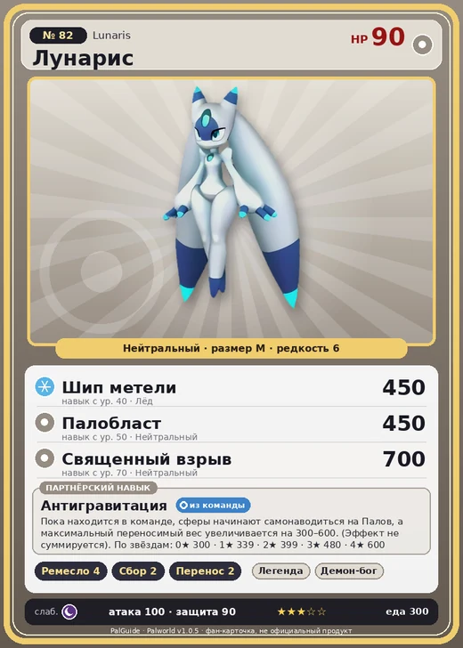

# Лунарис

<canvas id="fx"></canvas>

№ 82 · Lunaris

Нейтральный

Слабость: Тьма

🖐️ Ручная работа <b>4</b>🌾 Сбор <b>2</b>📦 Транспортировка <b>2</b>

<b>Антигравитация</b> 🎒 из команды

❤️ 90 · ⚔️ 100 · 🛡 90

Основное

💎Редкость <button class="hlp" data-tip="Чем выше число, тем реже встречается пал. 1–4 — обычные, 5–7 — редкие, 8+ — легендарные.">?</button><b>6</b>

📏Размер<b>M</b>

💰Цена продажи <button class="hlp" data-tip="Сколько золота даст торговец за пала.">?</button><b>1845</b>

Бой

🎯Множитель поимки <button class="hlp" data-tip="Насколько легче или труднее поймать: ×1 — обычно, меньше — сложнее.">?</button><b>×1</b>

🐎Скорость рывка верхом <button class="hlp" data-tip="Скорость, если сесть на пала и бежать рывком.">?</button><b>650</b>

Ферма и еда

🍖Сколько ест <button class="hlp" data-tip="Сколько сытости пал тратит — чем больше, тем больше еды нужно на базе.">?</button><b>300</b>

Разведение

🧬Сила разведения <button class="hlp" data-tip="Скрытое число игры: у детёныша оно примерно среднее от родителей. Чем меньше — тем «сильнее» пал.">?</button><b>2010</b>

=== "Обзор"

    #### Работа на базе
    - Ручная работа — ур. 4
    - Сбор — ур. 2
    - Транспортировка — ур. 2

    #### Партнёрский навык: Антигравитация
    Пока находится в команде, сферы начинают самонаводиться на Палов, а максимальный переносимый вес увеличивается на 300–600. (Эффект не суммируется). По звёздам: 0★ 300 · 1★ 339 · 2★ 399 · 3★ 480 · 4★ 600

    #### Чем хорош / чем плох
    - ✅ Самонаведение сфер, +вес 300–600; хорошая атака (100)
    - ❌ Слабый боец

    > Стоит лишь на миг встретиться с его взглядом — и ты уже не принадлежишь себе. Те, кто держит Лунарис при себе, лишь тешат себя иллюзией власти. На деле управляет он.

    См. также: [Стихии](../../guide/06_stihii.md) · [Разведение](../../guide/07_razvedenie.md) · [Все палы](README.md)

=== "Атаки"

    #### Атаки по уровням
    - ур. 1: Воздушная пушка (Нейтральный, сила 40)
    - ур. 7: Силовой выстрел (Нейтральный, сила 80)
    - ур. 15: Ледяной резак (Лёд, сила 80)
    - ур. 22: Плазмомёт (Молния, сила 120)
    - ур. 30: Силовая бомба (Нейтральный, сила 120)
    - ур. 40: Шип метели (Лёд, сила 450)
    - ур. 50: Палобласт (Нейтральный, сила 450)
    - ур. 70: Священный взрыв (Нейтральный, сила 700)

=== "Где живёт"

    #### Где водится
    - В дикой природе: да; точек появления днём: 64, ночью: 64; уровни в первых точках: 25–28
    - Подземелья: Пещера Священной Горы
    - Может продаваться у торговца/рекрутера
    - Яйцо: Большое обычное яйцо

=== "Дроп"

    #### Дроп
    - Осколок палдиума — 2–3 шт., 100%

    **Дроп альфы:**
    - Деталь древней цивилизации — 4–6 шт., 100%
    - Ценные внутренности — 4–6 шт., 100%

=== "Разведение"

    #### Разведение
    - Ранг разведения (CombiRank): 2010

=== "Пассивки"

    #### Лучшие пассивки по роли

    

⚔️ Боец

максимум урона и живучести в бою

<a class="psv r-4" data-psv="Легенда" href="../../../passivki/legend/">Легенда</a><a class="psv r-4" data-psv="Демон-бог" href="../../../passivki/demon_god/">Демон-бог</a><a class="psv r-3" data-psv="Святое небо" href="../../../passivki/celestial_emperor/">Святое небо</a><a class="psv r-3" data-psv="Хладнокровный" href="../../../passivki/serenity/">Хладнокровный</a>

🛠 Рабочий

работает быстрее и меньше устаёт на базе

<a class="psv r-5" data-psv="Дьявольские руки" href="../../../passivki/demons_hand/">Дьявольские руки</a><a class="psv r-4" data-psv="Виртуоз" href="../../../passivki/remarkable_craftsmanship/">Виртуоз</a><a class="psv r-3" data-psv="Мастеровитый" href="../../../passivki/artisan/">Мастеровитый</a><a class="psv r-3" data-psv="Трудоголик" href="../../../passivki/workaholic/">Трудоголик</a>

    <small>Нажми на пассивку, чтобы узнать, что она даёт и где её взять.</small>

<a class="card-link" href="../elgrove_cryst/">← Элгрув Крист</a><a class="card-link" href="../fenglope/">Фенглоп →</a>

