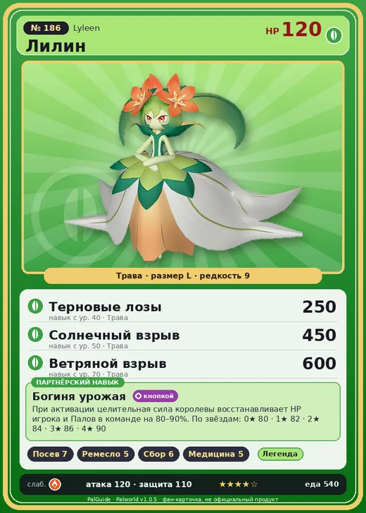

# Лилин

<canvas id="fx"></canvas>

№ 186

Трава

Слабость: Огонь <b class="mx">×1,5</b> <button class="hlp" data-tip="Множители перемножаются по обеим стихиям: ×1,5 за стихию, которую атака бьёт, ×0,65 за ту, что её держит.">?</button>

Устойчив: Земля <b class="mx">×0,65</b>

🌱 Посев семян <b>7</b>🖐️ Ручная работа <b>5</b>🌾 Сбор <b>6</b>💊 Фармацевтика <b>5</b>

<b>Богиня урожая</b> 🔘 Включается кнопкой

❤️ 120 · ⚔️ 120 · 🛡 110

Основное

💎Редкость <button class="hlp" data-tip="Чем выше число, тем реже встречается пал. 1–4 — обычные, 5–7 — редкие, 8+ — легендарные.">?</button><b>9</b>

📏Размер<b>L</b>

💰Цена продажи <button class="hlp" data-tip="Сколько золота даст торговец за пала.">?</button><b>3427</b>

Бой

🎯Множитель поимки <button class="hlp" data-tip="Насколько легче или труднее поймать: ×1 — обычно, меньше — сложнее.">?</button><b>×1</b>

🐎Скорость рывка верхом <button class="hlp" data-tip="Скорость, если сесть на пала и бежать рывком.">?</button><b>550</b>

Ферма и еда

🍖Сколько ест <button class="hlp" data-tip="Сколько сытости пал тратит — чем больше, тем больше еды нужно на базе.">?</button><b>540</b>

Разведение

🧬Сила разведения <button class="hlp" data-tip="Скрытое число игры: у детёныша оно примерно среднее от родителей. Чем меньше — тем «сильнее» пал.">?</button><b>240</b>

💞Особая пара <button class="hlp" data-tip="Этого пала можно вывести только от этой пары.">?</button><b>Лилин + Лилин</b>

=== "Обзор"

    #### Работа на базе

    
🌱 Посев семян<i style="--v:70%"></i><b>7</b>✋ Ручная работа<i style="--v:50%"></i><b>5</b>🧺 Сбор<i style="--v:60%"></i><b>6</b>💊 Фармацевтика<i style="--v:50%"></i><b>5</b>

    #### Партнёрский навык: Богиня урожая
    При активации целительная сила королевы восстанавливает HP игрока и Палов в команде на 80–90%. По звёздам: 0★ 80 · 1★ 82 · 2★ 84 · 3★ 86 · 4★ 90

    #### Чем хорош / чем плох
    - ✅ Лечение; сбор и посев высокого уровня; очень высокая атака (120); много здоровья (120); отличный рабочий (пригодность 7)
    - ❌ Хрупкая; много ест (540); разводится только особой парой

    > Добрый и спокойный Пал, полный любви. Он опекает маленьких Палов, потерявших родителей. Воспитание? Только Солнечный взрыв — со всей силы.

    См. также: [Стихии](../../guide/06_stihii.md) · [Разведение](../../guide/07_razvedenie.md) · [Все палы](README.md)

=== "Атаки"

    #### Атаки по уровням
    - ур. 1: Ветряной клинок (Трава, сила 40)
    - ур. 7: Семенной пулемёт (Трава, сила 80)
    - ур. 15: Семенная мина (Трава, сила 120)
    - ур. 22: Водяная бомба (Вода, сила 200)
    - ур. 30: Травяной торнадо (Трава, сила 200)
    - ур. 40: Терновые лозы (Трава, сила 250)
    - ур. 50: Солнечный взрыв (Трава, сила 450)
    - ур. 55: Защита плодородия (Трава, сила 0)
    - ур. 70: Ветряной взрыв (Трава, сила 600)

=== "Где живёт"

    #### Где водится

    

<button data-k="d" class="on">☀️ День</button><button data-k="n">🌙 Ночь</button>

ур. 75–80<a class="btn hm-full" href="../../../map/?pal=LilyQueen">Показать на большой карте</a>

🥚 Яйцо<b>Огромное яйцо свежей листвы</b>

=== "Дроп"

    #### Дроп
    - Качественное снадобье восстановления — 1–3 шт., 100%
    - Красивый цветок — 1–2 шт., 100%
    - Книга революционных технологий — 1 шт., 10%

    **Дроп альфы:**

    - Деталь древней цивилизации — 6–7 шт., 100%
    - Ценные внутренности — 6–7 шт., 100%

=== "Разведение"

    #### Разведение
    - Ранг разведения: 240
    - **Особая пара:** [Лилин](../../4_spravochniki/paly/lyleen.md) + [Лилин](../../4_spravochniki/paly/lyleen.md)
    - Участвует в особых парах: Лилин → Лилин; Лилин → Лилин; [Менастинг](menasting.md) → [Лилин Нокт](lyleen_noct.md)

=== "Пассивки"

    #### Лучшие пассивки по роли

    

⚔️ Боец

максимум урона и живучести в бою

<a class="psv r-4" data-psv="Легенда" href="../../../passivki/legend/">Легенда</a><a class="psv r-4" data-psv="Демон-бог" href="../../../passivki/demon_god/">Демон-бог</a><a class="psv r-3" data-psv="Король духов" href="../../../passivki/spirit_emperor/">Король духов</a><a class="psv r-3" data-psv="Хладнокровный" href="../../../passivki/serenity/">Хладнокровный</a>

🛠 Рабочий

работает быстрее и меньше устаёт на базе

<a class="psv r-5" data-psv="Дьявольские руки" href="../../../passivki/demons_hand/">Дьявольские руки</a><a class="psv r-4" data-psv="Виртуоз" href="../../../passivki/remarkable_craftsmanship/">Виртуоз</a><a class="psv r-3" data-psv="Мастеровитый" href="../../../passivki/artisan/">Мастеровитый</a><a class="psv r-3" data-psv="Трудоголик" href="../../../passivki/workaholic/">Трудоголик</a>

    <small>Нажми на пассивку, чтобы узнать, что она даёт и где её взять.</small>

<a class="card-link" href="../grizzbolt/">← Гриззболт</a><a class="card-link" href="../lyleen_noct/">Лилин Нокт →</a>

