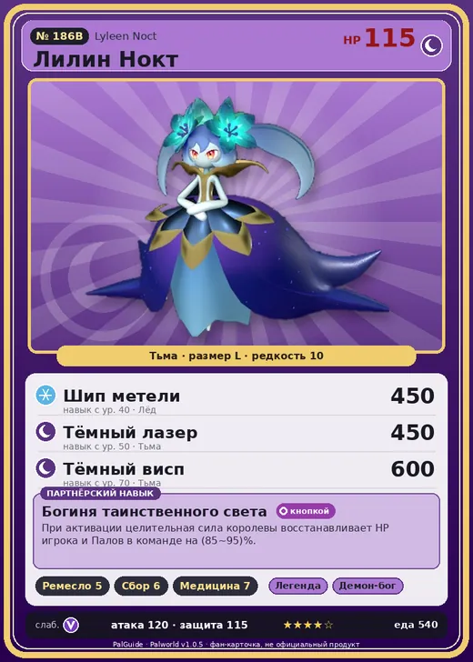

# #186B Лилин Нокт (Lyleen Noct)

#186B · Lyleen Noct

Тьма

Слабость: Дракон

🖐️ Ручная работа <b>5</b>🌾 Сбор <b>6</b>💊 Фармацевтика <b>7</b>

<b>Богиня таинственного света</b> 🔘 кнопкой

❤️ 115 · ⚔️ 120 · 🛡 115

| Поле | Значение |
|---|---|
| Стихия | Тьма |
| Слабость (кто бьёт сильнее) | Дракон |
| Редкость | 10 |
| Размер | L |
| HP / Атака / Защита (база вида) | 115 / 120 / 115 |
| Сколько ест | 540 |
| Цена продажи | 3540 |
| Множитель поимки | ×1 |
| Скорость рывка верхом | 550 |

## Работа на базе
- Ручная работа — ур. 5
- Сбор — ур. 6
- Фармацевтика — ур. 7

## Партнёрский навык: Богиня таинственного света
При активации целительная сила королевы восстанавливает HP игрока и Палов в команде на (85~95)% . level value 1 MainValue 85 2 MainValue 87 3 MainValue 89 4 MainValue 91 5 MainValue 95

## Атаки по уровням
- ур. 1: Тёмный шар (Тьма, сила 50)
- ур. 7: Ледяной резак (Лёд, сила 80)
- ур. 15: Теневой взрыв (Тьма, сила 80)
- ур. 22: Ледяное дыхание (Лёд, сила 160)
- ур. 30: Кошмарная сфера (Тьма, сила 300)
- ур. 40: Шип метели (Лёд, сила 450)
- ур. 45: Звездные мины (Нейтральный, сила 400)
- ур. 50: Тёмный лазер (Тьма, сила 450)
- ур. 70: Тёмный висп (Тьма, сила 600)

## Где водится
- В дикой природе: да; точек появления днём: 1, ночью: 1
- Яйцо: Огромное яйцо тьмы

## Дроп
- Качественное снадобье восстановления — 1–3 шт., 100%
- Красивый цветок — 2–3 шт., 100%
- Книга революционных технологий — 1 шт., 10%

**Дроп альфы:**
- Деталь древней цивилизации — 6–7 шт., 100%
- Ценные внутренности — 6–7 шт., 100%

## Разведение
- Ранг разведения (CombiRank): 220
- **Особая пара:** [Лилин](../../4_spravochniki/paly/lyleen.md) + [Менастинг](../../4_spravochniki/paly/menasting.md)

## Лучшие пассивки по роли
- по обзору: Легенда, Особая конституция, Хладнокровный, Мастеровитый
- боец: Легенда, Демон-бог, Хладнокровный, Бессмертие, Король тьмы (вместо Бессмертия, если нет мутации)
- рабочий: Дьявольские руки, Виртуоз, Мастеровитый, Небожитель/Трудоголик
- ездовой: Божественная скорость, Легенда, Вечный двигатель, Небесное скольжение

## Чем хорош / чем плох
- ✅ Лечение + фармацевтика 7; очень высокая атака (120); отличный рабочий (пригодность 7); можно оседлать
- ❌ Хрупкая; много ест (540); разводится только особой парой

> Изящный и благородный Пал, полный достоинства. Грубиянов он наказывает сокрушительной пощёчиной. Некоторые Палы, впрочем, только этого и добиваются.

См. также: [Стихии](../../guide/06_stihii.md) · [Разведение](../../guide/07_razvedenie.md) · [Все палы](README.md)
