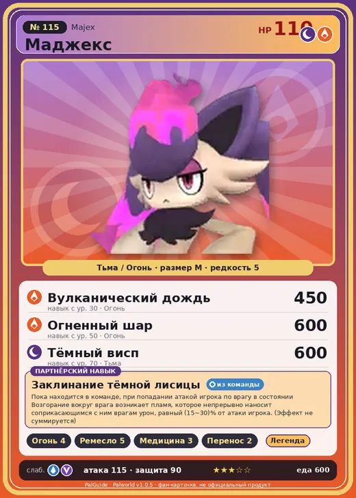

# Маджекс

<canvas id="fx"></canvas>

№ 115

ТьмаОгонь

Слабость: Вода <b class="mx">×1,5</b>Дракон <b class="mx">×1,5</b> <button class="hlp" data-tip="Множители перемножаются по обеим стихиям: ×1,5 за стихию, которую атака бьёт, ×0,65 за ту, что её держит. Вода: 1 × 1,5 = ×1,5; Дракон: 1,5 × 1 = ×1,5.">?</button>

Устойчив: Нейтральный <b class="mx">×0,65</b>Трава <b class="mx">×0,65</b>Лёд <b class="mx">×0,65</b>

🔥 Разжигание огня <b>4</b>🖐️ Ручная работа <b>5</b>💊 Фармацевтика <b>3</b>📦 Транспортировка <b>2</b>

<b>Заклинание тёмной лисицы</b> 🎒 Работает из команды

❤️ 110 · ⚔️ 115 · 🛡 90

Основное

💎Редкость <button class="hlp" data-tip="Чем выше число, тем реже встречается пал. 1–4 — обычные, 5–7 — редкие, 8+ — легендарные.">?</button><b>5</b>

📏Размер<b>M</b>

💰Цена продажи <button class="hlp" data-tip="Сколько золота даст торговец за пала.">?</button><b>2347</b>

Бой

🎯Множитель поимки <button class="hlp" data-tip="Насколько легче или труднее поймать: ×1 — обычно, меньше — сложнее.">?</button><b>×1</b>

🐎Скорость рывка верхом <button class="hlp" data-tip="Скорость, если сесть на пала и бежать рывком.">?</button><b>750</b>

Ферма и еда

🍖Сколько ест <button class="hlp" data-tip="Сколько сытости пал тратит — чем больше, тем больше еды нужно на базе.">?</button><b>600</b>

Разведение

🧬Сила разведения <button class="hlp" data-tip="Скрытое число игры: у детёныша оно примерно среднее от родителей. Чем меньше — тем «сильнее» пал.">?</button><b>1010</b>

=== "Обзор"

    #### Работа на базе

    
<a class="wbar" href="../../../2_mehaniki/rabota/?w=kindling&lv=4">🔥 Разжигание огня<i style="--v:40%"></i><b>4</b></a><a class="wbar" href="../../../2_mehaniki/rabota/?w=handiwork&lv=5">✋ Ручная работа<i style="--v:50%"></i><b>5</b></a><a class="wbar" href="../../../2_mehaniki/rabota/?w=medicine&lv=3">💊 Фармацевтика<i style="--v:30%"></i><b>3</b></a><a class="wbar" href="../../../2_mehaniki/rabota/?w=transporting&lv=2">📦 Транспортировка<i style="--v:20%"></i><b>2</b></a><a class="wb-more" href="../../../2_mehaniki/rabota/">Что значат уровни работы →</a>

    #### Партнёрский навык: Заклинание тёмной лисицы
    Пока находится в команде, при попадании атакой игрока по врагу в состоянии Возгорание вокруг врага возникает пламя, которое непрерывно наносит соприкасающимся с ним врагам урон, равный 15–30% от атаки игрока. (Эффект не суммируется). По звёздам: 0★ 15 · 1★ 18 · 2★ 21 · 3★ 24 · 4★ 30

    #### Чем хорош / чем плох
    - ✅ хорошая атака (115); отличный рабочий (пригодность 5)
    - ❌ много ест (600)

    > Стоит, уперев руки в бёдра, и выглядит эффектно. Но на самом деле хвост и волосы слишком тяжёлы, и это всего лишь попытка не упасть.

    См. также: [Стихии](../../guide/06_stihii.md) · [Разведение](../../guide/07_razvedenie.md) · [Все палы](README.md)

=== "Атаки"

    #### Атаки по уровням
    - ур. 1: Тёмный выстрел (Тьма, сила 40)
    - ур. 7: Расщеплённый огонь (Огонь, сила 80)
    - ур. 15: Стрелы тьмы (Тьма, сила 120)
    - ур. 22: Огненная стена (Огонь, сила 250)
    - ур. 30: Вулканический дождь (Огонь, сила 450)
    - ур. 40: Тёмный лазер (Тьма, сила 450)
    - ур. 50: Огненный шар (Огонь, сила 600)
    - ур. 70: Тёмный висп (Тьма, сила 600)

=== "Где живёт"

    #### Где водится

    

<button data-k="d" class="on">☀️ День</button><button data-k="n">🌙 Ночь</button>

<button data-w=p class=on>Палпагос</button><button data-w=t>Мировое древо</button>

ур. 35–75<a class="btn hm-full" href="../../../map/?pal=DarkFlameFox">Показать на большой карте</a>

Остров безмолвияРазрушенный город-крепость

🥚 Яйцо<b>Большое яйцо тьмы</b>

=== "Дроп"

    #### Дроп
    - Кожа — 2–3 шт., 100%
    - Огненный орган — 2 шт., 100%

    **Дроп альфы:**
    - Деталь древней цивилизации — 4–6 шт., 100%
    - Ценный мех — 2–3 шт., 100%

=== "Разведение"

    #### Разведение
    - Ранг разведения: 1010

=== "Пассивки"

    #### Лучшие пассивки по роли

    

⚔️ Боец

максимум урона и живучести в бою

<a class="psv r-4" data-psv="Легенда" href="../../../passivki/legend/">Легенда</a><a class="psv r-4" data-psv="Демон-бог" href="../../../passivki/demon_god/">Демон-бог</a><a class="psv r-3" data-psv="Король тьмы" href="../../../passivki/lord_of_the_underworld/">Король тьмы</a><a class="psv r-3" data-psv="Хладнокровный" href="../../../passivki/serenity/">Хладнокровный</a>

🛠 Рабочий

работает быстрее и меньше устаёт на базе

<a class="psv r-5" data-psv="Дьявольские руки" href="../../../passivki/demons_hand/">Дьявольские руки</a><a class="psv r-4" data-psv="Виртуоз" href="../../../passivki/remarkable_craftsmanship/">Виртуоз</a><a class="psv r-3" data-psv="Мастеровитый" href="../../../passivki/artisan/">Мастеровитый</a><a class="psv r-3" data-psv="Трудоголик" href="../../../passivki/workaholic/">Трудоголик</a>

    <small>Нажми на пассивку, чтобы узнать, что она даёт и где её взять.</small>

<a class="card-link" href="../frostplume/">← Фростплюм</a><a class="card-link" href="../sibelyx/">Сибеликс →</a>

