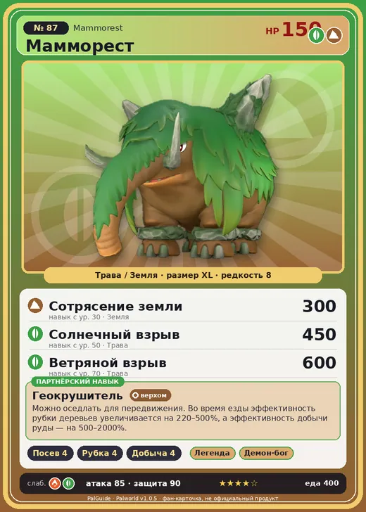

# #87 Мамморест (Mammorest)

№ 87

ТраваЗемля

Слабость: ОгоньТрава

🌱 Посев семян <b>4</b>🪓 Рубка деревьев <b>4</b>⛏️ Добыча <b>4</b>

<b>Геокрушитель</b> 🐎 верхом

❤️ 150 · ⚔️ 85 · 🛡 90

| Поле | Значение |
|---|---|
| Стихия | Трава, Земля |
| Слабость (кто бьёт сильнее) | Огонь, Трава |
| Редкость | 8 |
| Размер | XL |
| HP / Атака / Защита (база вида) | 150 / 85 / 90 |
| Сколько ест | 400 |
| Цена продажи | 2220 |
| Множитель поимки | ×1 |
| Скорость рывка верхом | 1030 |

=== "Обзор"

    #### Работа на базе
    - Посев семян — ур. 4
    - Рубка деревьев — ур. 4
    - Добыча — ур. 4

    #### Партнёрский навык: Геокрушитель
    Можно оседлать для передвижения. Во время езды эффективность рубки деревьев увеличивается на 220–500%, а эффективность добычи руды — на 500–2000%. Технологии 28. По звёздам: 0★ 220 · 1★ 260 · 2★ 320 · 3★ 400 · 4★ 500

    #### Чем хорош / чем плох
    - ✅ Добыча, тяжёлый маунт; много здоровья (150); можно оседлать
    - ❌ Медленный

    > Растительность на спинах у каждого — своя, уникальная. Когда-то она была популярным украшением, и даже были настоящие профи, которые занимались стрижкой Мамморест .

    См. также: [Стихии](../../guide/06_stihii.md) · [Разведение](../../guide/07_razvedenie.md) · [Все палы](README.md)

=== "Атаки"

    #### Атаки по уровням
    - ур. 1: Грязевой выстрел (Земля, сила 40)
    - ур. 7: Семенной пулемёт (Трава, сила 80)
    - ур. 15: Силовая бомба (Нейтральный, сила 120)
    - ур. 22: Травяной торнадо (Трава, сила 200)
    - ур. 30: Сотрясение земли (Земля, сила 300)
    - ур. 40: Терновые лозы (Трава, сила 250)
    - ур. 50: Солнечный взрыв (Трава, сила 450)
    - ур. 70: Ветряной взрыв (Трава, сила 600)

=== "Где живёт"

    #### Где водится
    - В дикой природе: да; точек появления днём: 486, ночью: 486; уровни в первых точках: 26–29
    - Может продаваться у торговца/рекрутера
    - Яйцо: Огромное яйцо свежей листвы

=== "Дроп"

    #### Дроп
    - Качественное масло Пала — 5–10 шт., 100%
    - Кожа — 5–10 шт., 100%
    - Мясо Маммореста — 2 шт., 100%

    **Дроп альфы:**
    - Деталь древней цивилизации — 5–6 шт., 100%
    - Ценный мех — 5–6 шт., 100%

=== "Разведение"

    #### Разведение
    - Ранг разведения (CombiRank): 1340
    - Участвует в особых парах: Вумпо → Мамморест Крист

=== "Пассивки"

    #### Лучшие пассивки по роли

    

⚔️ Боец

максимум урона и живучести в бою

<a class="psv r-4" data-psv="Легенда" href="../../../passivki/legend/">Легенда</a><a class="psv r-4" data-psv="Демон-бог" href="../../../passivki/demon_god/">Демон-бог</a><a class="psv r-3" data-psv="Король духов" href="../../../passivki/spirit_emperor/">Король духов</a><a class="psv r-3" data-psv="Хладнокровный" href="../../../passivki/serenity/">Хладнокровный</a>

🛠 Рабочий

работает быстрее и меньше устаёт на базе

<a class="psv r-5" data-psv="Дьявольские руки" href="../../../passivki/demons_hand/">Дьявольские руки</a><a class="psv r-4" data-psv="Виртуоз" href="../../../passivki/remarkable_craftsmanship/">Виртуоз</a><a class="psv r-3" data-psv="Мастеровитый" href="../../../passivki/artisan/">Мастеровитый</a><a class="psv r-3" data-psv="Трудоголик" href="../../../passivki/workaholic/">Трудоголик</a>

🐎 Ездовой

быстрее бегает или летает с тобой верхом

<a class="psv r-4" data-psv="Божественная скорость" href="../../../passivki/swift/">Божественная скорость</a><a class="psv r-4" data-psv="Легенда" href="../../../passivki/legend/">Легенда</a><a class="psv r-4" data-psv="Вечный двигатель" href="../../../passivki/eternal_engine/">Вечный двигатель</a><a class="psv r-4" data-psv="Небесное скольжение" href="../../../passivki/sky_strider/">Небесное скольжение</a>

    <small>Нажми на пассивку, чтобы узнать, что она даёт и где её взять.</small>

<a class="card-link" href="../munchill/">← Манчилл</a><a class="card-link" href="../mammorest_cryst/">Мамморест Крист →</a>

