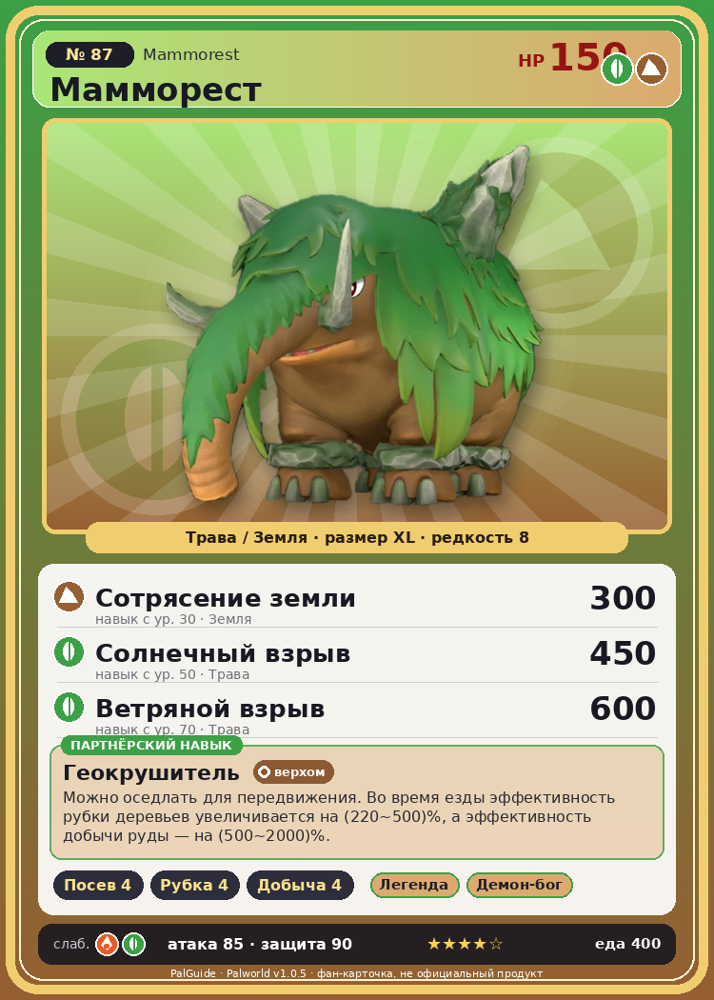

# #87 Мамморест (Mammorest)

{ width=360 }

| Поле | Значение |
|---|---|
| Стихия | Трава, Земля |
| Слабость (кто бьёт сильнее) | Огонь, Трава |
| Редкость | 8 |
| Размер | XL |
| HP / Атака / Защита (база вида) | 150 / 85 / 90 |
| Сколько ест | 400 |
| Цена продажи | 2220 |
| Множитель поимки | ×1 |
| Скорость рывка верхом | 1030 |

## Работа на базе
- Посев семян — ур. 4
- Рубка деревьев — ур. 4
- Добыча — ур. 4

## Партнёрский навык: Геокрушитель
Можно оседлать для передвижения. Во время езды эффективность рубки деревьев увеличивается на (220~500)% , а эффективность добычи руды — на (500~2000)% . Технологии 28 level value 1 Logging_up2_Otomo_only 220 Mining_up2_Otomo_only 500 2 Logging_up3_Otomo_only 260 Mining_up3_Otomo_only 750 3 Logging_up4_Otomo_only 320 Mining_up4_Otomo_only 1100 4 Logging_up5_Otomo_only 400 Mining_up5_Otomo_only 1500 5 Logging_up6_Otomo_only 500 Mining_up6_Otomo_only 2000

## Атаки по уровням
- ур. 1: Грязевой выстрел (Земля, сила 40)
- ур. 7: Семенной пулемёт (Трава, сила 80)
- ур. 15: Силовая бомба (Нейтральный, сила 120)
- ур. 22: Травяной торнадо (Трава, сила 200)
- ур. 30: Сотрясение земли (Земля, сила 300)
- ур. 40: Терновые лозы (Трава, сила 250)
- ур. 50: Солнечный взрыв (Трава, сила 450)
- ур. 70: Ветряной взрыв (Трава, сила 600)

## Где водится
- В дикой природе: да; точек появления днём: 486, ночью: 486; уровни в первых точках: 26–29
- Может продаваться у торговца/рекрутера
- Яйцо: Огромное яйцо свежей листвы

## Дроп
- Качественное масло Пала — 5–10 шт., 100%
- Кожа — 5–10 шт., 100%
- Мясо Маммореста — 2 шт., 100%

**Дроп альфы:**
- Деталь древней цивилизации — 5–6 шт., 100%
- Ценный мех — 5–6 шт., 100%

## Разведение
- Ранг разведения (CombiRank): 1340
- Участвует в особых парах: Вумпо → Мамморест Крист

## Лучшие пассивки по роли
- по обзору: Мастеровитый, Легенда, Трудоголик, Аскет
- боец: Легенда, Демон-бог, Хладнокровный, Бессмертие, Король духов (вместо Бессмертия, если нет мутации)
- рабочий: Дьявольские руки, Виртуоз, Мастеровитый, Небожитель/Трудоголик
- ездовой: Божественная скорость, Легенда, Вечный двигатель, Небесное скольжение

## Чем хорош / чем плох
- ✅ Добыча, тяжёлый маунт; много здоровья (150); можно оседлать
- ❌ Медленный

> Растительность на спинах у каждого — своя, уникальная. Когда-то она была популярным украшением, и даже были настоящие профи, которые занимались стрижкой Мамморест .

См. также: [Стихии](../../2_mehaniki/stihii.md) · [Разведение](../../2_mehaniki/razvedenie.md) · [Все палы](README.md)
_Источник: paldb.cc v1.0.5_
