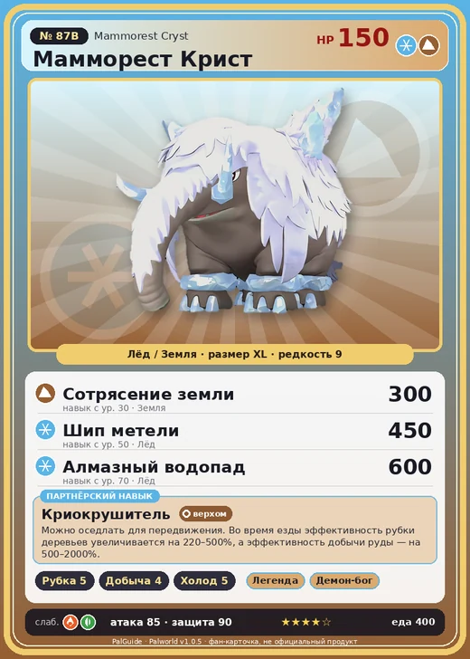

# Мамморест Крист

<canvas id="fx"></canvas>

№ 87B · Mammorest Cryst

ЛёдЗемля

Слабость: ОгоньТрава

🪓 Рубка деревьев <b>5</b>⛏️ Добыча <b>4</b>❄️ Охлаждение <b>5</b>

<b>Криокрушитель</b> 🐎 верхом

❤️ 150 · ⚔️ 85 · 🛡 90

Основное

💎Редкость <button class="hlp" data-tip="Чем выше число, тем реже встречается пал. 1–4 — обычные, 5–7 — редкие, 8+ — легендарные.">?</button><b>9</b>

📏Размер<b>XL</b>

💰Цена продажи <button class="hlp" data-tip="Сколько золота даст торговец за пала.">?</button><b>2424</b>

Бой

🎯Множитель поимки <button class="hlp" data-tip="Насколько легче или труднее поймать: ×1 — обычно, меньше — сложнее.">?</button><b>×1</b>

🐎Скорость рывка верхом <button class="hlp" data-tip="Скорость, если сесть на пала и бежать рывком.">?</button><b>1030</b>

Ферма и еда

🍖Сколько ест <button class="hlp" data-tip="Сколько сытости пал тратит — чем больше, тем больше еды нужно на базе.">?</button><b>400</b>

Разведение

🧬Сила разведения <button class="hlp" data-tip="Скрытое число игры: у детёныша оно примерно среднее от родителей. Чем меньше — тем «сильнее» пал.">?</button><b>1070</b>

💞Особая пара <button class="hlp" data-tip="Этого пала можно вывести только от этой пары.">?</button><b>Мамморест + Вумпо</b>

=== "Обзор"

    #### Работа на базе
    - Рубка деревьев — ур. 5
    - Добыча — ур. 4
    - Охлаждение — ур. 5

    #### Партнёрский навык: Криокрушитель
    Можно оседлать для передвижения. Во время езды эффективность рубки деревьев увеличивается на 220–500%, а эффективность добычи руды — на 500–2000%. Технологии 41. По звёздам: 0★ 220 · 1★ 260 · 2★ 320 · 3★ 400 · 4★ 500

    #### Чем хорош / чем плох
    - ✅ много здоровья (150); отличный рабочий (пригодность 5); можно оседлать
    - ❌ разводится только особой парой

    > Растительность на спинах у каждого — своя, уникальная. Бывали случаи, когда на заледеневшей спине Мамморест Крист находили растения, считавшиеся давно исчезнувшими.

    См. также: [Стихии](../../guide/06_stihii.md) · [Разведение](../../guide/07_razvedenie.md) · [Все палы](README.md)

=== "Атаки"

    #### Атаки по уровням
    - ур. 1: Камнемёт (Земля, сила 120)
    - ур. 7: Ледяной резак (Лёд, сила 80)
    - ур. 15: Силовая бомба (Нейтральный, сила 120)
    - ур. 22: Айсберг (Лёд, сила 120)
    - ур. 30: Сотрясение земли (Земля, сила 300)
    - ур. 40: Ледяное дыхание (Лёд, сила 160)
    - ур. 50: Шип метели (Лёд, сила 450)
    - ур. 70: Алмазный водопад (Лёд, сила 600)

=== "Где живёт"

    #### Где водится
    - В дикой природе: да; точек появления днём: 84, ночью: 84; уровни в первых точках: 36–39
    - Подземелья: Пещера Священной Горы
    - Может продаваться у торговца/рекрутера
    - Яйцо: Огромное яйцо льда

=== "Дроп"

    #### Дроп
    - Качественное масло Пала — 5–10 шт., 100%
    - Кожа — 5–10 шт., 100%
    - Мясо Маммореста — 2 шт., 100%

    **Дроп альфы:**
    - Деталь древней цивилизации — 5–6 шт., 100%
    - Ценный мех — 5–6 шт., 100%

=== "Разведение"

    #### Разведение
    - Ранг разведения (CombiRank): 1070
    - **Особая пара:** [Мамморест](../../4_spravochniki/paly/mammorest.md) + [Вумпо](../../4_spravochniki/paly/wumpo.md)

=== "Пассивки"

    #### Лучшие пассивки по роли

    

⚔️ Боец

максимум урона и живучести в бою

<a class="psv r-4" data-psv="Легенда" href="../../../passivki/legend/">Легенда</a><a class="psv r-4" data-psv="Демон-бог" href="../../../passivki/demon_god/">Демон-бог</a><a class="psv r-3" data-psv="Император льда" href="../../../passivki/ice_emperor/">Император льда</a><a class="psv r-3" data-psv="Хладнокровный" href="../../../passivki/serenity/">Хладнокровный</a>

🛠 Рабочий

работает быстрее и меньше устаёт на базе

<a class="psv r-5" data-psv="Дьявольские руки" href="../../../passivki/demons_hand/">Дьявольские руки</a><a class="psv r-4" data-psv="Виртуоз" href="../../../passivki/remarkable_craftsmanship/">Виртуоз</a><a class="psv r-3" data-psv="Мастеровитый" href="../../../passivki/artisan/">Мастеровитый</a><a class="psv r-3" data-psv="Трудоголик" href="../../../passivki/workaholic/">Трудоголик</a>

🐎 Ездовой

быстрее бегает или летает с тобой верхом

<a class="psv r-4" data-psv="Божественная скорость" href="../../../passivki/swift/">Божественная скорость</a><a class="psv r-4" data-psv="Легенда" href="../../../passivki/legend/">Легенда</a><a class="psv r-4" data-psv="Вечный двигатель" href="../../../passivki/eternal_engine/">Вечный двигатель</a><a class="psv r-4" data-psv="Небесное скольжение" href="../../../passivki/sky_strider/">Небесное скольжение</a>

    <small>Нажми на пассивку, чтобы узнать, что она даёт и где её взять.</small>

<a class="card-link" href="../mammorest/">← Мамморест</a><a class="card-link" href="../finsider/">Финсайдер →</a>

