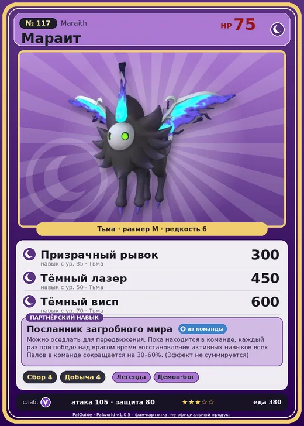

# #117 Мараит (Maraith)

#117 · Maraith

Тьма

Слабость: Дракон

🌾 Сбор <b>4</b>⛏️ Добыча <b>4</b>

<b>Посланник загробного мира</b> 🎒 из команды 🐎 верхом

❤️ 75 · ⚔️ 105 · 🛡 80

| Поле | Значение |
|---|---|
| Стихия | Тьма |
| Слабость (кто бьёт сильнее) | Дракон |
| Редкость | 6 |
| Размер | M |
| HP / Атака / Защита (база вида) | 75 / 105 / 80 |
| Сколько ест | 380 |
| Цена продажи | 1110 |
| Множитель поимки | ×1 |
| Скорость рывка верхом | 1100 |

## Работа на базе
- Сбор — ур. 4
- Добыча — ур. 4

## Партнёрский навык: Посланник загробного мира
Можно оседлать для передвижения. Пока находится в команде, каждый раз при победе над врагом время восстановления активных навыков всех Палов в команде сокращается на (30~60)% . (Эффект не суммируется) Технологии 37 level value 1 PartnerSkillCoolTime_PartnerSkill_GhostBeast 30 2 PartnerSkillCoolTime_PartnerSkill_GhostBeast 34 3 PartnerSkillCoolTime_PartnerSkill_GhostBeast 40 4 PartnerSkillCoolTime_PartnerSkill_GhostBeast 48 5 PartnerSkillCoolTime_PartnerSkill_GhostBeast 60

## Атаки по уровням
- ур. 1: Огненный выстрел (Огонь, сила 40)
- ур. 7: Тёмный шар (Тьма, сила 50)
- ур. 15: Огненная стрела (Огонь, сила 120)
- ур. 22: Теневой взрыв (Тьма, сила 80)
- ур. 30: Духовное пламя (Тьма, сила 200)
- ур. 35: Призрачный рывок (Тьма, сила 300)
- ур. 40: Кошмарная сфера (Тьма, сила 300)
- ур. 50: Тёмный лазер (Тьма, сила 450)
- ур. 70: Тёмный висп (Тьма, сила 600)

## Где водится
- В дикой природе: нет/особый способ; точек появления днём: 0, ночью: 356; уровни в первых точках: 40–45
- Подземелья: Пещера Священной Горы, Пещера Цветущей Сакуры
- Яйцо: Большое яйцо тьмы

## Дроп
- Кость — 1–2 шт., 100%
- Маленькая душа Пала — 1 шт., 15%
- Сырая нефть — 1 шт., 50%

**Дроп альфы:**
- Деталь древней цивилизации — 2–4 шт., 100%
- Ценный коготь — 2–4 шт., 100%

## Разведение
- Ранг разведения (CombiRank): 1710
- Участвует в особых парах: Инсинерам → Инсинерам Нокт

## Лучшие пассивки по роли
- боец: Легенда, Демон-бог, Хладнокровный, Бессмертие, Король тьмы (вместо Бессмертия, если нет мутации)
- рабочий: Дьявольские руки, Виртуоз, Мастеровитый, Небожитель/Трудоголик
- ездовой: Божественная скорость, Легенда, Вечный двигатель, Небесное скольжение

## Чем хорош / чем плох
- ✅ хорошая атака (105); можно оседлать
- ❌ явных минусов нет

> Он тяготеет к запаху, который источают те, чья смерть уже близка. Так что если Мараит начнёт проявлять к вам интерес… Скорее всего, всё уже решено.

См. также: [Стихии](../../2_mehaniki/stihii.md) · [Разведение](../../2_mehaniki/razvedenie.md) · [Все палы](README.md)
_Источник: paldb.cc v1.0.5_
