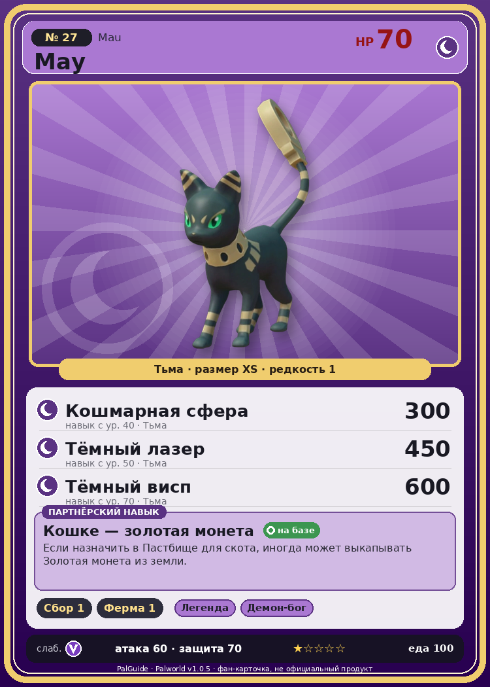

# #27 Мау (Mau)

{ width=360 }

| Поле | Значение |
|---|---|
| Стихия | Тьма |
| Слабость (кто бьёт сильнее) | Дракон |
| Редкость | 1 |
| Размер | XS |
| HP / Атака / Защита (база вида) | 70 / 60 / 70 |
| Сколько ест | 100 |
| Цена продажи | 665 |
| Множитель поимки | ×1 |
| Скорость рывка верхом | 550 |

## Работа на базе
- Сбор — ур. 1
- Фермерство — ур. 1

## Партнёрский навык: Кошке — золотая монета
Если назначить в Пастбище для скота , иногда может выкапывать Золотая монета из земли.

## Атаки по уровням
- ур. 1: Грязевой выстрел (Земля, сила 40)
- ур. 7: Тёмный шар (Тьма, сила 50)
- ур. 15: Теневой взрыв (Тьма, сила 80)
- ур. 22: Песчаный вихрь (Земля, сила 200)
- ур. 30: Духовное пламя (Тьма, сила 200)
- ур. 40: Кошмарная сфера (Тьма, сила 300)
- ур. 50: Тёмный лазер (Тьма, сила 450)
- ур. 70: Тёмный висп (Тьма, сила 600)

## Где водится
- В дикой природе: да; точек появления днём: 3, ночью: 3
- Яйцо: Яйцо тьмы

## Дроп
- Золотая монета — 100–200 шт., 50%
- Кожа — 1 шт., 100%

**Дроп альфы:**
- Деталь древней цивилизации — 1–2 шт., 100%
- Ценный коготь — 1–2 шт., 100%

## Разведение
- Ранг разведения (CombiRank): 3040
- Участвует в особых парах: Пенгуллет → Мау Крист

## Лучшие пассивки по роли
- боец: Легенда, Демон-бог, Хладнокровный, Бессмертие, Король тьмы (вместо Бессмертия, если нет мутации)
- ездовой: Божественная скорость, Легенда, Вечный двигатель, Небесное скольжение

## Чем хорош / чем плох
- ✅ можно оседлать
- ❌ слабая атака (60)

> Хвост Мау остаётся твёрдым даже после отделения. Из-за суеверия, будто он приносит богатство, многие из них напрасно отдали свои жизни.

См. также: [Стихии](../../2_mehaniki/stihii.md) · [Разведение](../../2_mehaniki/razvedenie.md) · [Все палы](README.md)
_Источник: paldb.cc v1.0.5_
