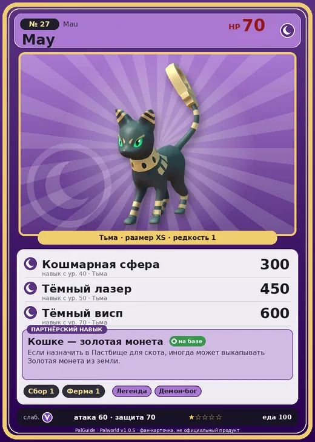

# Мау

<canvas id="fx"></canvas>

№ 27

Тьма

Слабость: Дракон <b class="mx">×1,5</b> <button class="hlp" data-tip="Множители перемножаются по обеим стихиям: ×1,5 за стихию, которую атака бьёт, ×0,65 за ту, что её держит.">?</button>

Устойчив: Нейтральный <b class="mx">×0,65</b>

🌾 Сбор <b>1</b>🐑 Фермерство <b>1</b>

<b>Кошке — золотая монета</b> 🏠 На базе🐾 Когда пал выпущен

❤️ 70 · ⚔️ 60 · 🛡 70

Основное

💎Редкость <button class="hlp" data-tip="Чем выше число, тем реже встречается пал. 1–4 — обычные, 5–7 — редкие, 8+ — легендарные.">?</button><b>1</b>

📏Размер<b>XS</b>

💰Цена продажи <button class="hlp" data-tip="Сколько золота даст торговец за пала.">?</button><b>665</b>

Бой

🎯Множитель поимки <button class="hlp" data-tip="Насколько легче или труднее поймать: ×1 — обычно, меньше — сложнее.">?</button><b>×1</b>

🐎Скорость рывка верхом <button class="hlp" data-tip="Скорость, если сесть на пала и бежать рывком.">?</button><b>550</b>

Ферма и еда

🍖Сколько ест <button class="hlp" data-tip="Сколько сытости пал тратит — чем больше, тем больше еды нужно на базе.">?</button><b>100</b>

Разведение

🧬Сила разведения <button class="hlp" data-tip="Скрытое число игры: у детёныша оно примерно среднее от родителей. Чем меньше — тем «сильнее» пал.">?</button><b>3040</b>

=== "Обзор"

    #### Работа на базе

    
<a class="wbar" href="../../../2_mehaniki/rabota/?w=gathering&lv=1">🧺 Сбор<i style="--v:10%"></i><b>1</b></a><a class="wbar" href="../../../2_mehaniki/rabota/?w=farming&lv=1">🐄 Фермерство<i style="--v:10%"></i><b>1</b></a><a class="wb-more" href="../../../2_mehaniki/rabota/">Что значат уровни работы →</a>

    #### Партнёрский навык: Кошке — золотая монета
    Если назначить в Пастбище для скота, иногда может выкапывать Золотая монета из земли.

    #### Чем хорош / чем плох
    - ✅ крепкая защита (70)
    - ❌ слабая атака (60)

    > Хвост Мау остаётся твёрдым даже после отделения. Из-за суеверия, будто он приносит богатство, многие из них напрасно отдали свои жизни.

    См. также: [Стихии](../../guide/06_stihii.md) · [Разведение](../../guide/07_razvedenie.md) · [Все палы](README.md)

=== "Атаки"

    #### Атаки по уровням
    - ур. 1: Грязевой выстрел (Земля, сила 40)
    - ур. 7: Тёмный шар (Тьма, сила 50)
    - ур. 15: Теневой взрыв (Тьма, сила 80)
    - ур. 22: Песчаный вихрь (Земля, сила 200)
    - ур. 30: Духовное пламя (Тьма, сила 200)
    - ур. 40: Кошмарная сфера (Тьма, сила 300)
    - ур. 50: Тёмный лазер (Тьма, сила 450)
    - ур. 70: Тёмный висп (Тьма, сила 600)

=== "Где живёт"

    #### Где водится

    

<button data-k="d" class="on">☀️ День</button><button data-k="n">🌙 Ночь</button>

ур. 25–64<a class="btn hm-full" href="../../../map/?pal=Bastet">Показать на большой карте</a>

Иссушенное побережьеИссохшие дюныЛедяной коралловый холм

🥚 Яйцо<b>Яйцо тьмы</b>

=== "Дроп"

    #### Дроп
    - Золотая монета — 100–200 шт., 50%
    - Кожа — 1 шт., 100%

    **Дроп альфы:**

    - Деталь древней цивилизации — 1–2 шт., 100%
    - Ценный коготь — 1–2 шт., 100%

=== "Разведение"

    #### Разведение
    - Ранг разведения: 3040
    - Участвует в особых парах: [Пенгуллет](pengullet.md) → [Мау Крист](mau_cryst.md)

=== "Пассивки"

    #### Лучшие пассивки по роли

    

⚔️ Боец

максимум урона и живучести в бою

<a class="psv r-4" data-psv="Легенда" href="../../../passivki/legend/">Легенда</a><a class="psv r-4" data-psv="Демон-бог" href="../../../passivki/demon_god/">Демон-бог</a><a class="psv r-3" data-psv="Король тьмы" href="../../../passivki/lord_of_the_underworld/">Король тьмы</a><a class="psv r-3" data-psv="Хладнокровный" href="../../../passivki/serenity/">Хладнокровный</a>

    <small>Нажми на пассивку, чтобы узнать, что она даёт и где её взять.</small>

<a class="card-link" href="../rooby/">← Руби</a><a class="card-link" href="../mau_cryst/">Мау Крист →</a>

