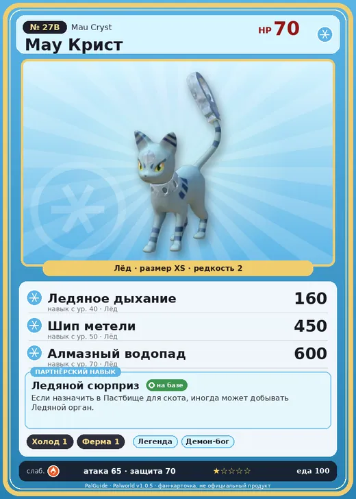

# #27B Мау Крист (Mau Cryst)

№ 27B

Лёд

Слабость: Огонь

❄️ Охлаждение <b>1</b>🐑 Фермерство <b>1</b>

<b>Ледяной сюрприз</b> 🏠 на базе 🐾 выпущен

❤️ 70 · ⚔️ 65 · 🛡 70

| Поле | Значение |
|---|---|
| Стихия | Лёд |
| Слабость (кто бьёт сильнее) | Огонь |
| Редкость | 2 |
| Размер | XS |
| HP / Атака / Защита (база вида) | 70 / 65 / 70 |
| Сколько ест | 100 |
| Цена продажи | 385 |
| Множитель поимки | ×1 |
| Скорость рывка верхом | 550 |

## Работа на базе
- Охлаждение — ур. 1
- Фермерство — ур. 1

## Партнёрский навык: Ледяной сюрприз
Если назначить в Пастбище для скота , иногда может добывать Ледяной орган .

## Атаки по уровням
- ур. 1: Ледяная ракета (Лёд, сила 40)
- ур. 7: Воздушная пушка (Нейтральный, сила 40)
- ур. 15: Грязевой выстрел (Земля, сила 40)
- ур. 22: Ледяной резак (Лёд, сила 80)
- ур. 30: Айсберг (Лёд, сила 120)
- ур. 40: Ледяное дыхание (Лёд, сила 160)
- ур. 50: Шип метели (Лёд, сила 450)
- ур. 70: Алмазный водопад (Лёд, сила 600)

## Где водится
- В дикой природе: да; точек появления днём: 4, ночью: 4
- Яйцо: Яйцо льда

## Дроп
- Ледяной орган — 1–2 шт., 100%
- Сапфир — 1 шт., 1%

**Дроп альфы:**
- Деталь древней цивилизации — 2–3 шт., 100%
- Ценный коготь — 2–3 шт., 100%

## Разведение
- Ранг разведения (CombiRank): 2750
- **Особая пара:** [Мау](../../4_spravochniki/paly/mau.md) + [Пенгуллет](../../4_spravochniki/paly/pengullet.md)

## Лучшие пассивки по роли
- боец: Легенда, Демон-бог, Хладнокровный, Бессмертие, Император льда (вместо Бессмертия, если нет мутации)
- ездовой: Божественная скорость, Легенда, Вечный двигатель, Небесное скольжение

## Чем хорош / чем плох
- ✅ можно оседлать
- ❌ слабая атака (65); разводится только особой парой

> Кристальный хвост этого Пала необычайно красив, но с его смертью рассыпается в прах. Из-за суеверия, будто несколько таких Палов приносят удачу, Мау Крист держали с особой заботой.

См. также: [Стихии](../../guide/06_stihii.md) · [Разведение](../../guide/07_razvedenie.md) · [Все палы](README.md)
