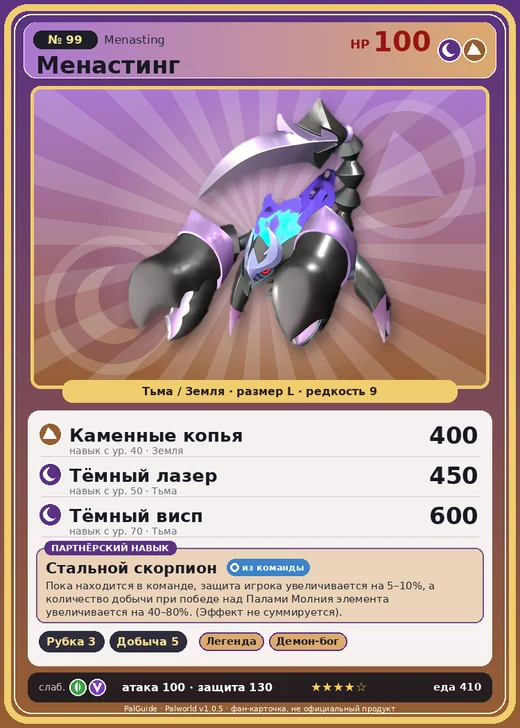

# #99 Менастинг (Menasting)

№ 99

ТьмаЗемля

Слабость: ДраконТрава

🪓 Рубка деревьев <b>3</b>⛏️ Добыча <b>5</b>

<b>Стальной скорпион</b> 🎒 из команды

❤️ 100 · ⚔️ 100 · 🛡 130

| Поле | Значение |
|---|---|
| Стихия | Тьма, Земля |
| Слабость (кто бьёт сильнее) | Дракон, Трава |
| Редкость | 9 |
| Размер | L |
| HP / Атака / Защита (база вида) | 100 / 100 / 130 |
| Сколько ест | 410 |
| Цена продажи | 2469 |
| Множитель поимки | ×1 |
| Скорость рывка верхом | 1200 |

## Работа на базе
- Рубка деревьев — ур. 3
- Добыча — ур. 5

## Партнёрский навык: Стальной скорпион
Пока находится в команде, защита игрока увеличивается на (5~10)% , а количество добычи при победе над Палами Молния элемента увеличивается на (40~80)% . (Эффект не суммируется) level value 1 , 40 TrainerDEF_UP_PartnerSkill_Otomo 5 2 , 50 TrainerDEF_UP_PartnerSkill_Otomo 6 3 , 60 TrainerDEF_UP_PartnerSkill_Otomo 7 4 , 70 TrainerDEF_UP_PartnerSkill_Otomo 8 5 , 80 TrainerDEF_UP_PartnerSkill_Otomo 10

## Атаки по уровням
- ур. 1: Грязевой выстрел (Земля, сила 40)
- ур. 7: Ядовитый выстрел (Тьма, сила 30)
- ур. 15: Теневой взрыв (Тьма, сила 80)
- ур. 22: Камнемёт (Земля, сила 120)
- ур. 30: Кошмарная сфера (Тьма, сила 300)
- ур. 35: Прыгучее жало (Земля, сила 350)
- ур. 40: Каменные копья (Земля, сила 400)
- ур. 50: Тёмный лазер (Тьма, сила 450)
- ур. 70: Тёмный висп (Тьма, сила 600)

## Где водится
- В дикой природе: да; точек появления днём: 547, ночью: 547; уровни в первых точках: 31–35
- Может продаваться у торговца/рекрутера
- Яйцо: Огромное яйцо тьмы

## Дроп
- Средняя душа Пала — 1–2 шт., 100%
- Ядовитая железа — 5–10 шт., 100%

**Дроп альфы:**
- Деталь древней цивилизации — 5–7 шт., 100%
- Ценный коготь — 5–7 шт., 100%

## Разведение
- Ранг разведения (CombiRank): 1120
- Участвует в особых парах: Теранайт → Менастинг Терра; Лилин → Лилин Нокт

## Лучшие пассивки по роли
- по обзору: Легенда, Демон-бог, Хладнокровный, Король тьмы
- боец: Легенда, Демон-бог, Хладнокровный, Бессмертие, Король тьмы (вместо Бессмертия, если нет мутации)
- рабочий: Дьявольские руки, Виртуоз, Мастеровитый, Небожитель/Трудоголик
- ездовой: Божественная скорость, Легенда, Вечный двигатель, Небесное скольжение

## Чем хорош / чем плох
- ✅ Тьма+земля, хорош в средней игре; хорошая атака (100); крепкая защита (130); отличный рабочий (пригодность 5); можно оседлать
- ❌ явных минусов нет

> Его тело — чистый сгусток энергии, а внутри — пустота. Он живьём заталкивает свою добычу в панцирь и поглощает её. Адские стоны заполняют окрестности.

См. также: [Стихии](../../guide/06_stihii.md) · [Разведение](../../guide/07_razvedenie.md) · [Все палы](README.md)
