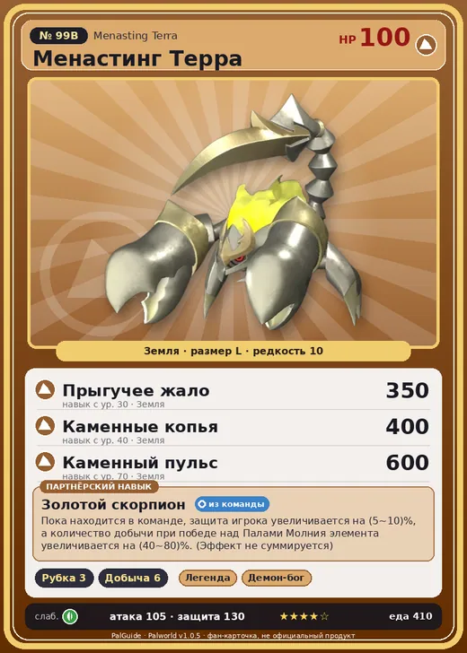

# #99B Менастинг Терра (Menasting Terra)

#99B · Menasting Terra

Земля

Слабость: Трава

🪓 Рубка деревьев <b>3</b>⛏️ Добыча <b>6</b>

<b>Золотой скорпион</b> 🎒 из команды

❤️ 100 · ⚔️ 105 · 🛡 130

| Поле | Значение |
|---|---|
| Стихия | Земля |
| Слабость (кто бьёт сильнее) | Трава |
| Редкость | 10 |
| Размер | L |
| HP / Атака / Защита (база вида) | 100 / 105 / 130 |
| Сколько ест | 410 |
| Цена продажи | 10000 |
| Множитель поимки | ×1 |
| Скорость рывка верхом | 1200 |

## Работа на базе
- Рубка деревьев — ур. 3
- Добыча — ур. 6

## Партнёрский навык: Золотой скорпион
Пока находится в команде, защита игрока увеличивается на (5~10)% , а количество добычи при победе над Палами Молния элемента увеличивается на (40~80)% . (Эффект не суммируется) level value 1 , 40 TrainerDEF_UP_PartnerSkill_Otomo 5 2 , 50 TrainerDEF_UP_PartnerSkill_Otomo 6 3 , 60 TrainerDEF_UP_PartnerSkill_Otomo 7 4 , 70 TrainerDEF_UP_PartnerSkill_Otomo 8 5 , 80 TrainerDEF_UP_PartnerSkill_Otomo 10

## Атаки по уровням
- ур. 1: Грязевой выстрел (Земля, сила 40)
- ур. 7: Каменный залп (Земля, сила 80)
- ур. 15: Камнемёт (Земля, сила 120)
- ур. 22: Песчаный вихрь (Земля, сила 200)
- ур. 30: Прыгучее жало (Земля, сила 350)
- ур. 40: Каменные копья (Земля, сила 400)
- ур. 50: Камнепад (Земля, сила 300)
- ур. 70: Каменный пульс (Земля, сила 600)

## Где водится
- В дикой природе: да; точек появления днём: 12, ночью: 12; уровни в первых точках: 48–52
- Яйцо: Огромное яйцо земли

## Дроп
- Средняя душа Пала — 2–3 шт., 100%
- Сапфир — 1 шт., 100%

**Дроп альфы:**
- Деталь древней цивилизации — 6–7 шт., 100%
- Ценный коготь — 2–3 шт., 100%

## Разведение
- Ранг разведения (CombiRank): 640
- **Особая пара:** [Менастинг](../../4_spravochniki/paly/menasting.md) + [Теранайт](../../4_spravochniki/paly/knocklem.md)

## Лучшие пассивки по роли
- боец: Легенда, Демон-бог, Хладнокровный, Бессмертие, Император земли (вместо Бессмертия, если нет мутации)
- рабочий: Дьявольские руки, Виртуоз, Мастеровитый, Небожитель/Трудоголик
- ездовой: Божественная скорость, Легенда, Вечный двигатель, Небесное скольжение

## Чем хорош / чем плох
- ✅ хорошая атака (105); крепкая защита (130); отличный рабочий (пригодность 6); можно оседлать
- ❌ разводится только особой парой

> Их настоящее тело — сгусток энергии, а внутри лишь пустота. Наполняя свой панцирь землёй и минералами, они приобретают колоссальную массу. Тот, кто попадёт под их удар, может лишь стонать, словно в аду.

См. также: [Стихии](../../guide/06_stihii.md) · [Разведение](../../guide/07_razvedenie.md) · [Все палы](README.md)
