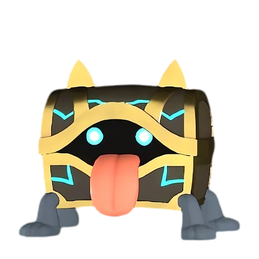

# Мимидог

<canvas id="fx"></canvas>

№ 144 · Mimog

Нейтральный

Слабость: Тьма <b class="mx">×1,5</b> <button class="hlp" data-tip="Множители перемножаются по обеим стихиям пала: ×1,5 за каждую стихию, которую атака бьёт, ×0,65 за каждую, которая её держит. Если одна стихия слаба, а другая устойчива (×1,5 × 0,65 ≈ ×0,98), слабости нет.">?</button>

🌾 Сбор <b>1</b>📦 Транспортировка <b>2</b>

<b>Взлом замков</b> 🐾 выпущен

❤️ 60 · ⚔️ 60 · 🛡 130

Основное

💎Редкость <button class="hlp" data-tip="Чем выше число, тем реже встречается пал. 1–4 — обычные, 5–7 — редкие, 8+ — легендарные.">?</button><b>7</b>

📏Размер<b>XS</b>

💰Цена продажи <button class="hlp" data-tip="Сколько золота даст торговец за пала.">?</button><b>3500</b>

Бой

🎯Множитель поимки <button class="hlp" data-tip="Насколько легче или труднее поймать: ×1 — обычно, меньше — сложнее.">?</button><b>×0.8</b>

Ферма и еда

🍖Сколько ест <button class="hlp" data-tip="Сколько сытости пал тратит — чем больше, тем больше еды нужно на базе.">?</button><b>230</b>

Разведение

🧬Сила разведения <button class="hlp" data-tip="Скрытое число игры: у детёныша оно примерно среднее от родителей. Чем меньше — тем «сильнее» пал.">?</button><b>1740</b>

💞Особая пара <button class="hlp" data-tip="Этого пала можно вывести только от этой пары.">?</button><b>Мимидог + Мимидог</b>

=== "Обзор"

    #### Работа на базе
    - Сбор — ур. 1
    - Транспортировка — ур. 2

    #### Партнёрский навык: Взлом замков
    Пока Мимидог сражается вместе с вами, его сила позволяет открывать сундуки любого уровня без использования ключей. Однако сундуки, требующие определённой рабочей пригодности, открыть нельзя.

    #### Чем хорош / чем плох
    - ✅ крепкая защита (130)
    - ❌ слабая атака (60); мало здоровья (60); разводится только особой парой

    > Когда-то на этом острове существовало королевство, где ежегодно вручали награду за самую глупую смерть. Первым её получил тот, кто |открыл сундук, не заметив Мимидог , — и был загрызен|.

    См. также: [Стихии](../../guide/06_stihii.md) · [Разведение](../../guide/07_razvedenie.md) · [Все палы](README.md)

=== "Атаки"

    #### Атаки по уровням
    - ур. 1: Силовой выстрел (Нейтральный, сила 80)
    - ур. 7: Тёмная пушка (Тьма, сила 70)
    - ур. 15: Духовное пламя (Тьма, сила 200)
    - ур. 22: Силовая бомба (Нейтральный, сила 120)
    - ур. 30: Воздушные клинки (Нейтральный, сила 160)
    - ур. 40: Священный взрыв (Нейтральный, сила 700)
    - ур. 50: Палобласт (Нейтральный, сила 450)
    - ур. 70: Тёмный висп (Тьма, сила 600)

=== "Где живёт"

    #### Где водится

    

<button data-k="d" class="on">☀️ День</button><button data-k="n">🌙 Ночь</button>

<button data-w=p class=on>Палпагос</button><button data-w=t>Мировое древо</button>

ур. 10–80<a class="btn hm-full" href="../../../map/?pal=MimicDog">Показать на большой карте</a>

Иссохшие дюныВыжженный холмСакурадзимаЛедяной коралловый холм

🥚 Яйцо<b>Большое обычное яйцо</b>

=== "Дроп"

    #### Дроп
    - Золотая монета — 1000–2000 шт., 100%
    - Собачья монета — 14–21 шт., 100%
    - Том обучения (огромный) — 1 шт., 20%

    **Дроп альфы:**
    - Деталь древней цивилизации — 1–3 шт., 100%
    - Собачья монета — 35 шт., 100%
    - Том обучения (огромный) — 1 шт., 100%
    - Ценный коготь — 1–2 шт., 100%

=== "Разведение"

    #### Разведение
    - Ранг разведения (CombiRank): 1740
    - **Особая пара:** [Мимидог](../../4_spravochniki/paly/mimog.md) + [Мимидог](../../4_spravochniki/paly/mimog.md)
    - Участвует в особых парах: Мимидог → Мимидог; Мимидог → Мимидог

=== "Пассивки"

    #### Лучшие пассивки по роли

    

⚔️ Боец

максимум урона и живучести в бою

<a class="psv r-4" data-psv="Легенда" href="../../../passivki/legend/">Легенда</a><a class="psv r-4" data-psv="Демон-бог" href="../../../passivki/demon_god/">Демон-бог</a><a class="psv r-3" data-psv="Святое небо" href="../../../passivki/celestial_emperor/">Святое небо</a><a class="psv r-3" data-psv="Хладнокровный" href="../../../passivki/serenity/">Хладнокровный</a>

    <small>Нажми на пассивку, чтобы узнать, что она даёт и где её взять.</small>

<a class="card-link" href="../nyafia/">← Няфия</a><a class="card-link" href="../xenovader/">Зеноведа →</a>

