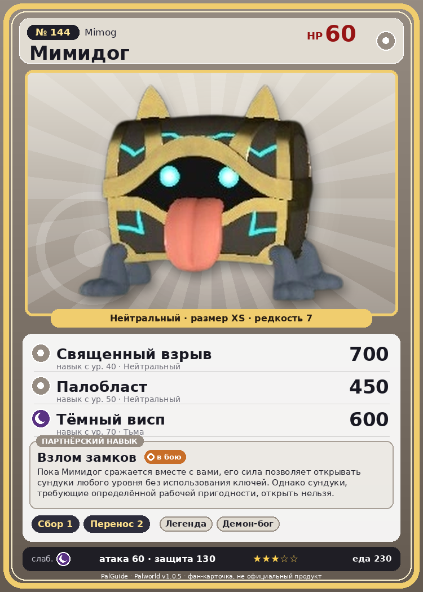

# #144 Мимидог (Mimog)

{ width=360 }

| Поле | Значение |
|---|---|
| Стихия | Нейтральный |
| Слабость (кто бьёт сильнее) | Тьма |
| Редкость | 7 |
| Размер | XS |
| HP / Атака / Защита (база вида) | 60 / 60 / 130 |
| Сколько ест | 230 |
| Цена продажи | 3500 |
| Множитель поимки | ×0.8 |
| Скорость рывка верхом | — |

## Работа на базе
- Сбор — ур. 1
- Транспортировка — ур. 2

## Партнёрский навык: Взлом замков
Пока Мимидог сражается вместе с вами, его сила позволяет открывать сундуки любого уровня без использования ключей. Однако сундуки, требующие определённой рабочей пригодности, открыть нельзя. level value 1 MainValue 5 OverWriteCoolTime 80 Пробуждение : 2 MainValue 5 OverWriteCoolTime 60 Пробуждение : (Сокращение перезарядки: Небольшое ) 3 MainValue 5 OverWriteCoolTime 40 Пробуждение : (Сокращение перезарядки: Среднее ) 4 MainValue 5 OverWriteCoolTime 20 Пробуждение : (Сокращение перезарядки: Большое ) 5 MainValue 5 OverWriteCoolTime 10 Пробуждение : (Сокращение перезарядки: Очень большое )

## Атаки по уровням
- ур. 1: Силовой выстрел (Нейтральный, сила 80)
- ур. 7: Тёмная пушка (Тьма, сила 70)
- ур. 15: Духовное пламя (Тьма, сила 200)
- ур. 22: Силовая бомба (Нейтральный, сила 120)
- ур. 30: Воздушные клинки (Нейтральный, сила 160)
- ур. 40: Священный взрыв (Нейтральный, сила 700)
- ур. 50: Палобласт (Нейтральный, сила 450)
- ур. 70: Тёмный висп (Тьма, сила 600)

## Где водится
- В дикой природе: да; точек появления днём: 4981, ночью: 4981
- Яйцо: Большое обычное яйцо

## Дроп
- Золотая монета — 1000–2000 шт., 100%
- Собачья монета — 14–21 шт., 100%
- Том обучения (огромный) — 1 шт., 20%

**Дроп альфы:**
- Деталь древней цивилизации — 1–3 шт., 100%
- Собачья монета — 35 шт., 100%
- Том обучения (огромный) — 1 шт., 100%
- Ценный коготь — 1–2 шт., 100%

## Разведение
- Ранг разведения (CombiRank): 1740
- **Особая пара:** [Мимидог](../../4_spravochniki/paly/mimog.md) + [Мимидог](../../4_spravochniki/paly/mimog.md)
- Участвует в особых парах: Мимидог → Мимидог; Мимидог → Мимидог

## Лучшие пассивки по роли
- боец: Легенда, Демон-бог, Хладнокровный, Бессмертие, Святое небо (вместо Бессмертия, если нет мутации)

## Чем хорош / чем плох
- ✅ крепкая защита (130)
- ❌ слабая атака (60); мало здоровья (60); разводится только особой парой

> Когда-то на этом острове существовало королевство, где ежегодно вручали награду за самую глупую смерть. Первым её получил тот, кто |открыл сундук, не заметив Мимидог , — и был загрызен|.

См. также: [Стихии](../../2_mehaniki/stihii.md) · [Разведение](../../2_mehaniki/razvedenie.md) · [Все палы](README.md)
_Источник: paldb.cc v1.0.5_
